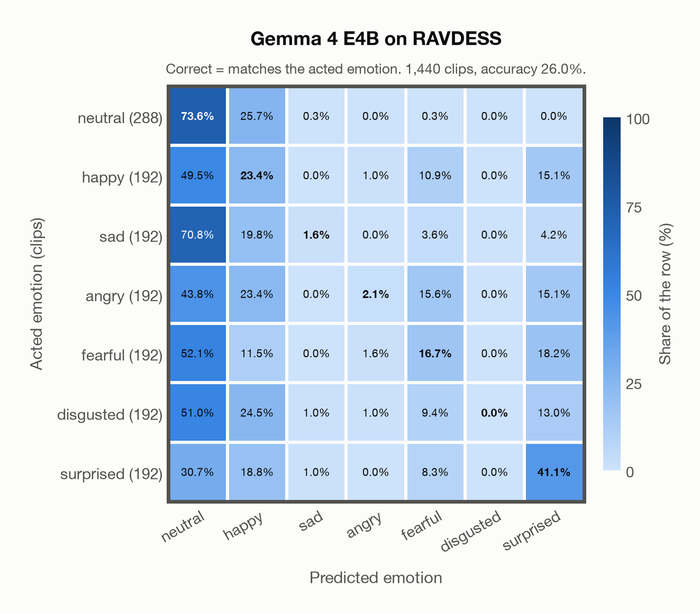

# Gemma 4 E4B on RAVDESS

Generated by `scripts/evaluation/evaluate.py` on 2026-11-08.

## Summary

| Metric | Value |
|---|---|
| Clips evaluated | 1,440 (English) |
| **Accuracy: prediction matches the acted emotion** | **26.0%** |
| Unweighted accuracy (mean recall of the 7 acted emotions) | 22.6% |
| Macro F1 (acted emotion) | 17.8% |
| Accuracy, all 8 model classes (acted emotion) | 26.0% |
| Chance level (7 emotions) | 14.3% |

## Setup

- **Model**: Gemma 4 E4B (`google/gemma-4-E4B-it`) as released (no fine-tuning), transformers 5.18.0, loaded by `scripts/models/gemma4_audio.py`. Gemma 4 E4B (thinking off) gets one conversation per clip in its chat template: the system prompt, then one user turn with the user prompt first and the audio after it (as the model card advises), with the system and user prompts of `scripts/llm_eval/prompts.yaml` (the same as for GPT Realtime); the clip as 16 kHz mono (at most its first 30 s). Greedy decoding (do_sample=False, no repetition penalty), at most 24 new tokens, bfloat16 on `mps`, sdpa attention; so the answers are the same from run to run (up to rounding differences between devices). The answer is read by `scripts/llm_eval/parsing.py` and becomes a one-hot vector over the 7 emotions plus `invalid`. An answer that is not exactly one label gets a follow-up in the same conversation ("Answer with exactly one word from this list, in lowercase, and nothing else: angry, disgusted, fearful, happy, neutral, sad, surprised."), up to 1 time(s); then `invalid`. An answer that is not one of the dataset's emotions counts as wrong (column *other answer* of the confusion matrices); the raw answers are in `outputs/gemma4_e4b/responses.jsonl`.
- **Data**: 1,440 clips of RAVDESS (English) from `data/ravdess/`.
- **Ground truth (acted emotion)**: the emotion each actor was asked to portray, from the third number in the file name (01 neutral, 02 calm, 03 happy, 04 sad, 05 angry, 06 fearful, 07 disgust, 08 surprised).
- Label mapping: neutral, happy, sad, angry, fearful and surprised keep their names; disgust = disgusted, and **calm = neutral** (the project's emotions have no *calm*), so neutral has 288 clips: 96 acted neutral and 192 acted calm.
- 24 professional actors (12 female, 12 male) say two sentences, "Kids are talking by the door" and "Dogs are sitting by the door", twice in each emotion, at two intensities (normal and strong) except for neutral.
- **7 emotions**: the prediction is the model's answer when it is one of the 7 emotions in this dataset (neutral, happy, sad, angry, fearful, disgusted, surprised); any other answer (`invalid`) counts as wrong, so the accuracy is the same with all 8 model classes.
- **Hardware**: Apple M4 Max, device `mps`, PyTorch 2.7.1. Inference took 11.0 min (458 ms per clip; answers saved by an earlier run take no time).
- **Per-clip predictions**: `outputs/gemma4_e4b/ravdess_predictions.csv` (in git, so the results can be checked clip by clip). The JSON file next to it describes the columns.

## Results per emotion

Rows: acted emotion. Precision, recall and F1 compare the prediction with the acted emotion.

| Emotion | Clips | Precision | Recall | F1 |
|---|---|---|---|---|
| neutral | 288 | 27.0% | 73.6% | 39.6% |
| happy | 192 | 14.7% | 23.4% | 18.0% |
| sad | 192 | 37.5% | 1.6% | 3.0% |
| angry | 192 | 36.4% | 2.1% | 3.9% |
| fearful | 192 | 25.6% | 16.7% | 20.2% |
| disgusted | 192 | 0.0% | 0.0% | 0.0% |
| surprised | 192 | 38.5% | 41.1% | 39.8% |

## Confusion matrix: acted emotion

The same numbers as a table. Rows: acted emotion. Columns: predicted emotion. Each row adds up to 100%.

| Acted \ Predicted | neutral | happy | sad | angry | fearful | disgusted | surprised |
|---|---|---|---|---|---|---|---|
| neutral (288) | **73.6%** | 25.7% | 0.3% | 0.0% | 0.3% | 0.0% | 0.0% |
| happy (192) | 49.5% | **23.4%** | 0.0% | 1.0% | 10.9% | 0.0% | 15.1% |
| sad (192) | 70.8% | 19.8% | **1.6%** | 0.0% | 3.6% | 0.0% | 4.2% |
| angry (192) | 43.8% | 23.4% | 0.0% | **2.1%** | 15.6% | 0.0% | 15.1% |
| fearful (192) | 52.1% | 11.5% | 0.0% | 1.6% | **16.7%** | 0.0% | 18.2% |
| disgusted (192) | 51.0% | 24.5% | 1.0% | 1.0% | 9.4% | **0.0%** | 13.0% |
| surprised (192) | 30.7% | 18.8% | 1.0% | 0.0% | 8.3% | 0.0% | **41.1%** |

Most frequent confusions: sad predicted as neutral (70.8%), fearful predicted as neutral (52.1%), disgusted predicted as neutral (51.0%).

## Predictions outside the 7 emotions

With all 8 model classes, the model chose a class that this dataset does not have for 0 clips (0.0%): `invalid` 0.

## Caveats

- **Gemma 4 E4B's training data**: not published (Google). The model may have heard these public datasets during training.
- *Calm* is not quite *neutral*: calm clips predicted as neutral count as correct.
- Listeners rated every file 10 times (247 listeners). The paper publishes their ratings as recognition rates per file, not as a vote for an emotion, so this report has no listeners' labels.
- Audio: 48 kHz WAV, resampled to 16 kHz; 5 files are stereo, and their channels are averaged.
