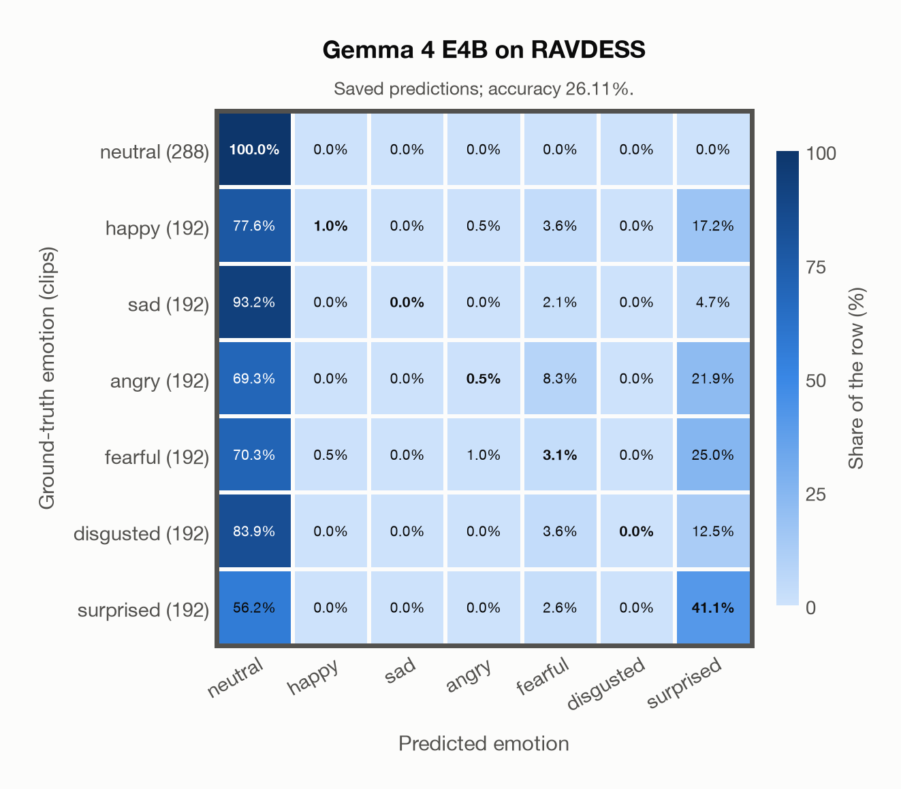

# Gemma 4 E4B on RAVDESS

Regenerated offline from saved CSV/JSON by `scripts/evaluation/refresh_reports.py`. This refresh performs no model inference or API requests.

## Summary

| Metric | Recomputed value |
|---|---:|
| Clips | 1,440 |
| Accuracy: acted emotion | 26.11% |
| UAR: mean ground-truth-row recall | 20.83% |
| Macro F1 | 12.16% |
| Weighted F1: true-support weighted | 14.01% |
| Accuracy: all model classes | 26.11% |
| Invalid / outside-candidate answers | 0 (0.00%) |

## Imported run and verification

- Source: [prediction CSV](../../outputs/gemma4_e4b/ravdess_predictions.csv) and [metadata JSON](../../outputs/gemma4_e4b/ravdess_predictions.json); both remain byte-for-byte unchanged.
- Original execution date recorded in JSON: `2026-11-14`.
- Dataset scope recorded in JSON: **RAVDESS**, English; 1,440 / 1,440 clips.
- Ground-truth column: `acted_emotion`. Candidate classes: neutral, happy, sad, angry, fearful, disgusted, surprised.
- Row counts, unique audio paths, correctness flags and saved metrics were checked against the CSV. Metric agreement tolerance is 0.000001 (six-decimal metadata).
- Weighted F1 weights each class's F1 by its true support, using the same resolved truth as macro F1; invalid answers remain errors. New metrics absent from the source JSON are recorded in the offline audit and summaries; the source JSON is preserved.
- Saved candidate/prompt/model protocol matches current configuration: scope `dataset`, model `google/gemma-4-E4B-it`, prompt hash `aab2967fd07a`.
- Original execution/client runtime metadata (reported by the imported run, not measured by this refresh): `{"device": "cuda:0", "hardware": "NVIDIA L4", "seconds": 2337.8, "ms_per_clip": 1623.5, "on_cpu": 0}`.
- Saved p_* columns encode the returned answer as one-hot values; they are not calibrated API class probabilities, and no confidence plot is inferred from them.
- A raw responses journal is present; this refresh validates CSV/JSON only.

## Prediction distribution

Counts and shares use all saved samples. The invalid bucket combines `invalid` and `other answer`: answers outside the dataset's candidate classes remain errors.

| Predicted label | Clips | Share of all clips |
|---|---:|---:|
| neutral | 1,153 | 80.07% |
| happy | 3 | 0.21% |
| sad | 0 | 0.00% |
| angry | 4 | 0.28% |
| fearful | 45 | 3.12% |
| disgusted | 0 | 0.00% |
| surprised | 235 | 16.32% |
| invalid / outside candidates | 0 | 0.00% |

## Results per emotion

| Ground-truth emotion | Clips | Recall | Acted-or-listener recall |
|---|---:|---:|---:|
| neutral | 288 | 100.00% | — |
| happy | 192 | 1.04% | — |
| sad | 192 | 0.00% | — |
| angry | 192 | 0.52% | — |
| fearful | 192 | 3.12% | — |
| disgusted | 192 | 0.00% | — |
| surprised | 192 | 41.15% | — |

Precision/F1 use the same resolved-truth convention as the evaluation script. Weighted F1 uses the resolved-truth clip counts below as weights.

| Predicted emotion | Resolved-truth clips | Precision | Recall | F1 |
|---|---:|---:|---:|---:|
| neutral | 288 | 24.98% | 100.00% | 39.97% |
| happy | 192 | 66.67% | 1.04% | 2.05% |
| sad | 192 | 0.00% | 0.00% | 0.00% |
| angry | 192 | 25.00% | 0.52% | 1.02% |
| fearful | 192 | 13.33% | 3.12% | 5.06% |
| disgusted | 192 | 0.00% | 0.00% | 0.00% |
| surprised | 192 | 33.62% | 41.15% | 37.00% |

## Confusion matrix: acted emotion

| Ground truth \ Predicted | neutral | happy | sad | angry | fearful | disgusted | surprised |
|---|---|---|---|---|---|---|---|
| neutral (288) | **100.0%** | 0.0% | 0.0% | 0.0% | 0.0% | 0.0% | 0.0% |
| happy (192) | 77.6% | **1.0%** | 0.0% | 0.5% | 3.6% | 0.0% | 17.2% |
| sad (192) | 93.2% | 0.0% | **0.0%** | 0.0% | 2.1% | 0.0% | 4.7% |
| angry (192) | 69.3% | 0.0% | 0.0% | **0.5%** | 8.3% | 0.0% | 21.9% |
| fearful (192) | 70.3% | 0.5% | 0.0% | 1.0% | **3.1%** | 0.0% | 25.0% |
| disgusted (192) | 83.9% | 0.0% | 0.0% | 0.0% | 3.6% | **0.0%** | 12.5% |
| surprised (192) | 56.2% | 0.0% | 0.0% | 0.0% | 2.6% | 0.0% | **41.1%** |

## Caveats

- **Training involvement for Gemma 4 E4B: No corpus-specific evidence**. Source: Broad multimodal pretraining and instruction tuning; complete corpus-level provenance not published (Google). Direct use and upstream teacher use both count as training involvement. No pattern: no corpus-specific evidence, not verified unseen. Corpus use is not test-clip leakage.
- Internal CSV/JSON consistency does not authenticate the original model or remote request logs.

[Offline validation audit](ravdess_offline_audit.json)
