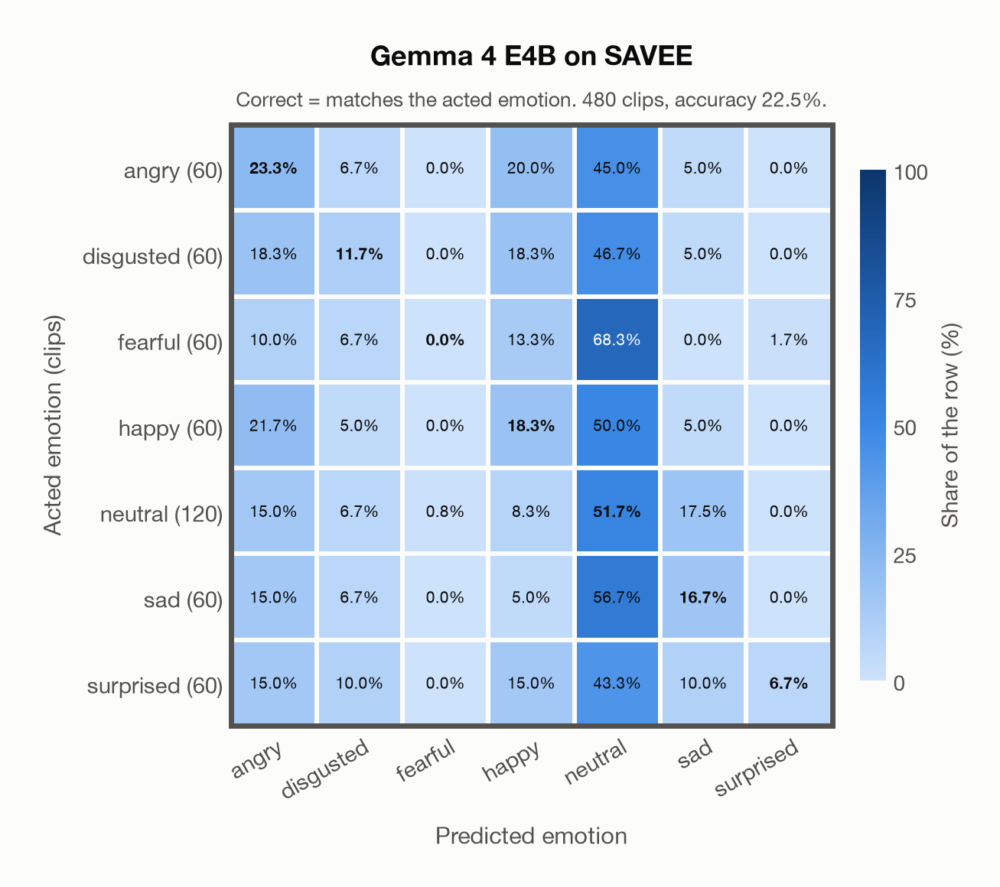

# Gemma 4 E4B on SAVEE

Generated by `scripts/evaluation/evaluate.py` on 2026-11-09.

## Summary

| Metric | Value |
|---|---|
| Clips evaluated | 480 (English (British)) |
| **Accuracy: prediction matches the acted emotion** | **22.5%** |
| Unweighted accuracy (mean recall of the 7 acted emotions) | 18.3% |
| Macro F1 (acted emotion) | 16.7% |
| Accuracy, all 8 model classes (acted emotion) | 22.5% |
| Chance level (7 emotions) | 14.3% |

## Setup

- **Model**: Gemma 4 E4B (`google/gemma-4-E4B-it`) as released (no fine-tuning), transformers 5.18.0, loaded by `scripts/models/gemma4_audio.py`. Gemma 4 E4B (thinking off) gets one conversation per clip in its chat template: the system prompt, then one user turn with the user prompt first and the audio after it (as the model card advises), with the system and user prompts of `scripts/llm_eval/prompts.yaml` (the same as for GPT Realtime); the clip as 16 kHz mono (at most its first 30 s). Greedy decoding (do_sample=False, no repetition penalty), at most 24 new tokens, bfloat16 on `mps`, sdpa attention; so the answers are the same from run to run (up to rounding differences between devices). The answer is read by `scripts/llm_eval/parsing.py` and becomes a one-hot vector over the 7 emotions plus `invalid`. An answer that is not exactly one label gets a follow-up in the same conversation ("Answer with exactly one word from this list, in lowercase, and nothing else: angry, disgusted, fearful, happy, neutral, sad, surprised."), up to 1 time(s); then `invalid`. An answer that is not one of the dataset's emotions counts as wrong (column *other answer* of the confusion matrices); the raw answers are in `outputs/gemma4_e4b/responses.jsonl`.
- **Data**: 480 clips of SAVEE (English (British)) from `data/savee/`.
- **Ground truth (acted emotion)**: the emotion each actor was asked to portray, from the letters after the speaker in the file name (`a`nger, `d`isgust, `f`ear, `h`appiness, `n`eutral, `sa`dness, `su`rprise).
- Label mapping: anger = angry, disgust = disgusted, fear = fearful, happiness = happy, neutral = neutral, sadness = sad, surprise = surprised.
- 4 male speakers (DC, JE, JK, KL) say 15 sentences in each emotion (only 3 of them are the same in every emotion) and 30 in neutral: 480 clips. Audio: 44.1 kHz mono WAV, resampled to 16 kHz.
- **7 emotions**: the prediction is the model's answer when it is one of the 7 emotions in this dataset (angry, disgusted, fearful, happy, neutral, sad, surprised); any other answer (`invalid`) counts as wrong, so the accuracy is the same with all 8 model classes.
- **Hardware**: Apple M4 Max, device `mps`, PyTorch 2.7.1. Inference took 3.8 min (470 ms per clip; answers saved by an earlier run take no time).
- **Per-clip predictions**: `outputs/gemma4_e4b/savee_predictions.csv` (in git, so the results can be checked clip by clip). The JSON file next to it describes the columns.

## Results per emotion

Rows: acted emotion. Precision, recall and F1 compare the prediction with the acted emotion.

| Emotion | Clips | Precision | Recall | F1 |
|---|---|---|---|---|
| angry | 60 | 17.5% | 23.3% | 20.0% |
| disgusted | 60 | 19.4% | 11.7% | 14.6% |
| fearful | 60 | 0.0% | 0.0% | 0.0% |
| happy | 60 | 17.2% | 18.3% | 17.7% |
| neutral | 120 | 25.0% | 51.7% | 33.7% |
| sad | 60 | 21.7% | 16.7% | 18.9% |
| surprised | 60 | 80.0% | 6.7% | 12.3% |

## Confusion matrix: acted emotion

The same numbers as a table. Rows: acted emotion. Columns: predicted emotion. Each row adds up to 100%.

| Acted \ Predicted | angry | disgusted | fearful | happy | neutral | sad | surprised |
|---|---|---|---|---|---|---|---|
| angry (60) | **23.3%** | 6.7% | 0.0% | 20.0% | 45.0% | 5.0% | 0.0% |
| disgusted (60) | 18.3% | **11.7%** | 0.0% | 18.3% | 46.7% | 5.0% | 0.0% |
| fearful (60) | 10.0% | 6.7% | **0.0%** | 13.3% | 68.3% | 0.0% | 1.7% |
| happy (60) | 21.7% | 5.0% | 0.0% | **18.3%** | 50.0% | 5.0% | 0.0% |
| neutral (120) | 15.0% | 6.7% | 0.8% | 8.3% | **51.7%** | 17.5% | 0.0% |
| sad (60) | 15.0% | 6.7% | 0.0% | 5.0% | 56.7% | **16.7%** | 0.0% |
| surprised (60) | 15.0% | 10.0% | 0.0% | 15.0% | 43.3% | 10.0% | **6.7%** |

Most frequent confusions: fearful predicted as neutral (68.3%), sad predicted as neutral (56.7%), happy predicted as neutral (50.0%).

## Predictions outside the 7 emotions

With all 8 model classes, the model chose a class that this dataset does not have for 0 clips (0.0%): `invalid` 0.

## Caveats

- **Gemma 4 E4B's training data**: not published (Google). The model may have heard these public datasets during training.
- **Unofficial copy.** The official corpus is free for research after registration and its licence forbids redistribution; the files come from an unofficial copy on Kaggle (ejlok1/surrey-audiovisual-expressed-emotion-savee), checked only against the file names and counts of the corpus.
- Only 4 speakers, all male. 10 evaluators validated the recordings originally; their results per clip are not published, so there is one way of counting a prediction as correct.
- Most sentences differ between emotions, and some of them are emotion-specific, so their words can hint at the emotion.
- SAVEE is in EmoBox, so it is in the training data of emotion2vec+.
