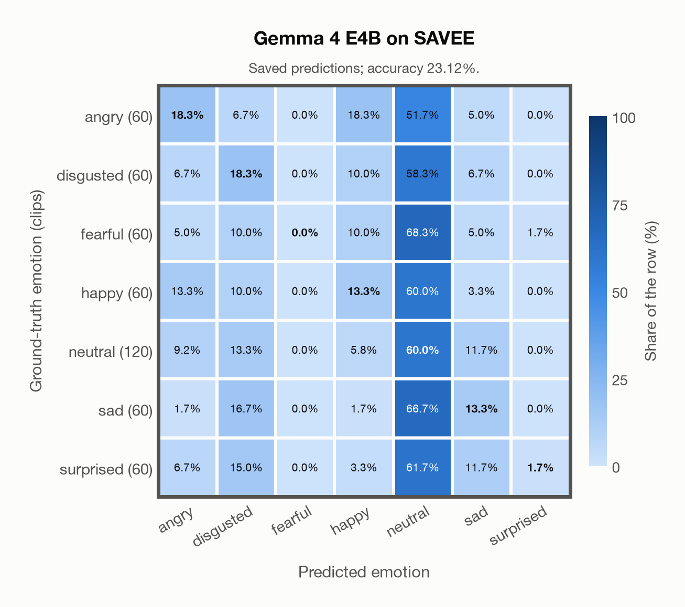

# Gemma 4 E4B on SAVEE

Regenerated offline from saved CSV/JSON by `scripts/evaluation/refresh_reports.py`. This refresh performs no model inference or API requests.

## Summary

| Metric | Recomputed value |
|---|---:|
| Clips | 480 |
| Accuracy: acted emotion | 23.12% |
| UAR: mean ground-truth-row recall | 17.86% |
| Macro F1 | 15.64% |
| Weighted F1: true-support weighted | 18.05% |
| Accuracy: all model classes | 23.12% |
| Invalid / outside-candidate answers | 0 (0.00%) |

## Imported run and verification

- Source: [prediction CSV](../../outputs/gemma4_e4b/savee_predictions.csv) and [metadata JSON](../../outputs/gemma4_e4b/savee_predictions.json); both remain byte-for-byte unchanged.
- Original execution date recorded in JSON: `2026-11-14`.
- Dataset scope recorded in JSON: **SAVEE**, English (British); 480 / 480 clips.
- Ground-truth column: `acted_emotion`. Candidate classes: angry, disgusted, fearful, happy, neutral, sad, surprised.
- Row counts, unique audio paths, correctness flags and saved metrics were checked against the CSV. Metric agreement tolerance is 0.000001 (six-decimal metadata).
- Weighted F1 weights each class's F1 by its true support, using the same resolved truth as macro F1; invalid answers remain errors. New metrics absent from the source JSON are recorded in the offline audit and summaries; the source JSON is preserved.
- Saved candidate/prompt/model protocol matches current configuration: scope `dataset`, model `google/gemma-4-E4B-it`, prompt hash `aab2967fd07a`.
- Original execution/client runtime metadata (reported by the imported run, not measured by this refresh): `{"device": "mps", "hardware": "Apple M3 Pro", "seconds": 344.2, "ms_per_clip": 717.0, "on_cpu": 0}`.
- Saved p_* columns encode the returned answer as one-hot values; they are not calibrated API class probabilities, and no confidence plot is inferred from them.
- A raw responses journal is present; this refresh validates CSV/JSON only.

## Prediction distribution

Counts and shares use all saved samples. The invalid bucket combines `invalid` and `other answer`: answers outside the dataset's candidate classes remain errors.

| Predicted label | Clips | Share of all clips |
|---|---:|---:|
| angry | 42 | 8.75% |
| disgusted | 62 | 12.92% |
| fearful | 0 | 0.00% |
| happy | 41 | 8.54% |
| neutral | 292 | 60.83% |
| sad | 41 | 8.54% |
| surprised | 2 | 0.42% |
| invalid / outside candidates | 0 | 0.00% |

## Results per emotion

| Ground-truth emotion | Clips | Recall | Acted-or-listener recall |
|---|---:|---:|---:|
| angry | 60 | 18.33% | — |
| disgusted | 60 | 18.33% | — |
| fearful | 60 | 0.00% | — |
| happy | 60 | 13.33% | — |
| neutral | 120 | 60.00% | — |
| sad | 60 | 13.33% | — |
| surprised | 60 | 1.67% | — |

Precision/F1 use the same resolved-truth convention as the evaluation script. Weighted F1 uses the resolved-truth clip counts below as weights.

| Predicted emotion | Resolved-truth clips | Precision | Recall | F1 |
|---|---:|---:|---:|---:|
| angry | 60 | 26.19% | 18.33% | 21.57% |
| disgusted | 60 | 17.74% | 18.33% | 18.03% |
| fearful | 60 | 0.00% | 0.00% | 0.00% |
| happy | 60 | 19.51% | 13.33% | 15.84% |
| neutral | 120 | 24.66% | 60.00% | 34.95% |
| sad | 60 | 19.51% | 13.33% | 15.84% |
| surprised | 60 | 50.00% | 1.67% | 3.23% |

## Confusion matrix: acted emotion

| Ground truth \ Predicted | angry | disgusted | fearful | happy | neutral | sad | surprised |
|---|---|---|---|---|---|---|---|
| angry (60) | **18.3%** | 6.7% | 0.0% | 18.3% | 51.7% | 5.0% | 0.0% |
| disgusted (60) | 6.7% | **18.3%** | 0.0% | 10.0% | 58.3% | 6.7% | 0.0% |
| fearful (60) | 5.0% | 10.0% | **0.0%** | 10.0% | 68.3% | 5.0% | 1.7% |
| happy (60) | 13.3% | 10.0% | 0.0% | **13.3%** | 60.0% | 3.3% | 0.0% |
| neutral (120) | 9.2% | 13.3% | 0.0% | 5.8% | **60.0%** | 11.7% | 0.0% |
| sad (60) | 1.7% | 16.7% | 0.0% | 1.7% | 66.7% | **13.3%** | 0.0% |
| surprised (60) | 6.7% | 15.0% | 0.0% | 3.3% | 61.7% | 11.7% | **1.7%** |

## Caveats

- **Training involvement for Gemma 4 E4B: No corpus-specific evidence**. Source: Broad multimodal pretraining and instruction tuning; complete corpus-level provenance not published (Google). Direct use and upstream teacher use both count as training involvement. No pattern: no corpus-specific evidence, not verified unseen. Corpus use is not test-clip leakage.
- Internal CSV/JSON consistency does not authenticate the original model or remote request logs.

[Offline validation audit](savee_offline_audit.json)
