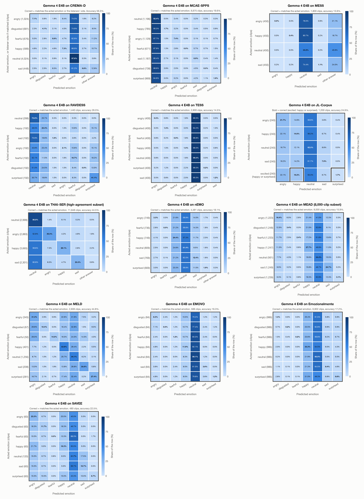

# Gemma 4 E4B: results on every dataset

Generated by `scripts/evaluation/evaluate.py` on 2026-11-09. Each dataset links to its full report. The datasets in the model's training data come first, then the others, each group sorted by accuracy.

| Dataset | Language | Ground-truth labels | In Gemma 4 E4B's training data | Clips | Emotions | Chance | Accuracy: acted emotion | Accuracy: acted or listeners' vote | Unweighted accuracy | Macro F1 |
|---|---|---|---|---|---|---|---|---|---|---|
| [MELD](meld.md) | English | angry, disgusted, fearful, happy, neutral, sad, surprised | not known | 2,608 | 7 | 14.3% | **44.8%** | – | 32.4% | 32.5% |
| [THAI-SER (high-agreement subset)](thai_ser.md) | Thai | neutral, angry, happy, sad | not known | 11,848 | 4 | 25.0% | **44.5%** | 51.1% | 44.2% | 43.0% |
| [RAVDESS](ravdess.md) | English | neutral, happy, sad, angry, fearful, disgusted, surprised | not known | 1,440 | 7 | 14.3% | **26.0%** | – | 22.6% | 17.8% |
| [JL-Corpus](jl_corpus.md) | English (New Zealand) | angry, happy, neutral, sad, excited (happy or surprised) | not known | 1,200 | 5 | 24.0% | **24.9%** | – | 24.9% | 33.7% |
| [SAVEE](savee.md) | English (British) | angry, disgusted, fearful, happy, neutral, sad, surprised | not known | 480 | 7 | 14.3% | **22.5%** | – | 18.3% | 16.7% |
| [MCAE-SPPS](mcae_spps.md) | Mandarin | neutral, happy, angry, fearful, sad, disgusted, surprised | not known | 6,675 | 7 | 14.3% | **19.6%** | 19.6% | 15.8% | 8.8% |
| [nEMO](nemo.md) | Polish | angry, fearful, happy, neutral, sad, surprised | not known | 4,481 | 6 | 16.7% | **18.1%** | – | 17.3% | 12.1% |
| [Emozionalmente](emozionalmente.md) | Italian | angry, disgusted, fearful, happy, neutral, sad, surprised | not known | 6,902 | 7 | 14.3% | **17.2%** | 26.0% | 17.2% | 11.2% |
| [EMOVO](emovo.md) | Italian | angry, disgusted, fearful, happy, neutral, sad, surprised | not known | 588 | 7 | 14.3% | **16.3%** | – | 16.3% | 9.1% |
| [CREMA-D](crema_d.md) | English | angry, disgusted, fearful, happy, neutral, sad | not known | 7,442 | 6 | 16.7% | **16.1%** | 56.3% | 18.0% | 9.2% |
| [MEAD (8,000-clip subset)](mead.md) | English | angry, disgusted, fearful, happy, neutral, sad, surprised | not known | 8,000 | 7 | 14.3% | **15.9%** | – | 18.9% | 14.1% |
| [TESS](tess.md) | English | angry, disgusted, fearful, happy, neutral, surprised, sad | not known | 2,800 | 7 | 14.3% | **14.5%** | – | 14.5% | 4.9% |
| [MESS](mess.md) | English | angry, happy, neutral, sad | not known | 1,800 | 4 | 25.0% | **13.9%** | – | 13.9% | 7.8% |

- **Ground-truth labels**: the emotions the speakers were asked to portray, as the project's class names (each report gives the dataset's own names), in the order of the rows of the confusion matrices.
- **Composite labels** (no model class; a prediction of any class in brackets counts as correct): JL-Corpus's *excited* (happy or surprised). Chance level counts these classes, so it is higher than 1 in the number of emotions.
- **In Gemma 4 E4B's training data**: *yes* means that the dataset is part of the data the model was trained on (not published, Google), so the model has probably seen these clips and the result is optimistic. *not known*: the training data is not published. The model may have heard these public datasets during training.
- **Accuracy: acted emotion** compares the prediction with the emotion the speaker was asked to portray. The prediction is the most probable of the emotions that the dataset has, so chance level depends on how many emotions it has.
- **Accuracy: acted or listeners' vote** also accepts the listeners' majority vote; it exists only for datasets that publish listeners' labels.
- **Subsets**: THAI-SER (high-agreement subset), MEAD (8,000-clip subset): a fixed subset of the dataset (`subsets` in config/evaluation.yaml), the same for every model; each report says how it is chosen.

## Confusion matrices

One matrix per dataset, from each dataset's report: CREMA-D, MCAE-SPPS, MESS, RAVDESS, TESS, JL-Corpus, THAI-SER (high-agreement subset), nEMO, MEAD (8,000-clip subset), MELD, EMOVO, Emozionalmente, SAVEE (order: `summary_figure` in config/evaluation.yaml). Rows: acted emotion; columns: predicted emotion; each row adds up to 100%. CREMA-D: the matrix where a prediction also counts as correct when it matches the listeners' vote, so a clip whose prediction matched that vote sits in the row of that vote. A composite label has its own row, whose bold cells count as correct.

## Only the emotions every dataset has: angry, happy, neutral, sad

The datasets have different emotions, and some emotions are much harder than others, so the table above also reflects which emotions each dataset has. Here every dataset is scored on the same 4 emotions (chance 25.0%): clips of other emotions are left out, and the prediction is the most probable of these 4.

| Dataset | Language | Ground-truth labels | In Gemma 4 E4B's training data | Clips | Accuracy | Unweighted accuracy |
|---|---|---|---|---|---|---|
| [MELD](meld.md) | English | angry, disgusted, fearful, happy, neutral, sad, surprised | not known | 2,210 | **48.8%** | 43.7% |
| [THAI-SER (high-agreement subset)](thai_ser.md) | Thai | neutral, angry, happy, sad | not known | 11,848 | **44.5%** | 44.2% |
| [SAVEE](savee.md) | English (British) | angry, disgusted, fearful, happy, neutral, sad, surprised | not known | 300 | **32.3%** | 27.5% |
| [RAVDESS](ravdess.md) | English | neutral, happy, sad, angry, fearful, disgusted, surprised | not known | 864 | **30.6%** | 25.2% |
| [MCAE-SPPS](mcae_spps.md) | Mandarin | neutral, happy, angry, fearful, sad, disgusted, surprised | not known | 4,297 | **29.9%** | 27.1% |
| [EMOVO](emovo.md) | Italian | angry, disgusted, fearful, happy, neutral, sad, surprised | not known | 336 | **28.0%** | 28.0% |
| [Emozionalmente](emozionalmente.md) | Italian | angry, disgusted, fearful, happy, neutral, sad, surprised | not known | 3,944 | **27.5%** | 27.5% |
| [MEAD (8,000-clip subset)](mead.md) | English | angry, disgusted, fearful, happy, neutral, sad, surprised | not known | 4,280 | **27.1%** | 30.8% |
| [JL-Corpus](jl_corpus.md) | English (New Zealand) | angry, happy, neutral, sad, excited (happy or surprised) | not known | 960 | **26.7%** | 26.7% |
| [nEMO](nemo.md) | Polish | angry, fearful, happy, neutral, sad, surprised | not known | 3,076 | **26.0%** | 25.4% |
| [TESS](tess.md) | English | angry, disgusted, fearful, happy, neutral, surprised, sad | not known | 1,600 | **24.9%** | 24.9% |
| [CREMA-D](crema_d.md) | English | angry, disgusted, fearful, happy, neutral, sad | not known | 4,900 | **23.1%** | 25.6% |
| [MESS](mess.md) | English | angry, happy, neutral, sad | not known | 1,800 | **13.9%** | 13.9% |

Computed from the predictions files in `outputs/`. Their probabilities have 4 decimals, so a clip whose shared emotions are tied counts as wrong.
