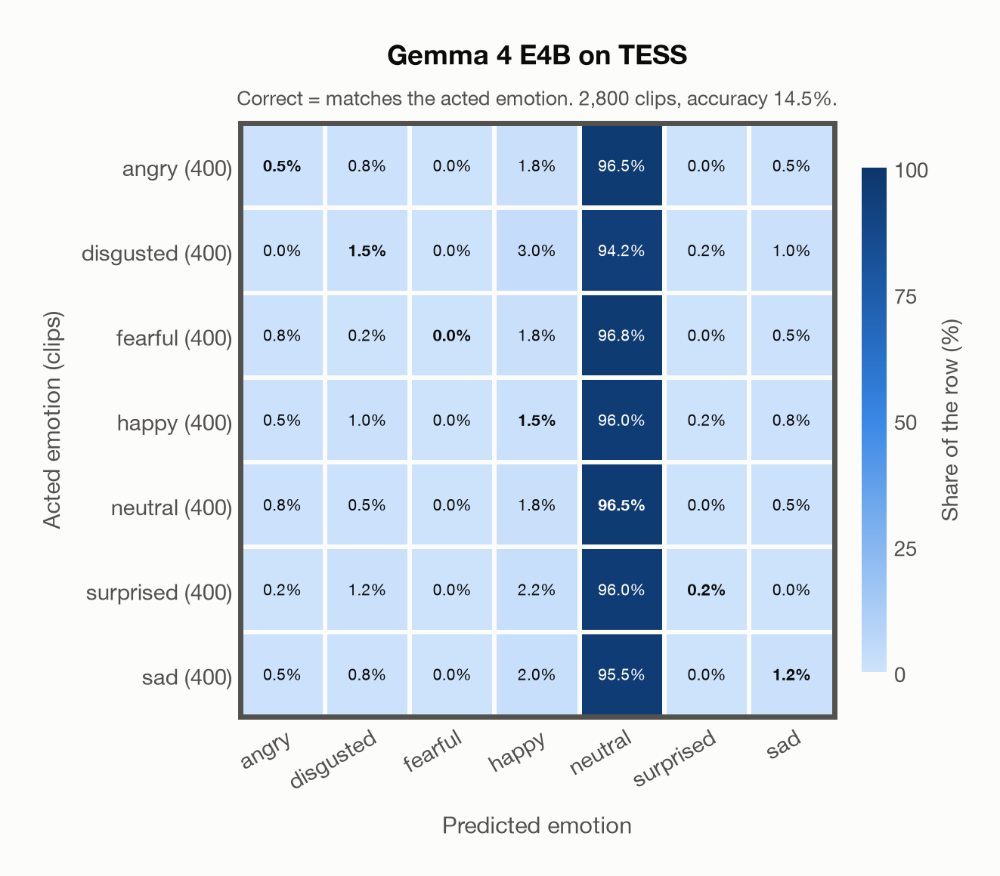

# Gemma 4 E4B on TESS

Generated by `scripts/evaluation/evaluate.py` on 2026-11-08.

## Summary

| Metric | Value |
|---|---|
| Clips evaluated | 2,800 (English) |
| **Accuracy: prediction matches the acted emotion** | **14.5%** |
| Unweighted accuracy (mean recall of the 7 acted emotions) | 14.5% |
| Macro F1 (acted emotion) | 4.9% |
| Accuracy, all 8 model classes (acted emotion) | 14.5% |
| Chance level (7 emotions) | 14.3% |

## Setup

- **Model**: Gemma 4 E4B (`google/gemma-4-E4B-it`) as released (no fine-tuning), transformers 5.18.0, loaded by `scripts/models/gemma4_audio.py`. Gemma 4 E4B (thinking off) gets one conversation per clip in its chat template: the system prompt, then one user turn with the user prompt first and the audio after it (as the model card advises), with the system and user prompts of `scripts/llm_eval/prompts.yaml` (the same as for GPT Realtime); the clip as 16 kHz mono (at most its first 30 s). Greedy decoding (do_sample=False, no repetition penalty), at most 24 new tokens, bfloat16 on `mps`, sdpa attention; so the answers are the same from run to run (up to rounding differences between devices). The answer is read by `scripts/llm_eval/parsing.py` and becomes a one-hot vector over the 7 emotions plus `invalid`. An answer that is not exactly one label gets a follow-up in the same conversation ("Answer with exactly one word from this list, in lowercase, and nothing else: angry, disgusted, fearful, happy, neutral, sad, surprised."), up to 1 time(s); then `invalid`. An answer that is not one of the dataset's emotions counts as wrong (column *other answer* of the confusion matrices); the raw answers are in `outputs/gemma4_e4b/responses.jsonl`.
- **Data**: 2,800 clips of TESS (English) from `data/tess/`.
- **Ground truth (acted emotion)**: the emotion each actress was asked to portray, from the last word of the file name (`angry`, `disgust`, `fear`, `happy`, `neutral`, `ps` for pleasant surprise, `sad`).
- Label mapping: angry, happy, neutral and sad keep their names; disgust = disgusted, fear = fearful, **pleasant surprise = surprised**.
- Two actresses, aged 26 and 64, say "Say the word ..." with the same 200 target words in each of the seven emotions.
- **7 emotions**: the prediction is the model's answer when it is one of the 7 emotions in this dataset (angry, disgusted, fearful, happy, neutral, surprised, sad); any other answer (`invalid`) counts as wrong, so the accuracy is the same with all 8 model classes.
- **Hardware**: Apple M4 Max, device `mps`, PyTorch 2.7.1. Inference took 16.4 min (351 ms per clip; answers saved by an earlier run take no time).
- **Per-clip predictions**: `outputs/gemma4_e4b/tess_predictions.csv` (in git, so the results can be checked clip by clip). The JSON file next to it describes the columns.

## Results per emotion

Rows: acted emotion. Precision, recall and F1 compare the prediction with the acted emotion.

| Emotion | Clips | Precision | Recall | F1 |
|---|---|---|---|---|
| angry | 400 | 15.4% | 0.5% | 1.0% |
| disgusted | 400 | 25.0% | 1.5% | 2.8% |
| fearful | 400 | 0.0% | 0.0% | 0.0% |
| happy | 400 | 10.7% | 1.5% | 2.6% |
| neutral | 400 | 14.4% | 96.5% | 25.0% |
| surprised | 400 | 33.3% | 0.2% | 0.5% |
| sad | 400 | 27.8% | 1.2% | 2.4% |

## Confusion matrix: acted emotion

The same numbers as a table. Rows: acted emotion. Columns: predicted emotion. Each row adds up to 100%.

| Acted \ Predicted | angry | disgusted | fearful | happy | neutral | surprised | sad |
|---|---|---|---|---|---|---|---|
| angry (400) | **0.5%** | 0.8% | 0.0% | 1.8% | 96.5% | 0.0% | 0.5% |
| disgusted (400) | 0.0% | **1.5%** | 0.0% | 3.0% | 94.2% | 0.2% | 1.0% |
| fearful (400) | 0.8% | 0.2% | **0.0%** | 1.8% | 96.8% | 0.0% | 0.5% |
| happy (400) | 0.5% | 1.0% | 0.0% | **1.5%** | 96.0% | 0.2% | 0.8% |
| neutral (400) | 0.8% | 0.5% | 0.0% | 1.8% | **96.5%** | 0.0% | 0.5% |
| surprised (400) | 0.2% | 1.2% | 0.0% | 2.2% | 96.0% | **0.2%** | 0.0% |
| sad (400) | 0.5% | 0.8% | 0.0% | 2.0% | 95.5% | 0.0% | **1.2%** |

Most frequent confusions: fearful predicted as neutral (96.8%), angry predicted as neutral (96.5%), surprised predicted as neutral (96.0%).

## Predictions outside the 7 emotions

With all 8 model classes, the model chose a class that this dataset does not have for 0 clips (0.0%): `invalid` 0.

## Caveats

- **Gemma 4 E4B's training data**: not published (Google). The model may have heard these public datasets during training.
- Only two speakers, so the result says little about other voices; models often score close to 100% on TESS.
- No listeners' labels are published with the dataset. Audio: 24,414 Hz WAV (one file, `OAF_food_fear.wav`, is 96 kHz), resampled to 16 kHz.
