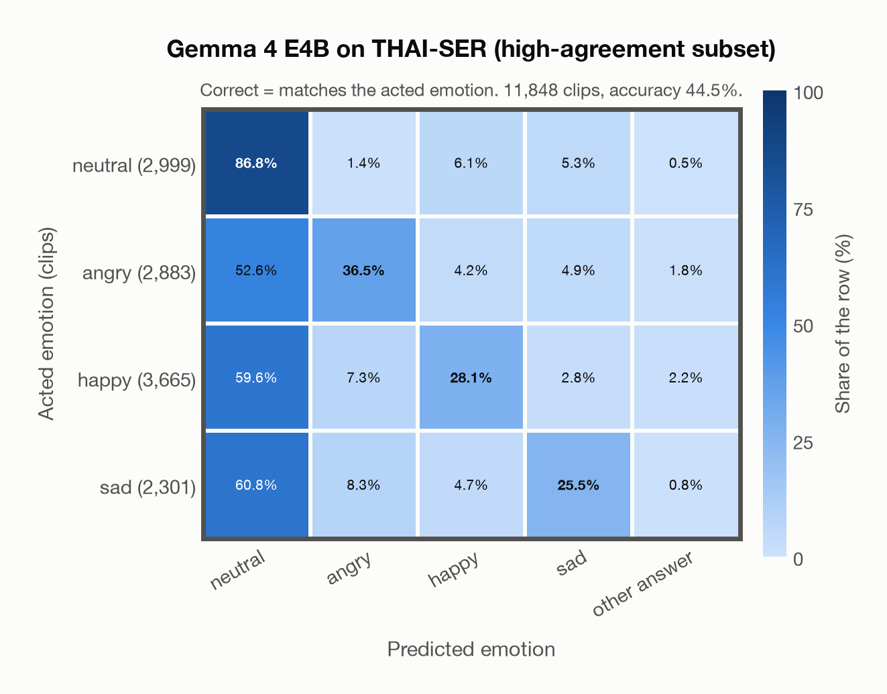
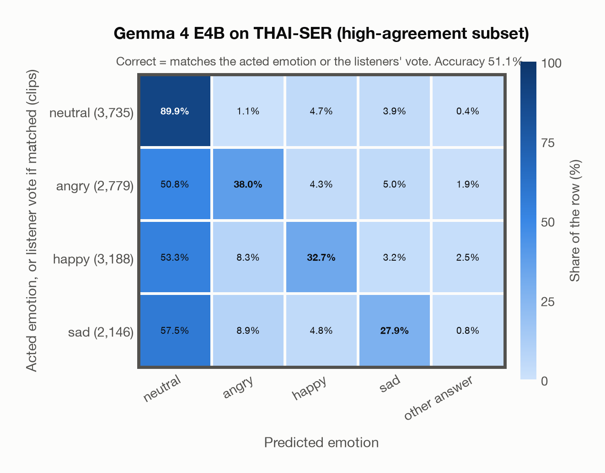

# Gemma 4 E4B on THAI-SER (high-agreement subset)

Generated by `scripts/evaluation/evaluate.py` on 2026-11-08.

## Summary

| Metric | Value |
|---|---|
| Clips evaluated | 11,848 (Thai) |
| **Accuracy: prediction matches the acted emotion** | **44.5%** |
| **Accuracy: prediction matches the acted emotion or the listeners' vote** | **51.1%** |
| Unweighted accuracy (mean recall of the 4 acted emotions) | 44.2% |
| Macro F1 (acted emotion) | 43.0% |
| Accuracy, all 8 model classes (acted emotion) | 44.5% |
| Chance level (4 emotions) | 25.0% |
| Listeners' majority vote vs acted emotion | 77.2% |

## Setup

- **Model**: Gemma 4 E4B (`google/gemma-4-E4B-it`) as released (no fine-tuning), transformers 5.18.0, loaded by `scripts/models/gemma4_audio.py`. Gemma 4 E4B (thinking off) gets one conversation per clip in its chat template: the system prompt, then one user turn with the user prompt first and the audio after it (as the model card advises), with the system and user prompts of `scripts/llm_eval/prompts.yaml` (the same as for GPT Realtime); the clip as 16 kHz mono (at most its first 30 s). Greedy decoding (do_sample=False, no repetition penalty), at most 24 new tokens, bfloat16 on `mps`, sdpa attention; so the answers are the same from run to run (up to rounding differences between devices). The answer is read by `scripts/llm_eval/parsing.py` and becomes a one-hot vector over the 7 emotions plus `invalid`. An answer that is not exactly one label gets a follow-up in the same conversation ("Answer with exactly one word from this list, in lowercase, and nothing else: angry, disgusted, fearful, happy, neutral, sad, surprised."), up to 1 time(s); then `invalid`. An answer that is not one of the dataset's emotions counts as wrong (column *other answer* of the confusion matrices); the raw answers are in `outputs/gemma4_e4b/responses.jsonl`.
- **Data**: 11,848 clips of THAI-SER (high-agreement subset) (Thai) from `data/thai_ser/`.
- **Ground truth (acted emotion)**: the emotion assigned to the actor for the scene (`assigned_emo`).
- **Listeners' vote**: the crowd-sourced majority label (`majority_emo`); clips without a majority have none.
- **High-agreement subset** (`subsets` in config/evaluation.yaml): only the clips with agreement >= 0.71 (`agreement`: the share of the crowd raters who chose the majority label), the subset the dataset authors recommend: 11,848 of the 22,584 clips of the four emotions (neutral 2,999, angry 2,883, happy 3,665, sad 2,301). Every model is evaluated on the same subset.
- Label mapping: Neutral = neutral, Angry = angry, Happy = happy, Sad = sad. Clips assigned *Frustrated* (5,270 of 27,854) are left out because none of the project's emotions matches it; a listener vote of *frustrated* can therefore never match.
- Audio: the condenser microphone for studio sessions and the Zoom recording for online sessions (44.1 kHz FLAC, resampled to 16 kHz).
- **4 emotions**: the prediction is the model's answer when it is one of the 4 emotions in this dataset (neutral, angry, happy, sad); any other answer (`disgusted`, `fearful`, `surprised`, `invalid`) counts as wrong, so the accuracy is the same with all 8 model classes.
- **Other answer**: for 166 clips the model's answer is none of the 4 emotions (an emotion this dataset does not have, or no readable answer). They count as wrong and have their own last column, *other answer*, in the confusion matrices; precision, recall and F1 are over the 4 emotions.
- **Two ways to count a prediction as correct.** *Acted emotion*: it must match the acted emotion. *Acted emotion or listeners' vote*: it also counts when it matches the listeners' majority vote (for a tied vote, any of the tied emotions). Both are reported.
- **Hardware**: Apple M4 Max, device `mps`, PyTorch 2.7.1. Inference took 132.5 min (671 ms per clip; answers saved by an earlier run take no time).
- **Per-clip predictions**: `outputs/gemma4_e4b/thai_ser_predictions.csv` (in git, so the results can be checked clip by clip). The JSON file next to it describes the columns.

## Results per emotion

Rows: acted emotion. Precision, recall and F1 compare the prediction with the acted emotion; the last column also accepts the listeners' vote.

| Emotion | Clips | Precision | Recall | F1 | Correct, acted or listeners' vote |
|---|---|---|---|---|---|
| neutral | 2,999 | 33.8% | 86.8% | 48.6% | 87.4% |
| angry | 2,883 | 67.8% | 36.5% | 47.5% | 40.3% |
| happy | 3,665 | 71.5% | 28.1% | 40.3% | 41.4% |
| sad | 2,301 | 59.3% | 25.5% | 35.6% | 32.8% |

## Confusion matrix: acted emotion

The same numbers as a table. Rows: acted emotion. Columns: predicted emotion. Each row adds up to 100%. *other answer*: the answer is none of the dataset's emotions (wrong).

| Acted \ Predicted | neutral | angry | happy | sad | other answer |
|---|---|---|---|---|---|
| neutral (2,999) | **86.8%** | 1.4% | 6.1% | 5.3% | 0.5% |
| angry (2,883) | 52.6% | **36.5%** | 4.2% | 4.9% | 1.8% |
| happy (3,665) | 59.6% | 7.3% | **28.1%** | 2.8% | 2.2% |
| sad (2,301) | 60.8% | 8.3% | 4.7% | **25.5%** | 0.8% |

Most frequent confusions: sad predicted as neutral (60.8%), happy predicted as neutral (59.6%), angry predicted as neutral (52.6%).

## Confusion matrix: acted emotion or listeners' vote

Here a prediction is correct when it matches the acted emotion or the listeners' vote. A clip goes into the row of the label its prediction matched, otherwise into the row of its acted emotion. The diagonal therefore holds every correct prediction, and the rows differ in size from the matrix above. 784 clips (6.6%) count as correct only because of the listeners' vote; the most common are acted happy predicted as neutral (485), acted sad predicted as neutral (165), acted angry predicted as neutral (105).

| Ground truth \ Predicted | neutral | angry | happy | sad | other answer |
|---|---|---|---|---|---|
| neutral (3,735) | **89.9%** | 1.1% | 4.7% | 3.9% | 0.4% |
| angry (2,779) | 50.8% | **38.0%** | 4.3% | 5.0% | 1.9% |
| happy (3,188) | 53.3% | 8.3% | **32.7%** | 3.2% | 2.5% |
| sad (2,146) | 57.5% | 8.9% | 4.8% | **27.9%** | 0.8% |

Most frequent confusions: sad predicted as neutral (57.5%), happy predicted as neutral (53.3%), angry predicted as neutral (50.8%).

## Predictions outside the 4 emotions

With all 8 model classes, the model chose a class that this dataset does not have for 166 clips (1.4%): `disgusted` 37, `fearful` 29, `surprised` 100, `invalid` 0.

## Comparison with human listeners

The listeners' majority vote matches the acted emotion for 77.2% of the 11,848 clips with a single (untied) vote. The model agrees with that vote for 46.1% of the same clips.

## Caveats

- **Gemma 4 E4B's training data**: not published (Google). The model may have heard these public datasets during training.
- **High agreement is not the acted emotion.** The raters agreed with each other, but for 2,698 of the 11,848 clips their majority label differs from the assigned one (often *frustrated* or *neutral*).
- Some sessions were recorded in an untreated studio room or over Zoom, so audio quality varies.
- **Acted labels are not perceived emotions.** The ground truth is what the actor intended; listeners sometimes heard something else, as the listeners' numbers above show.
