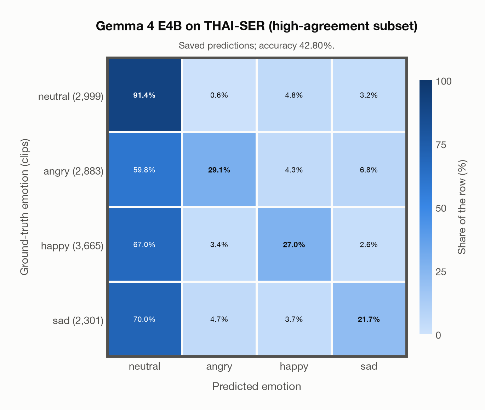
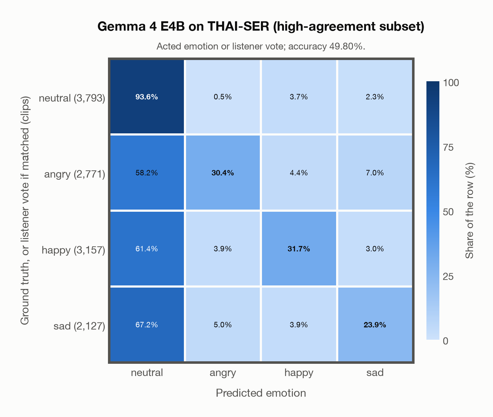

# Gemma 4 E4B on THAI-SER (high-agreement subset)

Regenerated offline from saved CSV/JSON by `scripts/evaluation/refresh_reports.py`. This refresh performs no model inference or API requests.

## Summary

| Metric | Recomputed value |
|---|---:|
| Clips | 11,848 |
| Accuracy: acted emotion | 42.80% |
| UAR: mean ground-truth-row recall | 42.32% |
| Macro F1 | 40.19% |
| Weighted F1: true-support weighted | 40.65% |
| Accuracy: all model classes | 42.80% |
| Invalid / outside-candidate answers | 0 (0.00%) |
| Accuracy: acted emotion or listener vote | 49.80% |
| Single listener vote vs acted emotion | 77.23% |
| Model vs single listener vote | 45.27% |

## Imported run and verification

- Source: [prediction CSV](../../outputs/gemma4_e4b/thai_ser_predictions.csv) and [metadata JSON](../../outputs/gemma4_e4b/thai_ser_predictions.json); both remain byte-for-byte unchanged.
- Original execution date recorded in JSON: `2026-11-13`.
- Dataset scope recorded in JSON: **THAI-SER (high-agreement subset)**, Thai; 11,848 / 11,848 clips.
- Ground-truth column: `acted_emotion`. Candidate classes: neutral, angry, happy, sad.
- Row counts, unique audio paths, correctness flags and saved metrics were checked against the CSV. Metric agreement tolerance is 0.000001 (six-decimal metadata).
- Weighted F1 weights each class's F1 by its true support, using the same resolved truth as macro F1; invalid answers remain errors. New metrics absent from the source JSON are recorded in the offline audit and summaries; the source JSON is preserved.
- Saved candidate/prompt/model protocol matches current configuration: scope `dataset`, model `google/gemma-4-E4B-it`, prompt hash `e683d765d4ac`.
- Original execution/client runtime metadata (reported by the imported run, not measured by this refresh): `{"device": "cuda:0", "hardware": "NVIDIA L4", "seconds": 16433.2, "ms_per_clip": 1387.0, "on_cpu": 0}`.
- Saved p_* columns encode the returned answer as one-hot values; they are not calibrated API class probabilities, and no confidence plot is inferred from them.
- A raw responses journal is present; this refresh validates CSV/JSON only.

## Prediction distribution

Counts and shares use all saved samples. The invalid bucket combines `invalid` and `other answer`: answers outside the dataset's candidate classes remain errors.

| Predicted label | Clips | Share of all clips |
|---|---:|---:|
| neutral | 8,529 | 71.99% |
| angry | 1,089 | 9.19% |
| happy | 1,343 | 11.34% |
| sad | 887 | 7.49% |
| invalid / outside candidates | 0 | 0.00% |

## Results per emotion

| Ground-truth emotion | Clips | Recall | Acted-or-listener recall |
|---|---:|---:|---:|
| neutral | 2,999 | 91.40% | 91.86% |
| angry | 2,883 | 29.14% | 33.06% |
| happy | 3,665 | 27.01% | 41.17% |
| sad | 2,301 | 21.73% | 29.68% |

Precision/F1 use the same resolved-truth convention as the evaluation script. Weighted F1 uses the resolved-truth clip counts below as weights.

| Predicted emotion | Resolved-truth clips | Precision | Recall | F1 |
|---|---:|---:|---:|---:|
| neutral | 2,999 | 32.14% | 91.40% | 47.55% |
| angry | 2,883 | 77.13% | 29.14% | 42.30% |
| happy | 3,665 | 73.72% | 27.01% | 39.54% |
| sad | 2,301 | 56.37% | 21.73% | 31.37% |

## Confusion matrix: acted emotion

| Ground truth \ Predicted | neutral | angry | happy | sad |
|---|---|---|---|---|
| neutral (2,999) | **91.4%** | 0.6% | 4.8% | 3.2% |
| angry (2,883) | 59.8% | **29.1%** | 4.3% | 6.8% |
| happy (3,665) | 67.0% | 3.4% | **27.0%** | 2.6% |
| sad (2,301) | 70.0% | 4.7% | 3.7% | **21.7%** |

## Confusion matrix: acted emotion or listener vote

A prediction accepted only through the listener vote is placed in that predicted emotion's row; other clips keep their original ground-truth row. Row supports can therefore change.

| Ground truth \ Predicted | neutral | angry | happy | sad |
|---|---|---|---|---|
| neutral (3,793) | **93.6%** | 0.5% | 3.7% | 2.3% |
| angry (2,771) | 58.2% | **30.4%** | 4.4% | 7.0% |
| happy (3,157) | 61.4% | 3.9% | **31.7%** | 3.0% |
| sad (2,127) | 67.2% | 5.0% | 3.9% | **23.9%** |

## Caveats

- **Training involvement for Gemma 4 E4B: No corpus-specific evidence**. Source: Broad multimodal pretraining and instruction tuning; complete corpus-level provenance not published (Google). Direct use and upstream teacher use both count as training involvement. No pattern: no corpus-specific evidence, not verified unseen. Corpus use is not test-clip leakage.
- Internal CSV/JSON consistency does not authenticate the original model or remote request logs.

[Offline validation audit](thai_ser_offline_audit.json)
