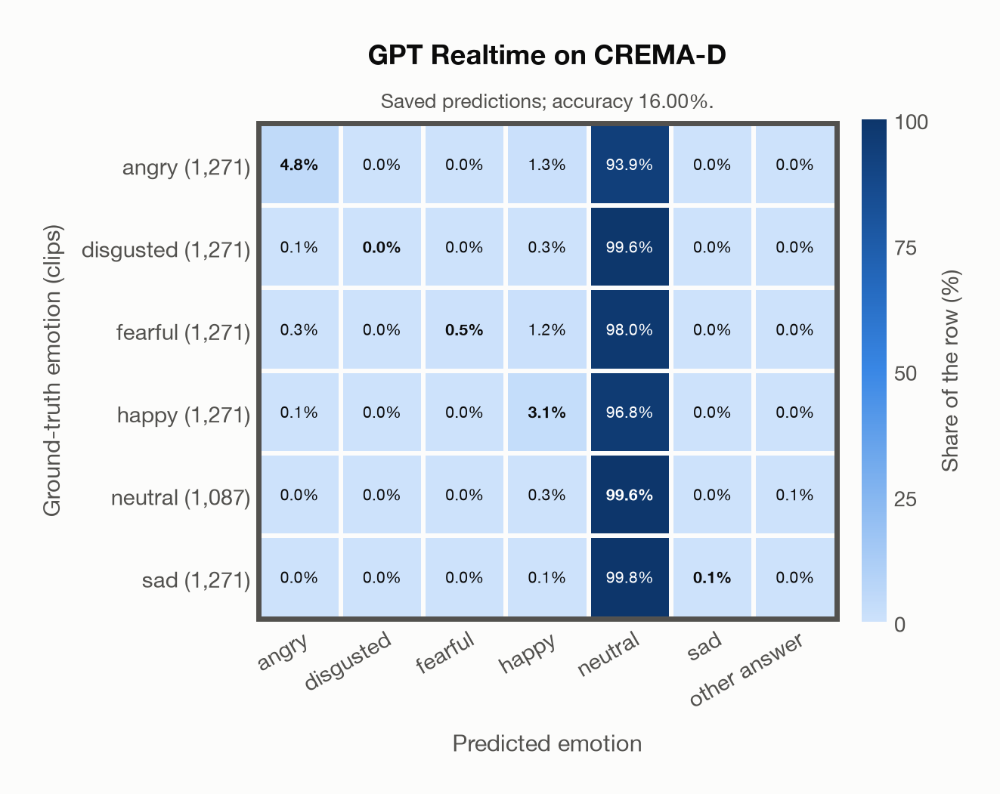
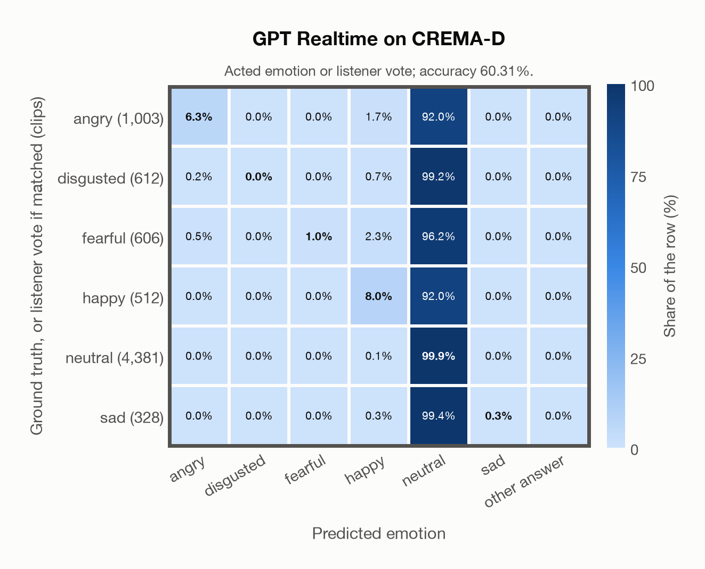

# GPT Realtime on CREMA-D

Regenerated offline from saved CSV/JSON by `scripts/evaluation/refresh_reports.py`. This refresh performs no model inference or API requests.

## Summary

| Metric | Recomputed value |
|---|---:|
| Clips | 7,442 |
| Accuracy: acted emotion | 16.00% |
| UAR: mean ground-truth-row recall | 18.02% |
| Macro F1 | 7.00% |
| Accuracy: all model classes | 16.00% |
| Accuracy: acted emotion or listener vote | 60.31% |
| Single listener vote vs acted emotion | 45.59% |
| Model vs single listener vote | 58.55% |

## Imported run and verification

- Source: [prediction CSV](../../outputs/gpt_realtime/crema_d_predictions.csv) and [metadata JSON](../../outputs/gpt_realtime/crema_d_predictions.json); both remain byte-for-byte unchanged.
- Original execution date recorded in JSON: `2026-11-09`.
- Dataset scope recorded in JSON: **CREMA-D**, English; 7,442 / 7,442 clips.
- Ground-truth column: `acted_emotion`. Candidate classes: angry, disgusted, fearful, happy, neutral, sad.
- Row counts, unique audio paths, correctness flags and saved metrics were checked against the CSV. Metric agreement tolerance is 0.000001 (six-decimal metadata).
- Saved candidate/prompt/model protocol matches current configuration: scope `dataset`, model `gpt-realtime`, prompt hash `4ff3d2e97612`.
- Original execution/client runtime metadata (reported by the imported run, not measured by this refresh): `{"device": "cpu", "hardware": "Apple M3 Pro", "seconds": 828.0, "ms_per_clip": 111.3, "on_cpu": 0}`.
- The original notes report up to 30 concurrent clip evaluations.
- The recorded ms_per_clip is total wall-clock time divided by the number of clips, not individual request latency; it is not directly comparable with local GPU inference timing.
- Saved p_* columns encode the returned answer as one-hot values; they are not calibrated API class probabilities, and no confidence plot is inferred from them.
- A raw responses journal is present; this refresh validates CSV/JSON only.

## Results per emotion

| Ground-truth emotion | Clips | Recall | Acted-or-listener recall |
|---|---:|---:|---:|
| angry | 1,271 | 4.80% | 26.04% |
| disgusted | 1,271 | 0.00% | 51.85% |
| fearful | 1,271 | 0.47% | 52.79% |
| happy | 1,271 | 3.15% | 62.94% |
| neutral | 1,087 | 99.63% | 99.63% |
| sad | 1,271 | 0.08% | 74.27% |

Precision/F1 use the same resolved-truth convention as the evaluation script.

| Predicted emotion | Resolved-truth clips | Precision | Recall | F1 |
|---|---:|---:|---:|---:|
| angry | 1,271 | 91.04% | 4.80% | 9.12% |
| disgusted | 1,271 | 0.00% | 0.00% | 0.00% |
| fearful | 1,271 | 100.00% | 0.47% | 0.94% |
| happy | 1,271 | 50.00% | 3.15% | 5.92% |
| neutral | 1,087 | 14.86% | 99.63% | 25.87% |
| sad | 1,271 | 100.00% | 0.08% | 0.16% |

## Confusion matrix: acted emotion

| Ground truth \ Predicted | angry | disgusted | fearful | happy | neutral | sad | other answer |
|---|---|---|---|---|---|---|---|
| angry (1,271) | **4.8%** | 0.0% | 0.0% | 1.3% | 93.9% | 0.0% | 0.0% |
| disgusted (1,271) | 0.1% | **0.0%** | 0.0% | 0.3% | 99.6% | 0.0% | 0.0% |
| fearful (1,271) | 0.3% | 0.0% | **0.5%** | 1.2% | 98.0% | 0.0% | 0.0% |
| happy (1,271) | 0.1% | 0.0% | 0.0% | **3.1%** | 96.8% | 0.0% | 0.0% |
| neutral (1,087) | 0.0% | 0.0% | 0.0% | 0.3% | **99.6%** | 0.0% | 0.1% |
| sad (1,271) | 0.0% | 0.0% | 0.0% | 0.1% | 99.8% | **0.1%** | 0.0% |

## Confusion matrix: acted emotion or listener vote

A prediction accepted only through the listener vote is placed in that predicted emotion's row; other clips keep their original ground-truth row. Row supports can therefore change.

| Ground truth \ Predicted | angry | disgusted | fearful | happy | neutral | sad | other answer |
|---|---|---|---|---|---|---|---|
| angry (1,003) | **6.3%** | 0.0% | 0.0% | 1.7% | 92.0% | 0.0% | 0.0% |
| disgusted (612) | 0.2% | **0.0%** | 0.0% | 0.7% | 99.2% | 0.0% | 0.0% |
| fearful (606) | 0.5% | 0.0% | **1.0%** | 2.3% | 96.2% | 0.0% | 0.0% |
| happy (512) | 0.0% | 0.0% | 0.0% | **8.0%** | 92.0% | 0.0% | 0.0% |
| neutral (4,381) | 0.0% | 0.0% | 0.0% | 0.1% | **99.9%** | 0.0% | 0.0% |
| sad (328) | 0.0% | 0.0% | 0.0% | 0.3% | 99.4% | **0.3%** | 0.0% |

## Caveats

- **Training involvement for GPT Realtime: No corpus-specific evidence**. Source: not published (OpenAI). Direct use and upstream teacher use both count as training involvement. No pattern: no corpus-specific evidence, not verified unseen. Corpus use is not test-clip leakage.
- The known empty CREMA-D recording 1076_MTI_SAD_XX.wav is retained in the saved predictions, matching the existing project evaluation scope.
- Internal CSV/JSON consistency does not authenticate the original model or remote request logs.

[Offline validation audit](crema_d_offline_audit.json)
