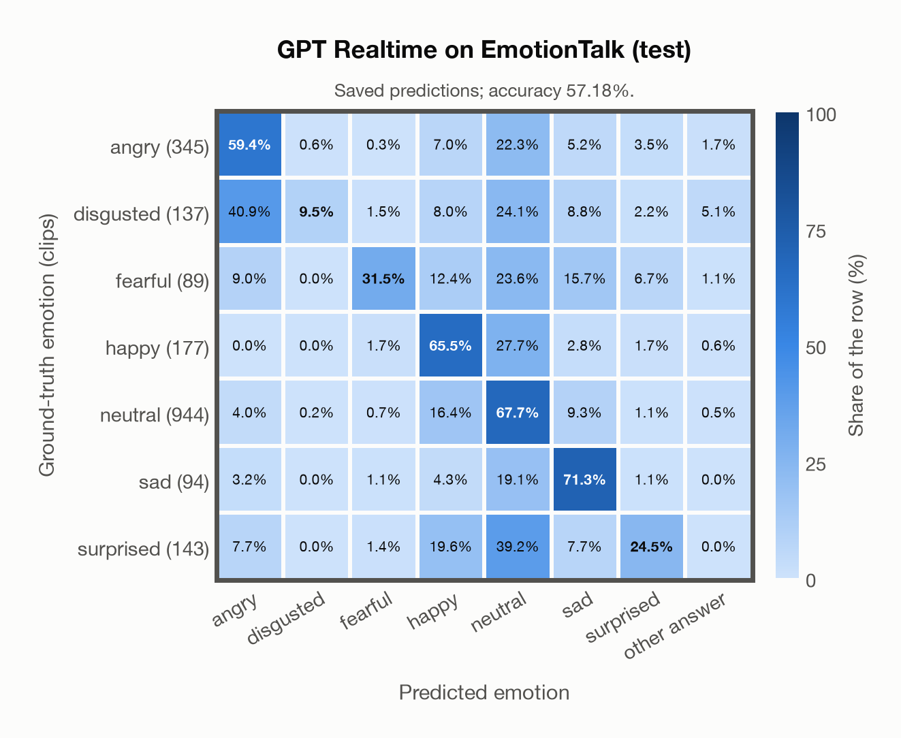

# GPT Realtime on EmotionTalk (test)

Regenerated offline from saved CSV/JSON by `scripts/evaluation/refresh_reports.py`. This refresh performs no model inference or API requests.

## Summary

| Metric | Recomputed value |
|---|---:|
| Clips | 1,929 |
| Accuracy: acted emotion | 57.18% |
| UAR: mean ground-truth-row recall | 47.05% |
| Macro F1 | 44.35% |
| Accuracy: all model classes | 57.18% |

## Imported run and verification

- Source: [prediction CSV](../../outputs/gpt_realtime/emotiontalk_predictions.csv) and [metadata JSON](../../outputs/gpt_realtime/emotiontalk_predictions.json); both remain byte-for-byte unchanged.
- Original execution date recorded in JSON: `2026-11-10`.
- Dataset scope recorded in JSON: **EmotionTalk (test)**, Mandarin; 1,929 / 1,929 clips.
- Ground-truth column: `acted_emotion`. Candidate classes: angry, disgusted, fearful, happy, neutral, sad, surprised.
- Row counts, unique audio paths, correctness flags and saved metrics were checked against the CSV. Metric agreement tolerance is 0.000001 (six-decimal metadata).
- Saved candidate/prompt/model protocol matches current configuration: scope `dataset`, model `gpt-realtime`, prompt hash `dc84c979c561`.
- Original execution/client runtime metadata (reported by the imported run, not measured by this refresh): `{"device": "cpu", "hardware": "Apple M3 Pro", "seconds": 270.7, "ms_per_clip": 140.4, "on_cpu": 0}`.
- The original notes report up to 30 concurrent clip evaluations.
- The recorded ms_per_clip is total wall-clock time divided by the number of clips, not individual request latency; it is not directly comparable with local GPU inference timing.
- Saved p_* columns encode the returned answer as one-hot values; they are not calibrated API class probabilities, and no confidence plot is inferred from them.
- A raw responses journal is present; this refresh validates CSV/JSON only.

## Results per emotion

| Ground-truth emotion | Clips | Recall | Acted-or-listener recall |
|---|---:|---:|---:|
| angry | 345 | 59.42% | — |
| disgusted | 137 | 9.49% | — |
| fearful | 89 | 31.46% | — |
| happy | 177 | 65.54% | — |
| neutral | 944 | 67.69% | — |
| sad | 94 | 71.28% | — |
| surprised | 143 | 24.48% | — |

Precision/F1 use the same resolved-truth convention as the evaluation script.

| Predicted emotion | Resolved-truth clips | Precision | Recall | F1 |
|---|---:|---:|---:|---:|
| angry | 345 | 63.86% | 59.42% | 61.56% |
| disgusted | 137 | 76.47% | 9.49% | 16.88% |
| fearful | 89 | 63.64% | 31.46% | 42.11% |
| happy | 177 | 33.24% | 65.54% | 44.11% |
| neutral | 944 | 71.56% | 67.69% | 69.57% |
| sad | 94 | 31.16% | 71.28% | 43.37% |
| surprised | 143 | 50.00% | 24.48% | 32.86% |

## Confusion matrix: acted emotion

| Ground truth \ Predicted | angry | disgusted | fearful | happy | neutral | sad | surprised | other answer |
|---|---|---|---|---|---|---|---|---|
| angry (345) | **59.4%** | 0.6% | 0.3% | 7.0% | 22.3% | 5.2% | 3.5% | 1.7% |
| disgusted (137) | 40.9% | **9.5%** | 1.5% | 8.0% | 24.1% | 8.8% | 2.2% | 5.1% |
| fearful (89) | 9.0% | 0.0% | **31.5%** | 12.4% | 23.6% | 15.7% | 6.7% | 1.1% |
| happy (177) | 0.0% | 0.0% | 1.7% | **65.5%** | 27.7% | 2.8% | 1.7% | 0.6% |
| neutral (944) | 4.0% | 0.2% | 0.7% | 16.4% | **67.7%** | 9.3% | 1.1% | 0.5% |
| sad (94) | 3.2% | 0.0% | 1.1% | 4.3% | 19.1% | **71.3%** | 1.1% | 0.0% |
| surprised (143) | 7.7% | 0.0% | 1.4% | 19.6% | 39.2% | 7.7% | **24.5%** | 0.0% |

## Caveats

- **Training involvement for GPT Realtime: No corpus-specific evidence**. Source: not published (OpenAI). Direct use and upstream teacher use both count as training involvement. No pattern: no corpus-specific evidence, not verified unseen. Corpus use is not test-clip leakage.
- Internal CSV/JSON consistency does not authenticate the original model or remote request logs.

[Offline validation audit](emotiontalk_offline_audit.json)
