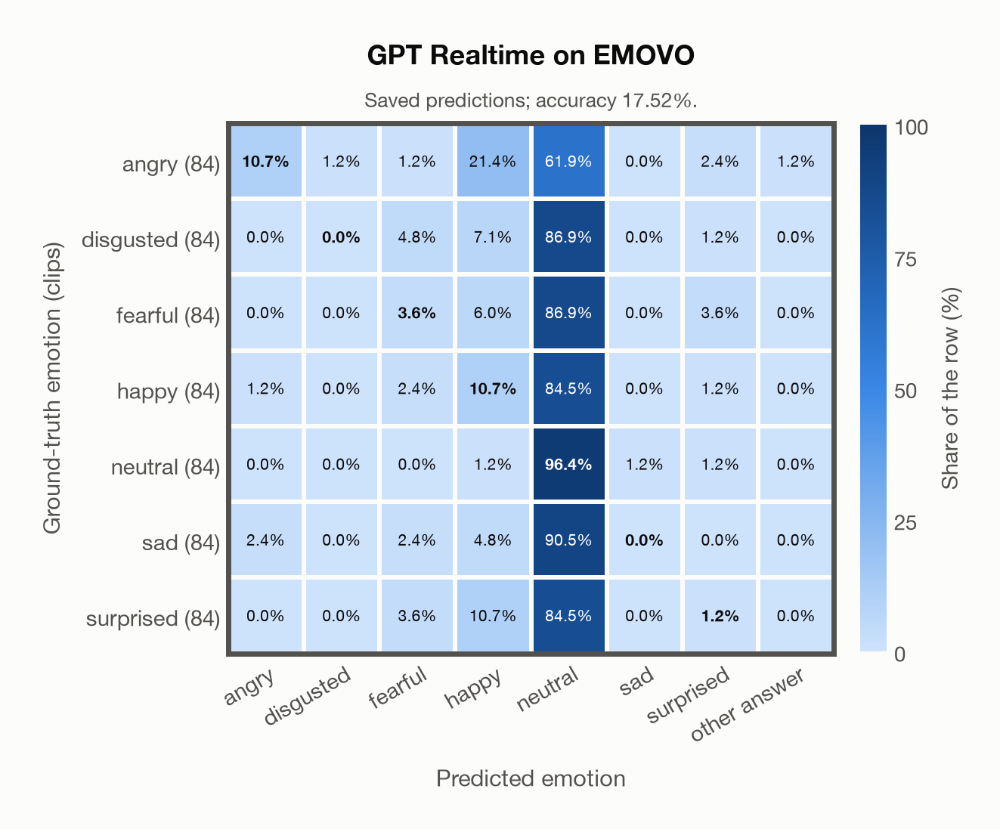

# GPT Realtime on EMOVO

Regenerated offline from saved CSV/JSON by `scripts/evaluation/refresh_reports.py`. This refresh performs no model inference or API requests.

## Summary

| Metric | Recomputed value |
|---|---:|
| Clips | 588 |
| Accuracy: acted emotion | 17.52% |
| UAR: mean ground-truth-row recall | 17.52% |
| Macro F1 | 9.73% |
| Accuracy: all model classes | 17.52% |

## Imported run and verification

- Source: [prediction CSV](../../outputs/gpt_realtime/emovo_predictions.csv) and [metadata JSON](../../outputs/gpt_realtime/emovo_predictions.json); both remain byte-for-byte unchanged.
- Original execution date recorded in JSON: `2026-11-10`.
- Dataset scope recorded in JSON: **EMOVO**, Italian; 588 / 588 clips.
- Ground-truth column: `acted_emotion`. Candidate classes: angry, disgusted, fearful, happy, neutral, sad, surprised.
- Row counts, unique audio paths, correctness flags and saved metrics were checked against the CSV. Metric agreement tolerance is 0.000001 (six-decimal metadata).
- Saved candidate/prompt/model protocol matches current configuration: scope `dataset`, model `gpt-realtime`, prompt hash `dc84c979c561`.
- Original execution/client runtime metadata (reported by the imported run, not measured by this refresh): `{"device": "cpu", "hardware": "Apple M3 Pro", "seconds": 70.9, "ms_per_clip": 120.6, "on_cpu": 0}`.
- The original notes report up to 30 concurrent clip evaluations.
- The recorded ms_per_clip is total wall-clock time divided by the number of clips, not individual request latency; it is not directly comparable with local GPU inference timing.
- Saved p_* columns encode the returned answer as one-hot values; they are not calibrated API class probabilities, and no confidence plot is inferred from them.
- A raw responses journal is present; this refresh validates CSV/JSON only.

## Results per emotion

| Ground-truth emotion | Clips | Recall | Acted-or-listener recall |
|---|---:|---:|---:|
| angry | 84 | 10.71% | — |
| disgusted | 84 | 0.00% | — |
| fearful | 84 | 3.57% | — |
| happy | 84 | 10.71% | — |
| neutral | 84 | 96.43% | — |
| sad | 84 | 0.00% | — |
| surprised | 84 | 1.19% | — |

Precision/F1 use the same resolved-truth convention as the evaluation script.

| Predicted emotion | Resolved-truth clips | Precision | Recall | F1 |
|---|---:|---:|---:|---:|
| angry | 84 | 75.00% | 10.71% | 18.75% |
| disgusted | 84 | 0.00% | 0.00% | 0.00% |
| fearful | 84 | 20.00% | 3.57% | 6.06% |
| happy | 84 | 17.31% | 10.71% | 13.24% |
| neutral | 84 | 16.30% | 96.43% | 27.88% |
| sad | 84 | 0.00% | 0.00% | 0.00% |
| surprised | 84 | 11.11% | 1.19% | 2.15% |

## Confusion matrix: acted emotion

| Ground truth \ Predicted | angry | disgusted | fearful | happy | neutral | sad | surprised | other answer |
|---|---|---|---|---|---|---|---|---|
| angry (84) | **10.7%** | 1.2% | 1.2% | 21.4% | 61.9% | 0.0% | 2.4% | 1.2% |
| disgusted (84) | 0.0% | **0.0%** | 4.8% | 7.1% | 86.9% | 0.0% | 1.2% | 0.0% |
| fearful (84) | 0.0% | 0.0% | **3.6%** | 6.0% | 86.9% | 0.0% | 3.6% | 0.0% |
| happy (84) | 1.2% | 0.0% | 2.4% | **10.7%** | 84.5% | 0.0% | 1.2% | 0.0% |
| neutral (84) | 0.0% | 0.0% | 0.0% | 1.2% | **96.4%** | 1.2% | 1.2% | 0.0% |
| sad (84) | 2.4% | 0.0% | 2.4% | 4.8% | 90.5% | **0.0%** | 0.0% | 0.0% |
| surprised (84) | 0.0% | 0.0% | 3.6% | 10.7% | 84.5% | 0.0% | **1.2%** | 0.0% |

## Caveats

- **Training involvement for GPT Realtime: No corpus-specific evidence**. Source: not published (OpenAI). Direct use and upstream teacher use both count as training involvement. No pattern: no corpus-specific evidence, not verified unseen. Corpus use is not test-clip leakage.
- Internal CSV/JSON consistency does not authenticate the original model or remote request logs.

[Offline validation audit](emovo_offline_audit.json)
