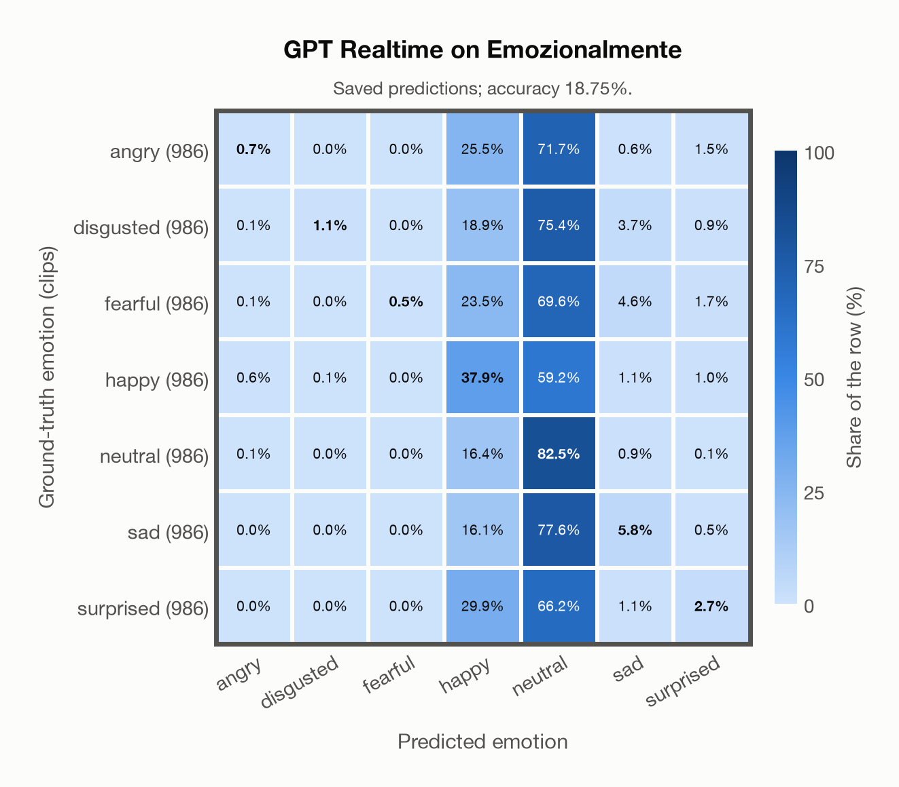
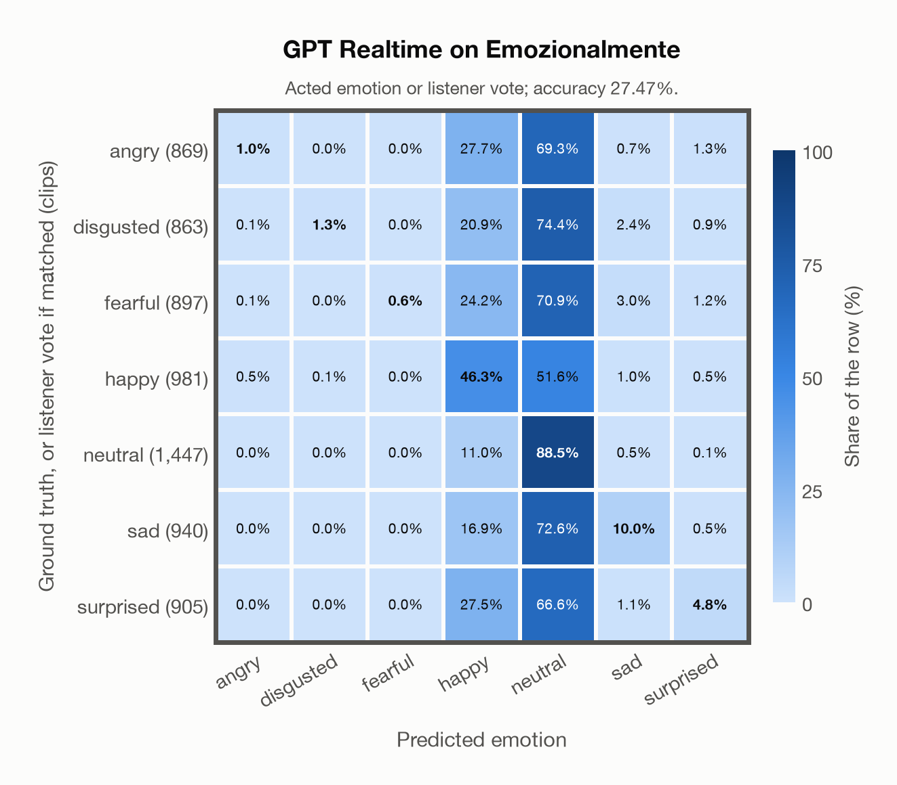

# GPT Realtime on Emozionalmente

Regenerated offline from saved CSV/JSON by `scripts/evaluation/refresh_reports.py`. This refresh performs no model inference or API requests.

## Summary

| Metric | Recomputed value |
|---|---:|
| Clips | 6,902 |
| Accuracy: acted emotion | 18.75% |
| UAR: mean ground-truth-row recall | 18.75% |
| Macro F1 | 10.73% |
| Weighted F1 (by true class support) | 10.73% |
| Accuracy: all model classes | 18.75% |
| Accuracy: acted emotion or listener vote | 27.47% |
| Single listener vote vs acted emotion | 81.22% |
| Model vs single listener vote | 24.03% |

## Imported run and verification

- Source: [prediction CSV](../../outputs/gpt_realtime/emozionalmente_predictions.csv) and [metadata JSON](../../outputs/gpt_realtime/emozionalmente_predictions.json); both remain byte-for-byte unchanged.
- Original execution date recorded in JSON: `2026-11-10`.
- Dataset scope recorded in JSON: **Emozionalmente**, Italian; 6,902 / 6,902 clips.
- Ground-truth column: `acted_emotion`. Candidate classes: angry, disgusted, fearful, happy, neutral, sad, surprised.
- Row counts, unique audio paths, correctness flags and saved metrics were checked against the CSV. Metric agreement tolerance is 0.000001 (six-decimal metadata).
- Saved candidate/prompt/model protocol matches current configuration: scope `dataset`, model `gpt-realtime`, prompt hash `dc84c979c561`.
- Original execution/client runtime metadata (reported by the imported run, not measured by this refresh): `{"device": "cpu", "hardware": "Apple M3 Pro", "seconds": 812.4, "ms_per_clip": 117.7, "on_cpu": 0}`.
- The original notes report up to 30 concurrent clip evaluations.
- The recorded ms_per_clip is total wall-clock time divided by the number of clips, not individual request latency; it is not directly comparable with local GPU inference timing.
- Saved p_* columns encode the returned answer as one-hot values; they are not calibrated API class probabilities, and no confidence plot is inferred from them.
- A raw responses journal is present; this refresh validates CSV/JSON only.

## Results per emotion

| Ground-truth emotion | Clips | Recall | Acted-or-listener recall |
|---|---:|---:|---:|
| angry | 986 | 0.71% | 12.78% |
| disgusted | 986 | 1.12% | 13.59% |
| fearful | 986 | 0.51% | 9.53% |
| happy | 986 | 37.93% | 46.55% |
| neutral | 986 | 82.45% | 83.06% |
| sad | 986 | 5.78% | 14.20% |
| surprised | 986 | 2.74% | 12.58% |

Precision/F1 use the same resolved-truth convention as the evaluation script.

| Predicted emotion | Resolved-truth clips | Precision | Recall | F1 |
|---|---:|---:|---:|---:|
| angry | 986 | 43.75% | 0.71% | 1.40% |
| disgusted | 986 | 91.67% | 1.12% | 2.20% |
| fearful | 986 | 100.00% | 0.51% | 1.01% |
| happy | 986 | 22.54% | 37.93% | 28.28% |
| neutral | 986 | 16.42% | 82.45% | 27.39% |
| sad | 986 | 32.57% | 5.78% | 9.82% |
| surprised | 986 | 32.14% | 2.74% | 5.05% |

## Confusion matrix: acted emotion

| Ground truth \ Predicted | angry | disgusted | fearful | happy | neutral | sad | surprised |
|---|---|---|---|---|---|---|---|
| angry (986) | **0.7%** | 0.0% | 0.0% | 25.5% | 71.7% | 0.6% | 1.5% |
| disgusted (986) | 0.1% | **1.1%** | 0.0% | 18.9% | 75.4% | 3.7% | 0.9% |
| fearful (986) | 0.1% | 0.0% | **0.5%** | 23.5% | 69.6% | 4.6% | 1.7% |
| happy (986) | 0.6% | 0.1% | 0.0% | **37.9%** | 59.2% | 1.1% | 1.0% |
| neutral (986) | 0.1% | 0.0% | 0.0% | 16.4% | **82.5%** | 0.9% | 0.1% |
| sad (986) | 0.0% | 0.0% | 0.0% | 16.1% | 77.6% | **5.8%** | 0.5% |
| surprised (986) | 0.0% | 0.0% | 0.0% | 29.9% | 66.2% | 1.1% | **2.7%** |

## Confusion matrix: acted emotion or listener vote

A prediction accepted only through the listener vote is placed in that predicted emotion's row; other clips keep their original ground-truth row. Row supports can therefore change.

| Ground truth \ Predicted | angry | disgusted | fearful | happy | neutral | sad | surprised |
|---|---|---|---|---|---|---|---|
| angry (869) | **1.0%** | 0.0% | 0.0% | 27.7% | 69.3% | 0.7% | 1.3% |
| disgusted (863) | 0.1% | **1.3%** | 0.0% | 20.9% | 74.4% | 2.4% | 0.9% |
| fearful (897) | 0.1% | 0.0% | **0.6%** | 24.2% | 70.9% | 3.0% | 1.2% |
| happy (981) | 0.5% | 0.1% | 0.0% | **46.3%** | 51.6% | 1.0% | 0.5% |
| neutral (1,447) | 0.0% | 0.0% | 0.0% | 11.0% | **88.5%** | 0.5% | 0.1% |
| sad (940) | 0.0% | 0.0% | 0.0% | 16.9% | 72.6% | **10.0%** | 0.5% |
| surprised (905) | 0.0% | 0.0% | 0.0% | 27.5% | 66.6% | 1.1% | **4.8%** |

## Caveats

- **Training involvement for GPT Realtime: No corpus-specific evidence**. Source: not published (OpenAI). Direct use and upstream teacher use both count as training involvement. No pattern: no corpus-specific evidence, not verified unseen. Corpus use is not test-clip leakage.
- Internal CSV/JSON consistency does not authenticate the original model or remote request logs.

[Offline validation audit](emozionalmente_offline_audit.json)
