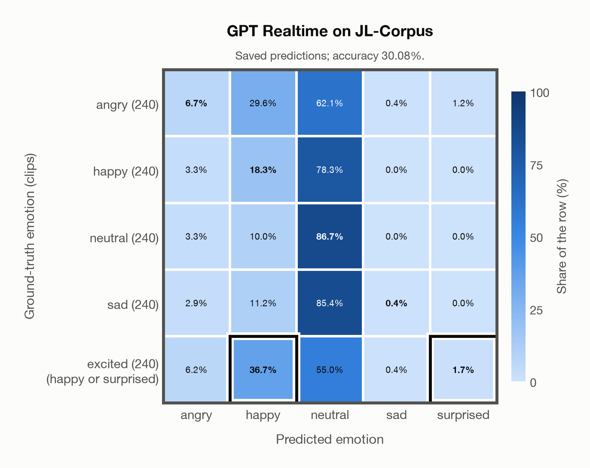

# GPT Realtime on JL-Corpus

Regenerated offline from saved CSV/JSON by `scripts/evaluation/refresh_reports.py`. This refresh performs no model inference or API requests.

## Summary

| Metric | Recomputed value |
|---|---:|
| Clips | 1,200 |
| Accuracy: acted emotion | 30.08% |
| UAR: mean ground-truth-row recall | 30.08% |
| Macro F1 | 31.54% |
| Accuracy: all model classes | 30.08% |

## Imported run and verification

- Source: [prediction CSV](../../outputs/gpt_realtime/jl_corpus_predictions.csv) and [metadata JSON](../../outputs/gpt_realtime/jl_corpus_predictions.json); both remain byte-for-byte unchanged.
- Original execution date recorded in JSON: `2026-11-09`.
- Dataset scope recorded in JSON: **JL-Corpus**, English (New Zealand); 1,200 / 1,200 clips.
- Ground-truth column: `acted_emotion`. Candidate classes: angry, happy, neutral, sad, surprised.
- Row counts, unique audio paths, correctness flags and saved metrics were checked against the CSV. Metric agreement tolerance is 0.000001 (six-decimal metadata).
- Saved candidate/prompt/model protocol matches current configuration: scope `dataset`, model `gpt-realtime`, prompt hash `810c234fb672`.
- Original execution/client runtime metadata (reported by the imported run, not measured by this refresh): `{"device": "cpu", "hardware": "Apple M3 Pro", "seconds": 134.8, "ms_per_clip": 112.4, "on_cpu": 0}`.
- The original notes report up to 30 concurrent clip evaluations.
- The recorded ms_per_clip is total wall-clock time divided by the number of clips, not individual request latency; it is not directly comparable with local GPU inference timing.
- Saved p_* columns encode the returned answer as one-hot values; they are not calibrated API class probabilities, and no confidence plot is inferred from them.
- A raw responses journal is present; this refresh validates CSV/JSON only.
- Composite labels follow the existing accepted-label rule: excited accepts happy or surprised. F1 resolves a correct composite to the predicted class, otherwise to its first accepted class.

## Results per emotion

| Ground-truth emotion | Clips | Recall | Acted-or-listener recall |
|---|---:|---:|---:|
| angry | 240 | 6.67% | — |
| happy | 240 | 18.33% | — |
| neutral | 240 | 86.67% | — |
| sad | 240 | 0.42% | — |
| excited (happy or surprised) | 240 | 38.33% | — |

Precision/F1 use the same resolved-truth convention as the evaluation script.

| Predicted emotion | Resolved-truth clips | Precision | Recall | F1 |
|---|---:|---:|---:|---:|
| angry | 240 | 29.63% | 6.67% | 10.88% |
| happy | 476 | 51.97% | 27.73% | 36.16% |
| neutral | 240 | 23.58% | 86.67% | 37.08% |
| sad | 240 | 33.33% | 0.42% | 0.82% |
| surprised | 4 | 57.14% | 100.00% | 72.73% |

## Confusion matrix: acted emotion

| Ground truth \ Predicted | angry | happy | neutral | sad | surprised |
|---|---|---|---|---|---|
| angry (240) | **6.7%** | 29.6% | 62.1% | 0.4% | 1.2% |
| happy (240) | 3.3% | **18.3%** | 78.3% | 0.0% | 0.0% |
| neutral (240) | 3.3% | 10.0% | **86.7%** | 0.0% | 0.0% |
| sad (240) | 2.9% | 11.2% | 85.4% | **0.4%** | 0.0% |
| excited (happy or surprised) (240) | 6.2% | **36.7%** | 55.0% | 0.4% | **1.7%** |

## Caveats

- **Training involvement for GPT Realtime: No corpus-specific evidence**. Source: not published (OpenAI). Direct use and upstream teacher use both count as training involvement. No pattern: no corpus-specific evidence, not verified unseen. Corpus use is not test-clip leakage.
- Internal CSV/JSON consistency does not authenticate the original model or remote request logs.

[Offline validation audit](jl_corpus_offline_audit.json)
