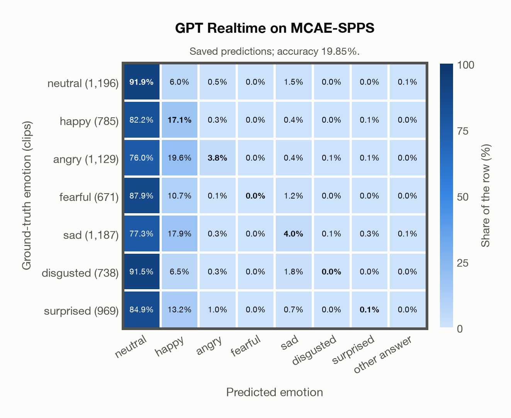
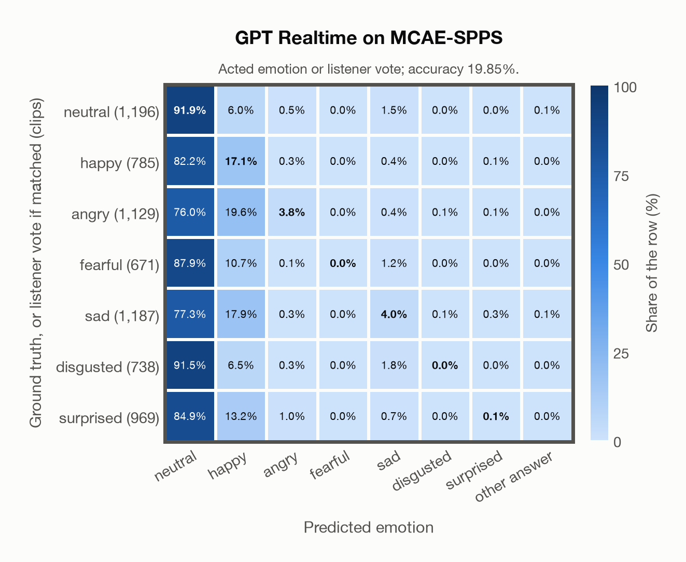

# GPT Realtime on MCAE-SPPS

Regenerated offline from saved CSV/JSON by `scripts/evaluation/refresh_reports.py`. This refresh performs no model inference or API requests.

## Summary

| Metric | Recomputed value |
|---|---:|
| Clips | 6,675 |
| Accuracy: acted emotion | 19.85% |
| UAR: mean ground-truth-row recall | 16.70% |
| Macro F1 | 9.03% |
| Accuracy: all model classes | 19.85% |
| Accuracy: acted emotion or listener vote | 19.85% |
| Single listener vote vs acted emotion | 100.00% |
| Model vs single listener vote | 19.85% |

## Imported run and verification

- Source: [prediction CSV](../../outputs/gpt_realtime/mcae_spps_predictions.csv) and [metadata JSON](../../outputs/gpt_realtime/mcae_spps_predictions.json); both remain byte-for-byte unchanged.
- Original execution date recorded in JSON: `2026-11-09`.
- Dataset scope recorded in JSON: **MCAE-SPPS**, Mandarin; 6,675 / 6,675 clips.
- Ground-truth column: `acted_emotion`. Candidate classes: neutral, happy, angry, fearful, sad, disgusted, surprised.
- Row counts, unique audio paths, correctness flags and saved metrics were checked against the CSV. Metric agreement tolerance is 0.000001 (six-decimal metadata).
- Saved candidate/prompt/model protocol matches current configuration: scope `dataset`, model `gpt-realtime`, prompt hash `dc84c979c561`.
- Original execution/client runtime metadata (reported by the imported run, not measured by this refresh): `{"device": "cpu", "hardware": "Apple M3 Pro", "seconds": 665.4, "ms_per_clip": 99.7, "on_cpu": 0}`.
- The original notes report up to 30 concurrent clip evaluations.
- The recorded ms_per_clip is total wall-clock time divided by the number of clips, not individual request latency; it is not directly comparable with local GPU inference timing.
- Saved p_* columns encode the returned answer as one-hot values; they are not calibrated API class probabilities, and no confidence plot is inferred from them.
- A raw responses journal is present; this refresh validates CSV/JSON only.

## Results per emotion

| Ground-truth emotion | Clips | Recall | Acted-or-listener recall |
|---|---:|---:|---:|
| neutral | 1,196 | 91.89% | 91.89% |
| happy | 785 | 17.07% | 17.07% |
| angry | 1,129 | 3.81% | 3.81% |
| fearful | 671 | 0.00% | 0.00% |
| sad | 1,187 | 4.04% | 4.04% |
| disgusted | 738 | 0.00% | 0.00% |
| surprised | 969 | 0.10% | 0.10% |

Precision/F1 use the same resolved-truth convention as the evaluation script.

| Predicted emotion | Resolved-truth clips | Precision | Recall | F1 |
|---|---:|---:|---:|---:|
| neutral | 1,196 | 19.60% | 91.89% | 32.31% |
| happy | 785 | 15.11% | 17.07% | 16.03% |
| angry | 1,129 | 63.24% | 3.81% | 7.18% |
| fearful | 671 | 0.00% | 0.00% | 0.00% |
| sad | 1,187 | 47.06% | 4.04% | 7.45% |
| disgusted | 738 | 0.00% | 0.00% | 0.00% |
| surprised | 969 | 14.29% | 0.10% | 0.20% |

## Confusion matrix: acted emotion

| Ground truth \ Predicted | neutral | happy | angry | fearful | sad | disgusted | surprised | other answer |
|---|---|---|---|---|---|---|---|---|
| neutral (1,196) | **91.9%** | 6.0% | 0.5% | 0.0% | 1.5% | 0.0% | 0.0% | 0.1% |
| happy (785) | 82.2% | **17.1%** | 0.3% | 0.0% | 0.4% | 0.0% | 0.1% | 0.0% |
| angry (1,129) | 76.0% | 19.6% | **3.8%** | 0.0% | 0.4% | 0.1% | 0.1% | 0.0% |
| fearful (671) | 87.9% | 10.7% | 0.1% | **0.0%** | 1.2% | 0.0% | 0.0% | 0.0% |
| sad (1,187) | 77.3% | 17.9% | 0.3% | 0.0% | **4.0%** | 0.1% | 0.3% | 0.1% |
| disgusted (738) | 91.5% | 6.5% | 0.3% | 0.0% | 1.8% | **0.0%** | 0.0% | 0.0% |
| surprised (969) | 84.9% | 13.2% | 1.0% | 0.0% | 0.7% | 0.0% | **0.1%** | 0.0% |

## Confusion matrix: acted emotion or listener vote

A prediction accepted only through the listener vote is placed in that predicted emotion's row; other clips keep their original ground-truth row. Row supports can therefore change.

| Ground truth \ Predicted | neutral | happy | angry | fearful | sad | disgusted | surprised | other answer |
|---|---|---|---|---|---|---|---|---|
| neutral (1,196) | **91.9%** | 6.0% | 0.5% | 0.0% | 1.5% | 0.0% | 0.0% | 0.1% |
| happy (785) | 82.2% | **17.1%** | 0.3% | 0.0% | 0.4% | 0.0% | 0.1% | 0.0% |
| angry (1,129) | 76.0% | 19.6% | **3.8%** | 0.0% | 0.4% | 0.1% | 0.1% | 0.0% |
| fearful (671) | 87.9% | 10.7% | 0.1% | **0.0%** | 1.2% | 0.0% | 0.0% | 0.0% |
| sad (1,187) | 77.3% | 17.9% | 0.3% | 0.0% | **4.0%** | 0.1% | 0.3% | 0.1% |
| disgusted (738) | 91.5% | 6.5% | 0.3% | 0.0% | 1.8% | **0.0%** | 0.0% | 0.0% |
| surprised (969) | 84.9% | 13.2% | 1.0% | 0.0% | 0.7% | 0.0% | **0.1%** | 0.0% |

## Caveats

- **Training involvement for GPT Realtime: No corpus-specific evidence**. Source: not published (OpenAI). Direct use and upstream teacher use both count as training involvement. No pattern: no corpus-specific evidence, not verified unseen. Corpus use is not test-clip leakage.
- Internal CSV/JSON consistency does not authenticate the original model or remote request logs.

[Offline validation audit](mcae_spps_offline_audit.json)
