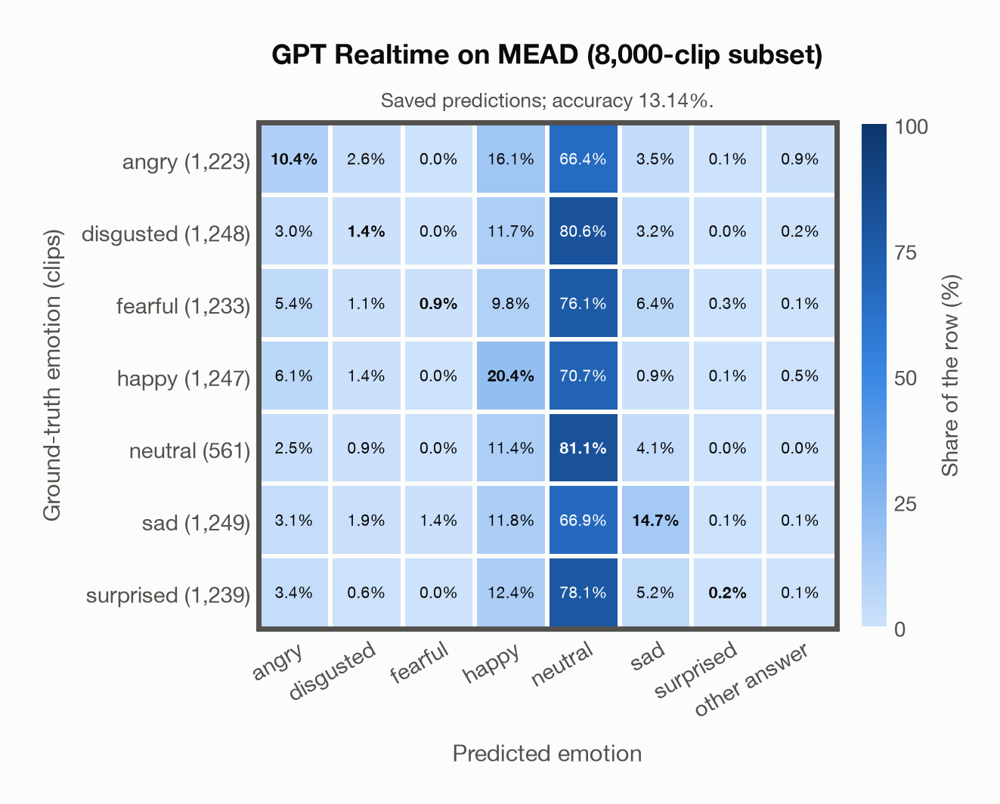

# GPT Realtime on MEAD (8,000-clip subset)

Regenerated offline from saved CSV/JSON by `scripts/evaluation/refresh_reports.py`. This refresh performs no model inference or API requests.

## Summary

| Metric | Recomputed value |
|---|---:|
| Clips | 8,000 |
| Accuracy: acted emotion | 13.14% |
| UAR: mean ground-truth-row recall | 18.44% |
| Macro F1 | 11.14% |
| Accuracy: all model classes | 13.14% |

## Imported run and verification

- Source: [prediction CSV](../../outputs/gpt_realtime/mead_predictions.csv) and [metadata JSON](../../outputs/gpt_realtime/mead_predictions.json); both remain byte-for-byte unchanged.
- Original execution date recorded in JSON: `2026-11-10`.
- Dataset scope recorded in JSON: **MEAD (8,000-clip subset)**, English; 8,000 / 8,000 clips.
- Ground-truth column: `acted_emotion`. Candidate classes: angry, disgusted, fearful, happy, neutral, sad, surprised.
- Row counts, unique audio paths, correctness flags and saved metrics were checked against the CSV. Metric agreement tolerance is 0.000001 (six-decimal metadata).
- Saved candidate/prompt/model protocol matches current configuration: scope `dataset`, model `gpt-realtime`, prompt hash `dc84c979c561`.
- Original execution/client runtime metadata (reported by the imported run, not measured by this refresh): `{"device": "cpu", "hardware": "Apple M3 Pro", "seconds": 1011.1, "ms_per_clip": 126.4, "on_cpu": 0}`.
- The original notes report up to 30 concurrent clip evaluations.
- The recorded ms_per_clip is total wall-clock time divided by the number of clips, not individual request latency; it is not directly comparable with local GPU inference timing.
- Saved p_* columns encode the returned answer as one-hot values; they are not calibrated API class probabilities, and no confidence plot is inferred from them.
- A raw responses journal is present; this refresh validates CSV/JSON only.

## Results per emotion

| Ground-truth emotion | Clips | Recall | Acted-or-listener recall |
|---|---:|---:|---:|
| angry | 1,223 | 10.38% | — |
| disgusted | 1,248 | 1.36% | — |
| fearful | 1,233 | 0.89% | — |
| happy | 1,247 | 20.37% | — |
| neutral | 561 | 81.11% | — |
| sad | 1,249 | 14.73% | — |
| surprised | 1,239 | 0.24% | — |

Precision/F1 use the same resolved-truth convention as the evaluation script.

| Predicted emotion | Resolved-truth clips | Precision | Recall | F1 |
|---|---:|---:|---:|---:|
| angry | 1,223 | 31.67% | 10.38% | 15.64% |
| disgusted | 1,248 | 14.78% | 1.36% | 2.49% |
| fearful | 1,233 | 39.29% | 0.89% | 1.74% |
| happy | 1,247 | 23.45% | 20.37% | 21.80% |
| neutral | 561 | 7.72% | 81.11% | 14.09% |
| sad | 1,249 | 41.44% | 14.73% | 21.74% |
| surprised | 1,239 | 30.00% | 0.24% | 0.48% |

## Confusion matrix: acted emotion

| Ground truth \ Predicted | angry | disgusted | fearful | happy | neutral | sad | surprised | other answer |
|---|---|---|---|---|---|---|---|---|
| angry (1,223) | **10.4%** | 2.6% | 0.0% | 16.1% | 66.4% | 3.5% | 0.1% | 0.9% |
| disgusted (1,248) | 3.0% | **1.4%** | 0.0% | 11.7% | 80.6% | 3.2% | 0.0% | 0.2% |
| fearful (1,233) | 5.4% | 1.1% | **0.9%** | 9.8% | 76.1% | 6.4% | 0.3% | 0.1% |
| happy (1,247) | 6.1% | 1.4% | 0.0% | **20.4%** | 70.7% | 0.9% | 0.1% | 0.5% |
| neutral (561) | 2.5% | 0.9% | 0.0% | 11.4% | **81.1%** | 4.1% | 0.0% | 0.0% |
| sad (1,249) | 3.1% | 1.9% | 1.4% | 11.8% | 66.9% | **14.7%** | 0.1% | 0.1% |
| surprised (1,239) | 3.4% | 0.6% | 0.0% | 12.4% | 78.1% | 5.2% | **0.2%** | 0.1% |

## Caveats

- **Training involvement for GPT Realtime: No corpus-specific evidence**. Source: not published (OpenAI). Direct use and upstream teacher use both count as training involvement. No pattern: no corpus-specific evidence, not verified unseen. Corpus use is not test-clip leakage.
- Internal CSV/JSON consistency does not authenticate the original model or remote request logs.

[Offline validation audit](mead_offline_audit.json)
