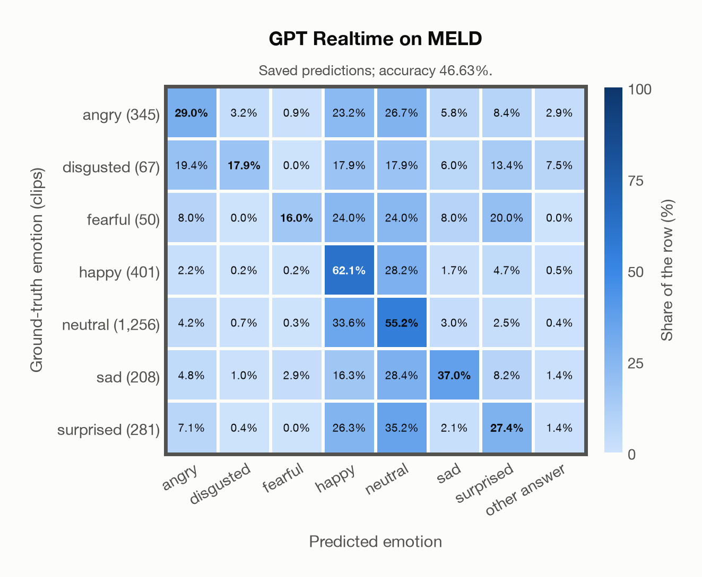

# GPT Realtime on MELD

Regenerated offline from saved CSV/JSON by `scripts/evaluation/refresh_reports.py`. This refresh performs no model inference or API requests.

## Summary

| Metric | Recomputed value |
|---|---:|
| Clips | 2,608 |
| Accuracy: acted emotion | 46.63% |
| UAR: mean ground-truth-row recall | 34.94% |
| Macro F1 | 36.36% |
| Accuracy: all model classes | 46.63% |

## Imported run and verification

- Source: [prediction CSV](../../outputs/gpt_realtime/meld_predictions.csv) and [metadata JSON](../../outputs/gpt_realtime/meld_predictions.json); both remain byte-for-byte unchanged.
- Original execution date recorded in JSON: `2026-11-10`.
- Dataset scope recorded in JSON: **MELD**, English; 2,608 / 2,608 clips.
- Ground-truth column: `acted_emotion`. Candidate classes: angry, disgusted, fearful, happy, neutral, sad, surprised.
- Row counts, unique audio paths, correctness flags and saved metrics were checked against the CSV. Metric agreement tolerance is 0.000001 (six-decimal metadata).
- Saved candidate/prompt/model protocol matches current configuration: scope `dataset`, model `gpt-realtime`, prompt hash `dc84c979c561`.
- Original execution/client runtime metadata (reported by the imported run, not measured by this refresh): `{"device": "cpu", "hardware": "Apple M3 Pro", "seconds": 323.9, "ms_per_clip": 124.2, "on_cpu": 0}`.
- The original notes report up to 30 concurrent clip evaluations.
- The recorded ms_per_clip is total wall-clock time divided by the number of clips, not individual request latency; it is not directly comparable with local GPU inference timing.
- Saved p_* columns encode the returned answer as one-hot values; they are not calibrated API class probabilities, and no confidence plot is inferred from them.
- A raw responses journal is present; this refresh validates CSV/JSON only.

## Results per emotion

| Ground-truth emotion | Clips | Recall | Acted-or-listener recall |
|---|---:|---:|---:|
| angry | 345 | 28.99% | — |
| disgusted | 67 | 17.91% | — |
| fearful | 50 | 16.00% | — |
| happy | 401 | 62.09% | — |
| neutral | 1,256 | 55.18% | — |
| sad | 208 | 37.02% | — |
| surprised | 281 | 27.40% | — |

Precision/F1 use the same resolved-truth convention as the evaluation script.

| Predicted emotion | Resolved-truth clips | Precision | Recall | F1 |
|---|---:|---:|---:|---:|
| angry | 345 | 47.85% | 28.99% | 36.10% |
| disgusted | 67 | 33.33% | 17.91% | 23.30% |
| fearful | 50 | 36.36% | 16.00% | 22.22% |
| happy | 401 | 28.20% | 62.09% | 38.79% |
| neutral | 1,256 | 64.17% | 55.18% | 59.33% |
| sad | 208 | 49.36% | 37.02% | 42.31% |
| surprised | 281 | 39.90% | 27.40% | 32.49% |

## Confusion matrix: acted emotion

| Ground truth \ Predicted | angry | disgusted | fearful | happy | neutral | sad | surprised | other answer |
|---|---|---|---|---|---|---|---|---|
| angry (345) | **29.0%** | 3.2% | 0.9% | 23.2% | 26.7% | 5.8% | 8.4% | 2.9% |
| disgusted (67) | 19.4% | **17.9%** | 0.0% | 17.9% | 17.9% | 6.0% | 13.4% | 7.5% |
| fearful (50) | 8.0% | 0.0% | **16.0%** | 24.0% | 24.0% | 8.0% | 20.0% | 0.0% |
| happy (401) | 2.2% | 0.2% | 0.2% | **62.1%** | 28.2% | 1.7% | 4.7% | 0.5% |
| neutral (1,256) | 4.2% | 0.7% | 0.3% | 33.6% | **55.2%** | 3.0% | 2.5% | 0.4% |
| sad (208) | 4.8% | 1.0% | 2.9% | 16.3% | 28.4% | **37.0%** | 8.2% | 1.4% |
| surprised (281) | 7.1% | 0.4% | 0.0% | 26.3% | 35.2% | 2.1% | **27.4%** | 1.4% |

## Caveats

- **Training involvement for GPT Realtime: No corpus-specific evidence**. Source: not published (OpenAI). Direct use and upstream teacher use both count as training involvement. No pattern: no corpus-specific evidence, not verified unseen. Corpus use is not test-clip leakage.
- Internal CSV/JSON consistency does not authenticate the original model or remote request logs.

[Offline validation audit](meld_offline_audit.json)
