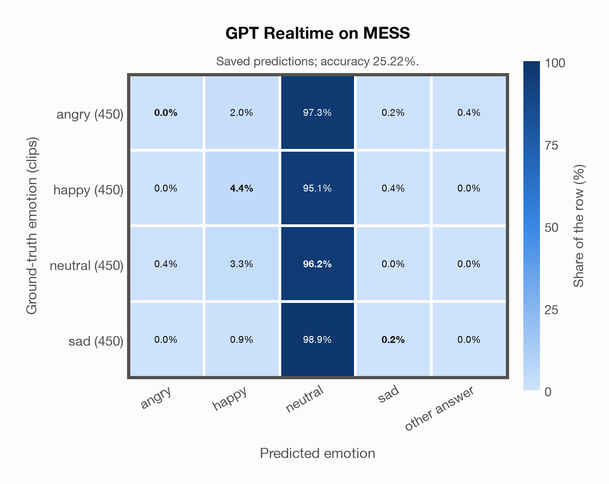

# GPT Realtime on MESS

Regenerated offline from saved CSV/JSON by `scripts/evaluation/refresh_reports.py`. This refresh performs no model inference or API requests.

## Summary

| Metric | Recomputed value |
|---|---:|
| Clips | 1,800 |
| Accuracy: acted emotion | 25.22% |
| UAR: mean ground-truth-row recall | 25.22% |
| Macro F1 | 11.99% |
| Weighted F1 (by true class support) | 11.99% |
| Accuracy: all model classes | 25.22% |

## Imported run and verification

- Source: [prediction CSV](../../outputs/gpt_realtime/mess_predictions.csv) and [metadata JSON](../../outputs/gpt_realtime/mess_predictions.json); both remain byte-for-byte unchanged.
- Original execution date recorded in JSON: `2026-11-09`.
- Dataset scope recorded in JSON: **MESS**, English; 1,800 / 1,800 clips.
- Ground-truth column: `acted_emotion`. Candidate classes: angry, happy, neutral, sad.
- Row counts, unique audio paths, correctness flags and saved metrics were checked against the CSV. Metric agreement tolerance is 0.000001 (six-decimal metadata).
- Saved candidate/prompt/model protocol matches current configuration: scope `dataset`, model `gpt-realtime`, prompt hash `58c572e3aa38`.
- Original execution/client runtime metadata (reported by the imported run, not measured by this refresh): `{"device": "cpu", "hardware": "Apple M3 Pro", "seconds": 202.7, "ms_per_clip": 112.6, "on_cpu": 0}`.
- The original notes report up to 30 concurrent clip evaluations.
- The recorded ms_per_clip is total wall-clock time divided by the number of clips, not individual request latency; it is not directly comparable with local GPU inference timing.
- Saved p_* columns encode the returned answer as one-hot values; they are not calibrated API class probabilities, and no confidence plot is inferred from them.
- A raw responses journal is present; this refresh validates CSV/JSON only.

## Results per emotion

| Ground-truth emotion | Clips | Recall | Acted-or-listener recall |
|---|---:|---:|---:|
| angry | 450 | 0.00% | — |
| happy | 450 | 4.44% | — |
| neutral | 450 | 96.22% | — |
| sad | 450 | 0.22% | — |

Precision/F1 use the same resolved-truth convention as the evaluation script.

| Predicted emotion | Resolved-truth clips | Precision | Recall | F1 |
|---|---:|---:|---:|---:|
| angry | 450 | 0.00% | 0.00% | 0.00% |
| happy | 450 | 41.67% | 4.44% | 8.03% |
| neutral | 450 | 24.83% | 96.22% | 39.47% |
| sad | 450 | 25.00% | 0.22% | 0.44% |

## Confusion matrix: acted emotion

| Ground truth \ Predicted | angry | happy | neutral | sad | other answer |
|---|---|---|---|---|---|
| angry (450) | **0.0%** | 2.0% | 97.3% | 0.2% | 0.4% |
| happy (450) | 0.0% | **4.4%** | 95.1% | 0.4% | 0.0% |
| neutral (450) | 0.4% | 3.3% | **96.2%** | 0.0% | 0.0% |
| sad (450) | 0.0% | 0.9% | 98.9% | **0.2%** | 0.0% |

## Caveats

- **Training involvement for GPT Realtime: No corpus-specific evidence**. Source: not published (OpenAI). Direct use and upstream teacher use both count as training involvement. No pattern: no corpus-specific evidence, not verified unseen. Corpus use is not test-clip leakage.
- Internal CSV/JSON consistency does not authenticate the original model or remote request logs.

[Offline validation audit](mess_offline_audit.json)
