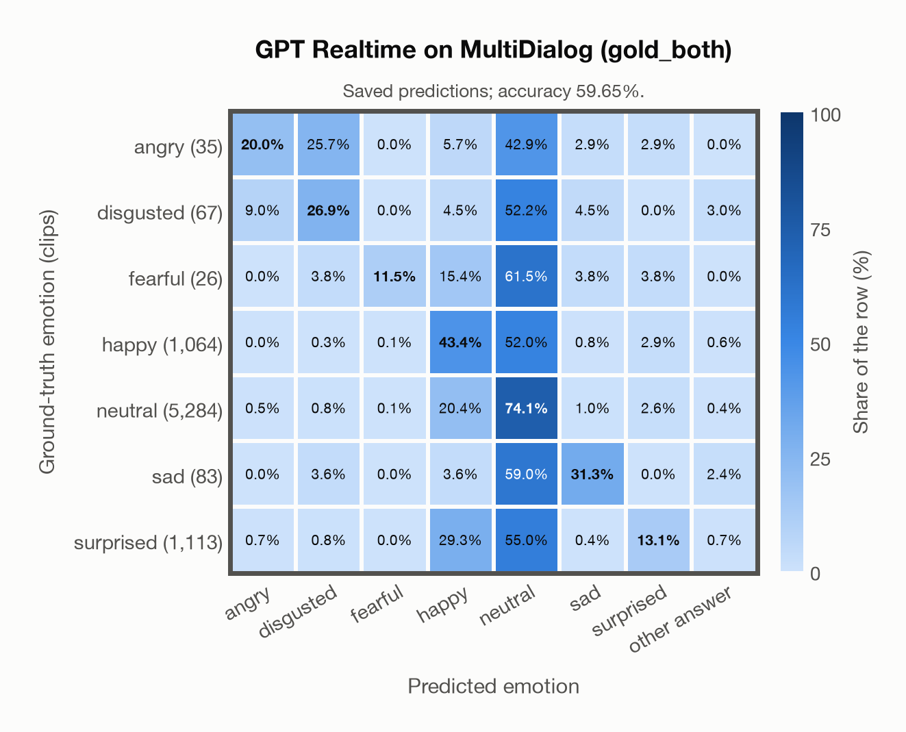

# GPT Realtime on MultiDialog (gold_both)

Regenerated offline from saved CSV/JSON by `scripts/evaluation/refresh_reports.py`. This refresh performs no model inference or API requests.

## Summary

| Metric | Recomputed value |
|---|---:|
| Clips | 7,672 |
| Accuracy: acted emotion | 59.65% |
| UAR: mean ground-truth-row recall | 31.48% |
| Macro F1 | 30.48% |
| Accuracy: all model classes | 59.65% |

## Imported run and verification

- Source: [prediction CSV](../../outputs/gpt_realtime/multidialog_predictions.csv) and [metadata JSON](../../outputs/gpt_realtime/multidialog_predictions.json); both remain byte-for-byte unchanged.
- Original execution date recorded in JSON: `2026-11-10`.
- Dataset scope recorded in JSON: **MultiDialog (gold_both)**, English; 7,672 / 7,672 clips.
- Ground-truth column: `acted_emotion`. Candidate classes: angry, disgusted, fearful, happy, neutral, sad, surprised.
- Row counts, unique audio paths, correctness flags and saved metrics were checked against the CSV. Metric agreement tolerance is 0.000001 (six-decimal metadata).
- Saved candidate/prompt/model protocol matches current configuration: scope `dataset`, model `gpt-realtime`, prompt hash `dc84c979c561`.
- Original execution/client runtime metadata (reported by the imported run, not measured by this refresh): `{"device": "cpu", "hardware": "Apple M3 Pro", "seconds": 1.5, "ms_per_clip": 0.2, "on_cpu": 0}`.
- The original notes report up to 30 concurrent clip evaluations.
- The recorded ms_per_clip is total wall-clock time divided by the number of clips, not individual request latency; it is not directly comparable with local GPU inference timing.
- Saved p_* columns encode the returned answer as one-hot values; they are not calibrated API class probabilities, and no confidence plot is inferred from them.
- A raw responses journal is present; this refresh validates CSV/JSON only.

## Results per emotion

| Ground-truth emotion | Clips | Recall | Acted-or-listener recall |
|---|---:|---:|---:|
| angry | 35 | 20.00% | — |
| disgusted | 67 | 26.87% | — |
| fearful | 26 | 11.54% | — |
| happy | 1,064 | 43.42% | — |
| neutral | 5,284 | 74.07% | — |
| sad | 83 | 31.33% | — |
| surprised | 1,113 | 13.12% | — |

Precision/F1 use the same resolved-truth convention as the evaluation script.

| Predicted emotion | Resolved-truth clips | Precision | Recall | F1 |
|---|---:|---:|---:|---:|
| angry | 35 | 14.00% | 20.00% | 16.47% |
| disgusted | 67 | 20.69% | 26.87% | 23.38% |
| fearful | 26 | 37.50% | 11.54% | 17.65% |
| happy | 1,064 | 24.57% | 43.42% | 31.39% |
| neutral | 5,284 | 75.36% | 74.07% | 74.71% |
| sad | 83 | 27.66% | 31.33% | 29.38% |
| surprised | 1,113 | 45.91% | 13.12% | 20.41% |

## Confusion matrix: acted emotion

| Ground truth \ Predicted | angry | disgusted | fearful | happy | neutral | sad | surprised | other answer |
|---|---|---|---|---|---|---|---|---|
| angry (35) | **20.0%** | 25.7% | 0.0% | 5.7% | 42.9% | 2.9% | 2.9% | 0.0% |
| disgusted (67) | 9.0% | **26.9%** | 0.0% | 4.5% | 52.2% | 4.5% | 0.0% | 3.0% |
| fearful (26) | 0.0% | 3.8% | **11.5%** | 15.4% | 61.5% | 3.8% | 3.8% | 0.0% |
| happy (1,064) | 0.0% | 0.3% | 0.1% | **43.4%** | 52.0% | 0.8% | 2.9% | 0.6% |
| neutral (5,284) | 0.5% | 0.8% | 0.1% | 20.4% | **74.1%** | 1.0% | 2.6% | 0.4% |
| sad (83) | 0.0% | 3.6% | 0.0% | 3.6% | 59.0% | **31.3%** | 0.0% | 2.4% |
| surprised (1,113) | 0.7% | 0.8% | 0.0% | 29.3% | 55.0% | 0.4% | **13.1%** | 0.7% |

## Caveats

- **Training involvement for GPT Realtime: No corpus-specific evidence**. Source: not published (OpenAI). Direct use and upstream teacher use both count as training involvement. No pattern: no corpus-specific evidence, not verified unseen. Corpus use is not test-clip leakage.
- Internal CSV/JSON consistency does not authenticate the original model or remote request logs.

[Offline validation audit](multidialog_offline_audit.json)
