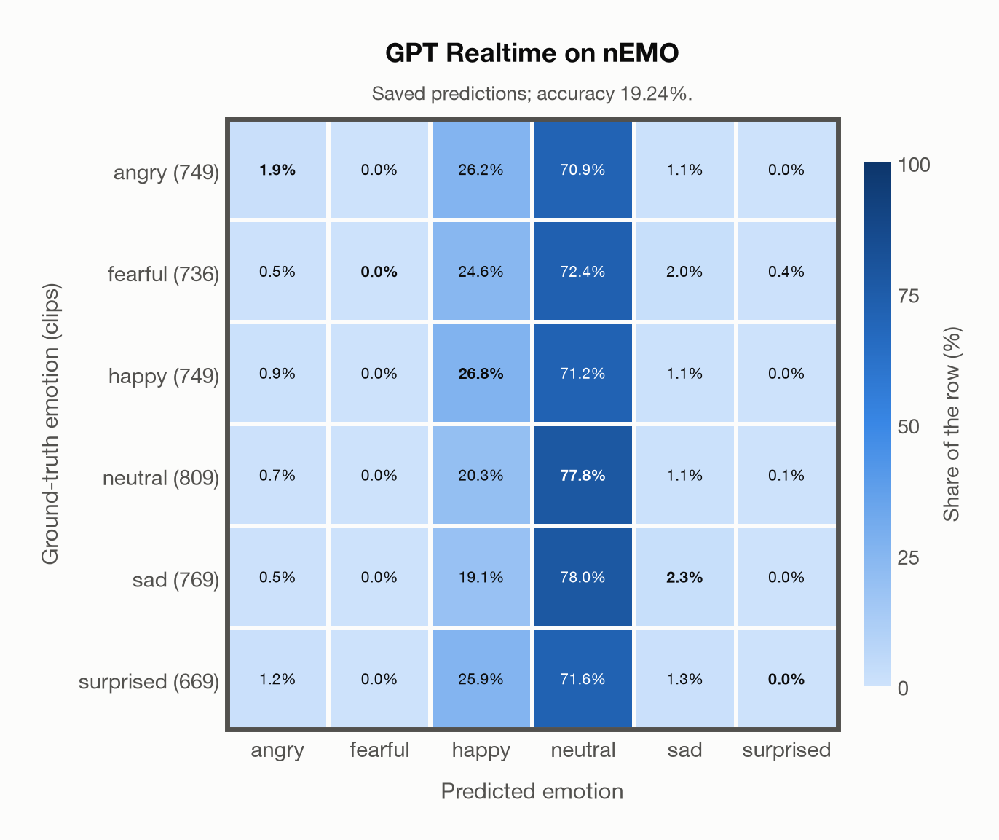

# GPT Realtime on nEMO

Regenerated offline from saved CSV/JSON by `scripts/evaluation/refresh_reports.py`. This refresh performs no model inference or API requests.

## Summary

| Metric | Recomputed value |
|---|---:|
| Clips | 4,481 |
| Accuracy: acted emotion | 19.24% |
| UAR: mean ground-truth-row recall | 18.13% |
| Macro F1 | 10.10% |
| Weighted F1 (by true class support) | 10.56% |
| Accuracy: all model classes | 19.24% |

## Imported run and verification

- Source: [prediction CSV](../../outputs/gpt_realtime/nemo_predictions.csv) and [metadata JSON](../../outputs/gpt_realtime/nemo_predictions.json); both remain byte-for-byte unchanged.
- Original execution date recorded in JSON: `2026-11-09`.
- Dataset scope recorded in JSON: **nEMO**, Polish; 4,481 / 4,481 clips.
- Ground-truth column: `acted_emotion`. Candidate classes: angry, fearful, happy, neutral, sad, surprised.
- Row counts, unique audio paths, correctness flags and saved metrics were checked against the CSV. Metric agreement tolerance is 0.000001 (six-decimal metadata).
- Saved candidate/prompt/model protocol matches current configuration: scope `dataset`, model `gpt-realtime`, prompt hash `f9ee39cb12fd`.
- Original execution/client runtime metadata (reported by the imported run, not measured by this refresh): `{"device": "cpu", "hardware": "Apple M3 Pro", "seconds": 501.4, "ms_per_clip": 111.9, "on_cpu": 0}`.
- The original notes report up to 30 concurrent clip evaluations.
- The recorded ms_per_clip is total wall-clock time divided by the number of clips, not individual request latency; it is not directly comparable with local GPU inference timing.
- Saved p_* columns encode the returned answer as one-hot values; they are not calibrated API class probabilities, and no confidence plot is inferred from them.
- A raw responses journal is present; this refresh validates CSV/JSON only.

## Results per emotion

| Ground-truth emotion | Clips | Recall | Acted-or-listener recall |
|---|---:|---:|---:|
| angry | 749 | 1.87% | — |
| fearful | 736 | 0.00% | — |
| happy | 749 | 26.84% | — |
| neutral | 809 | 77.75% | — |
| sad | 769 | 2.34% | — |
| surprised | 669 | 0.00% | — |

Precision/F1 use the same resolved-truth convention as the evaluation script.

| Predicted emotion | Resolved-truth clips | Precision | Recall | F1 |
|---|---:|---:|---:|---:|
| angry | 749 | 32.56% | 1.87% | 3.54% |
| fearful | 736 | 0.00% | 0.00% | 0.00% |
| happy | 749 | 18.93% | 26.84% | 22.20% |
| neutral | 809 | 19.03% | 77.75% | 30.58% |
| sad | 769 | 26.87% | 2.34% | 4.31% |
| surprised | 669 | 0.00% | 0.00% | 0.00% |

## Confusion matrix: acted emotion

| Ground truth \ Predicted | angry | fearful | happy | neutral | sad | surprised |
|---|---|---|---|---|---|---|
| angry (749) | **1.9%** | 0.0% | 26.2% | 70.9% | 1.1% | 0.0% |
| fearful (736) | 0.5% | **0.0%** | 24.6% | 72.4% | 2.0% | 0.4% |
| happy (749) | 0.9% | 0.0% | **26.8%** | 71.2% | 1.1% | 0.0% |
| neutral (809) | 0.7% | 0.0% | 20.3% | **77.8%** | 1.1% | 0.1% |
| sad (769) | 0.5% | 0.0% | 19.1% | 78.0% | **2.3%** | 0.0% |
| surprised (669) | 1.2% | 0.0% | 25.9% | 71.6% | 1.3% | **0.0%** |

## Caveats

- **Training involvement for GPT Realtime: No corpus-specific evidence**. Source: not published (OpenAI). Direct use and upstream teacher use both count as training involvement. No pattern: no corpus-specific evidence, not verified unseen. Corpus use is not test-clip leakage.
- Internal CSV/JSON consistency does not authenticate the original model or remote request logs.

[Offline validation audit](nemo_offline_audit.json)
