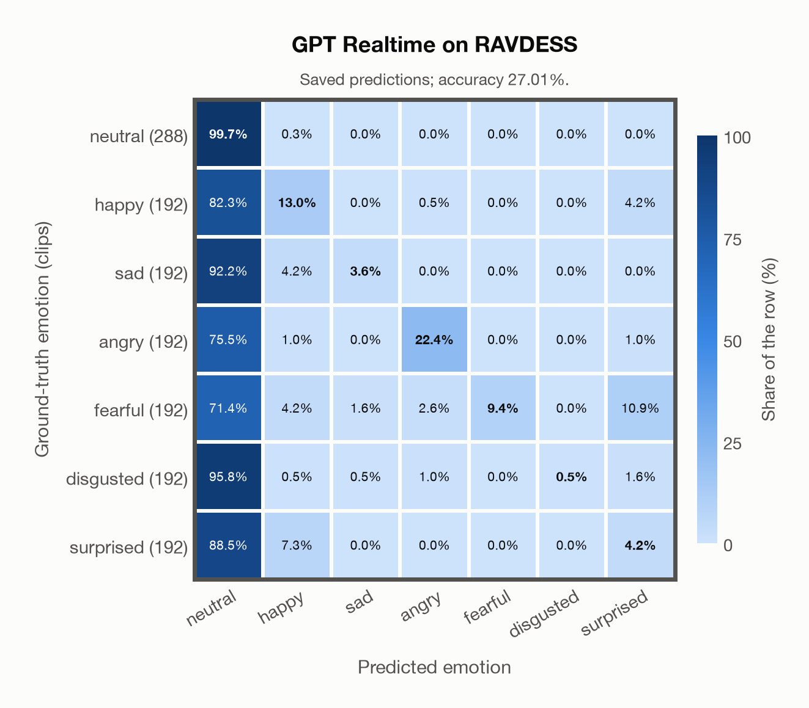

# GPT Realtime on RAVDESS

Regenerated offline from saved CSV/JSON by `scripts/evaluation/refresh_reports.py`. This refresh performs no model inference or API requests.

## Summary

| Metric | Recomputed value |
|---|---:|
| Clips | 1,440 |
| Accuracy: acted emotion | 27.01% |
| UAR: mean ground-truth-row recall | 21.83% |
| Macro F1 | 17.76% |
| Weighted F1 (by true class support) | 19.06% |
| Accuracy: all model classes | 27.01% |

## Imported run and verification

- Source: [prediction CSV](../../outputs/gpt_realtime/ravdess_predictions.csv) and [metadata JSON](../../outputs/gpt_realtime/ravdess_predictions.json); both remain byte-for-byte unchanged.
- Original execution date recorded in JSON: `2026-11-09`.
- Dataset scope recorded in JSON: **RAVDESS**, English; 1,440 / 1,440 clips.
- Ground-truth column: `acted_emotion`. Candidate classes: neutral, happy, sad, angry, fearful, disgusted, surprised.
- Row counts, unique audio paths, correctness flags and saved metrics were checked against the CSV. Metric agreement tolerance is 0.000001 (six-decimal metadata).
- Saved candidate/prompt/model protocol matches current configuration: scope `dataset`, model `gpt-realtime`, prompt hash `dc84c979c561`.
- Original execution/client runtime metadata (reported by the imported run, not measured by this refresh): `{"device": "cpu", "hardware": "Apple M3 Pro", "seconds": 176.3, "ms_per_clip": 122.5, "on_cpu": 0}`.
- The original notes report up to 30 concurrent clip evaluations.
- The recorded ms_per_clip is total wall-clock time divided by the number of clips, not individual request latency; it is not directly comparable with local GPU inference timing.
- Saved p_* columns encode the returned answer as one-hot values; they are not calibrated API class probabilities, and no confidence plot is inferred from them.
- A raw responses journal is present; this refresh validates CSV/JSON only.

## Results per emotion

| Ground-truth emotion | Clips | Recall | Acted-or-listener recall |
|---|---:|---:|---:|
| neutral | 288 | 99.65% | — |
| happy | 192 | 13.02% | — |
| sad | 192 | 3.65% | — |
| angry | 192 | 22.40% | — |
| fearful | 192 | 9.38% | — |
| disgusted | 192 | 0.52% | — |
| surprised | 192 | 4.17% | — |

Precision/F1 use the same resolved-truth convention as the evaluation script.

| Predicted emotion | Resolved-truth clips | Precision | Recall | F1 |
|---|---:|---:|---:|---:|
| neutral | 288 | 22.81% | 99.65% | 37.13% |
| happy | 192 | 42.37% | 13.02% | 19.92% |
| sad | 192 | 63.64% | 3.65% | 6.90% |
| angry | 192 | 84.31% | 22.40% | 35.39% |
| fearful | 192 | 100.00% | 9.38% | 17.14% |
| disgusted | 192 | 100.00% | 0.52% | 1.04% |
| surprised | 192 | 19.05% | 4.17% | 6.84% |

## Confusion matrix: acted emotion

| Ground truth \ Predicted | neutral | happy | sad | angry | fearful | disgusted | surprised |
|---|---|---|---|---|---|---|---|
| neutral (288) | **99.7%** | 0.3% | 0.0% | 0.0% | 0.0% | 0.0% | 0.0% |
| happy (192) | 82.3% | **13.0%** | 0.0% | 0.5% | 0.0% | 0.0% | 4.2% |
| sad (192) | 92.2% | 4.2% | **3.6%** | 0.0% | 0.0% | 0.0% | 0.0% |
| angry (192) | 75.5% | 1.0% | 0.0% | **22.4%** | 0.0% | 0.0% | 1.0% |
| fearful (192) | 71.4% | 4.2% | 1.6% | 2.6% | **9.4%** | 0.0% | 10.9% |
| disgusted (192) | 95.8% | 0.5% | 0.5% | 1.0% | 0.0% | **0.5%** | 1.6% |
| surprised (192) | 88.5% | 7.3% | 0.0% | 0.0% | 0.0% | 0.0% | **4.2%** |

## Caveats

- **Training involvement for GPT Realtime: No corpus-specific evidence**. Source: not published (OpenAI). Direct use and upstream teacher use both count as training involvement. No pattern: no corpus-specific evidence, not verified unseen. Corpus use is not test-clip leakage.
- Internal CSV/JSON consistency does not authenticate the original model or remote request logs.

[Offline validation audit](ravdess_offline_audit.json)
