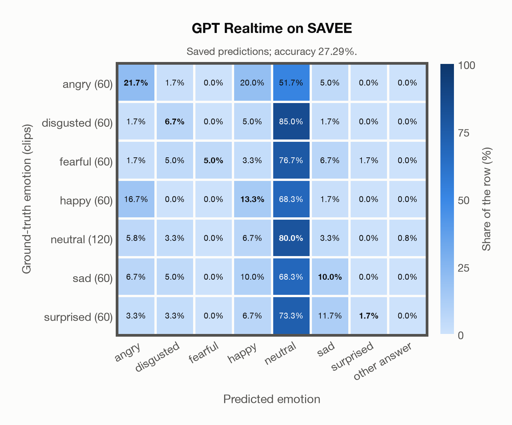

# GPT Realtime on SAVEE

Regenerated offline from saved CSV/JSON by `scripts/evaluation/refresh_reports.py`. This refresh performs no model inference or API requests.

## Summary

| Metric | Recomputed value |
|---|---:|
| Clips | 480 |
| Accuracy: acted emotion | 27.29% |
| UAR: mean ground-truth-row recall | 19.76% |
| Macro F1 | 17.14% |
| Accuracy: all model classes | 27.29% |

## Imported run and verification

- Source: [prediction CSV](../../outputs/gpt_realtime/savee_predictions.csv) and [metadata JSON](../../outputs/gpt_realtime/savee_predictions.json); both remain byte-for-byte unchanged.
- Original execution date recorded in JSON: `2026-11-10`.
- Dataset scope recorded in JSON: **SAVEE**, English (British); 480 / 480 clips.
- Ground-truth column: `acted_emotion`. Candidate classes: angry, disgusted, fearful, happy, neutral, sad, surprised.
- Row counts, unique audio paths, correctness flags and saved metrics were checked against the CSV. Metric agreement tolerance is 0.000001 (six-decimal metadata).
- Saved candidate/prompt/model protocol matches current configuration: scope `dataset`, model `gpt-realtime`, prompt hash `dc84c979c561`.
- Original execution/client runtime metadata (reported by the imported run, not measured by this refresh): `{"device": "cpu", "hardware": "Apple M3 Pro", "seconds": 61.9, "ms_per_clip": 129.1, "on_cpu": 0}`.
- The original notes report up to 30 concurrent clip evaluations.
- The recorded ms_per_clip is total wall-clock time divided by the number of clips, not individual request latency; it is not directly comparable with local GPU inference timing.
- Saved p_* columns encode the returned answer as one-hot values; they are not calibrated API class probabilities, and no confidence plot is inferred from them.
- A raw responses journal is present; this refresh validates CSV/JSON only.

## Results per emotion

| Ground-truth emotion | Clips | Recall | Acted-or-listener recall |
|---|---:|---:|---:|
| angry | 60 | 21.67% | — |
| disgusted | 60 | 6.67% | — |
| fearful | 60 | 5.00% | — |
| happy | 60 | 13.33% | — |
| neutral | 120 | 80.00% | — |
| sad | 60 | 10.00% | — |
| surprised | 60 | 1.67% | — |

Precision/F1 use the same resolved-truth convention as the evaluation script.

| Predicted emotion | Resolved-truth clips | Precision | Recall | F1 |
|---|---:|---:|---:|---:|
| angry | 60 | 34.21% | 21.67% | 26.53% |
| disgusted | 60 | 23.53% | 6.67% | 10.39% |
| fearful | 60 | 100.00% | 5.00% | 9.52% |
| happy | 60 | 18.60% | 13.33% | 15.53% |
| neutral | 120 | 27.43% | 80.00% | 40.85% |
| sad | 60 | 23.08% | 10.00% | 13.95% |
| surprised | 60 | 50.00% | 1.67% | 3.23% |

## Confusion matrix: acted emotion

| Ground truth \ Predicted | angry | disgusted | fearful | happy | neutral | sad | surprised | other answer |
|---|---|---|---|---|---|---|---|---|
| angry (60) | **21.7%** | 1.7% | 0.0% | 20.0% | 51.7% | 5.0% | 0.0% | 0.0% |
| disgusted (60) | 1.7% | **6.7%** | 0.0% | 5.0% | 85.0% | 1.7% | 0.0% | 0.0% |
| fearful (60) | 1.7% | 5.0% | **5.0%** | 3.3% | 76.7% | 6.7% | 1.7% | 0.0% |
| happy (60) | 16.7% | 0.0% | 0.0% | **13.3%** | 68.3% | 1.7% | 0.0% | 0.0% |
| neutral (120) | 5.8% | 3.3% | 0.0% | 6.7% | **80.0%** | 3.3% | 0.0% | 0.8% |
| sad (60) | 6.7% | 5.0% | 0.0% | 10.0% | 68.3% | **10.0%** | 0.0% | 0.0% |
| surprised (60) | 3.3% | 3.3% | 0.0% | 6.7% | 73.3% | 11.7% | **1.7%** | 0.0% |

## Caveats

- **Training involvement for GPT Realtime: No corpus-specific evidence**. Source: not published (OpenAI). Direct use and upstream teacher use both count as training involvement. No pattern: no corpus-specific evidence, not verified unseen. Corpus use is not test-clip leakage.
- Internal CSV/JSON consistency does not authenticate the original model or remote request logs.

[Offline validation audit](savee_offline_audit.json)
