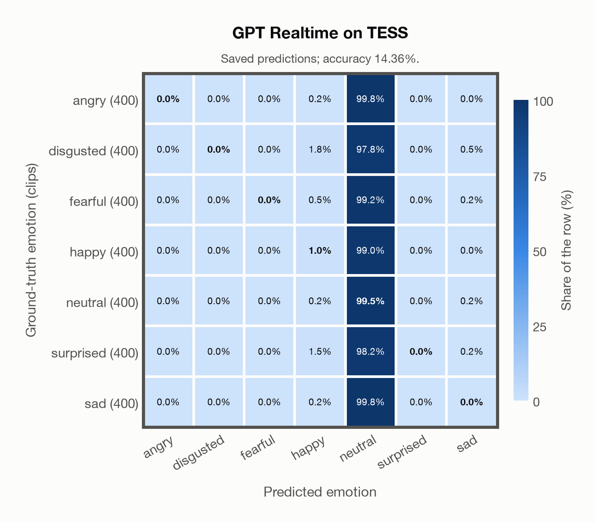

# GPT Realtime on TESS

Regenerated offline from saved CSV/JSON by `scripts/evaluation/refresh_reports.py`. This refresh performs no model inference or API requests.

## Summary

| Metric | Recomputed value |
|---|---:|
| Clips | 2,800 |
| Accuracy: acted emotion | 14.36% |
| UAR: mean ground-truth-row recall | 14.36% |
| Macro F1 | 3.85% |
| Weighted F1 (by true class support) | 3.85% |
| Accuracy: all model classes | 14.36% |

## Imported run and verification

- Source: [prediction CSV](../../outputs/gpt_realtime/tess_predictions.csv) and [metadata JSON](../../outputs/gpt_realtime/tess_predictions.json); both remain byte-for-byte unchanged.
- Original execution date recorded in JSON: `2026-11-09`.
- Dataset scope recorded in JSON: **TESS**, English; 2,800 / 2,800 clips.
- Ground-truth column: `acted_emotion`. Candidate classes: angry, disgusted, fearful, happy, neutral, surprised, sad.
- Row counts, unique audio paths, correctness flags and saved metrics were checked against the CSV. Metric agreement tolerance is 0.000001 (six-decimal metadata).
- Saved candidate/prompt/model protocol matches current configuration: scope `dataset`, model `gpt-realtime`, prompt hash `dc84c979c561`.
- Original execution/client runtime metadata (reported by the imported run, not measured by this refresh): `{"device": "cpu", "hardware": "Apple M3 Pro", "seconds": 307.0, "ms_per_clip": 109.6, "on_cpu": 0}`.
- The original notes report up to 30 concurrent clip evaluations.
- The recorded ms_per_clip is total wall-clock time divided by the number of clips, not individual request latency; it is not directly comparable with local GPU inference timing.
- Saved p_* columns encode the returned answer as one-hot values; they are not calibrated API class probabilities, and no confidence plot is inferred from them.
- A raw responses journal is present; this refresh validates CSV/JSON only.

## Results per emotion

| Ground-truth emotion | Clips | Recall | Acted-or-listener recall |
|---|---:|---:|---:|
| angry | 400 | 0.00% | — |
| disgusted | 400 | 0.00% | — |
| fearful | 400 | 0.00% | — |
| happy | 400 | 1.00% | — |
| neutral | 400 | 99.50% | — |
| surprised | 400 | 0.00% | — |
| sad | 400 | 0.00% | — |

Precision/F1 use the same resolved-truth convention as the evaluation script.

| Predicted emotion | Resolved-truth clips | Precision | Recall | F1 |
|---|---:|---:|---:|---:|
| angry | 400 | 0.00% | 0.00% | 0.00% |
| disgusted | 400 | 0.00% | 0.00% | 0.00% |
| fearful | 400 | 0.00% | 0.00% | 0.00% |
| happy | 400 | 18.18% | 1.00% | 1.90% |
| neutral | 400 | 14.35% | 99.50% | 25.09% |
| surprised | 400 | 0.00% | 0.00% | 0.00% |
| sad | 400 | 0.00% | 0.00% | 0.00% |

## Confusion matrix: acted emotion

| Ground truth \ Predicted | angry | disgusted | fearful | happy | neutral | surprised | sad |
|---|---|---|---|---|---|---|---|
| angry (400) | **0.0%** | 0.0% | 0.0% | 0.2% | 99.8% | 0.0% | 0.0% |
| disgusted (400) | 0.0% | **0.0%** | 0.0% | 1.8% | 97.8% | 0.0% | 0.5% |
| fearful (400) | 0.0% | 0.0% | **0.0%** | 0.5% | 99.2% | 0.0% | 0.2% |
| happy (400) | 0.0% | 0.0% | 0.0% | **1.0%** | 99.0% | 0.0% | 0.0% |
| neutral (400) | 0.0% | 0.0% | 0.0% | 0.2% | **99.5%** | 0.0% | 0.2% |
| surprised (400) | 0.0% | 0.0% | 0.0% | 1.5% | 98.2% | **0.0%** | 0.2% |
| sad (400) | 0.0% | 0.0% | 0.0% | 0.2% | 99.8% | 0.0% | **0.0%** |

## Caveats

- **Training involvement for GPT Realtime: No corpus-specific evidence**. Source: not published (OpenAI). Direct use and upstream teacher use both count as training involvement. No pattern: no corpus-specific evidence, not verified unseen. Corpus use is not test-clip leakage.
- Internal CSV/JSON consistency does not authenticate the original model or remote request logs.

[Offline validation audit](tess_offline_audit.json)
