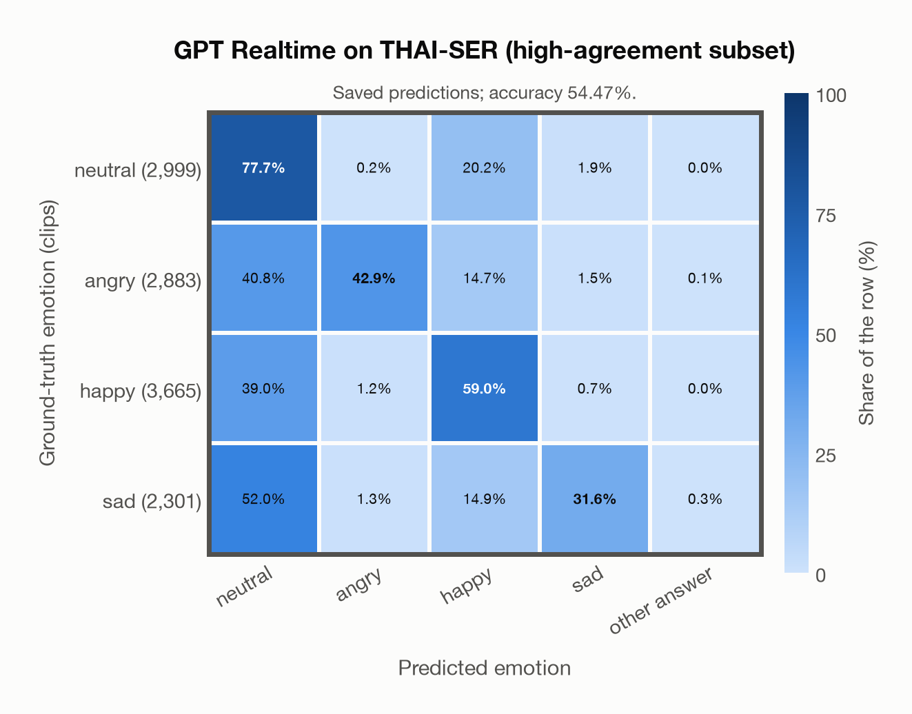
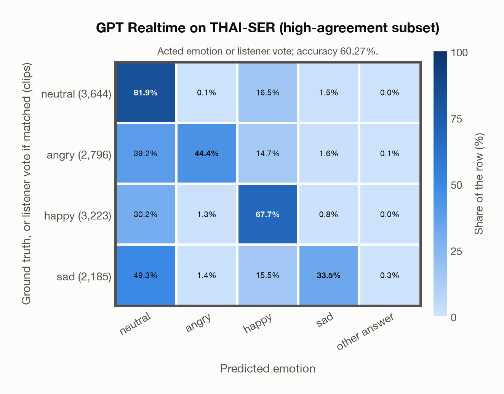

# GPT Realtime on THAI-SER (high-agreement subset)

Regenerated offline from saved CSV/JSON by `scripts/evaluation/refresh_reports.py`. This refresh performs no model inference or API requests.

## Summary

| Metric | Recomputed value |
|---|---:|
| Clips | 11,848 |
| Accuracy: acted emotion | 54.47% |
| UAR: mean ground-truth-row recall | 52.78% |
| Macro F1 | 54.00% |
| Accuracy: all model classes | 54.47% |
| Accuracy: acted emotion or listener vote | 60.27% |
| Single listener vote vs acted emotion | 77.23% |
| Model vs single listener vote | 54.30% |

## Imported run and verification

- Source: [prediction CSV](../../outputs/gpt_realtime/thai_ser_predictions.csv) and [metadata JSON](../../outputs/gpt_realtime/thai_ser_predictions.json); both remain byte-for-byte unchanged.
- Original execution date recorded in JSON: `2026-11-09`.
- Dataset scope recorded in JSON: **THAI-SER (high-agreement subset)**, Thai; 11,848 / 11,848 clips.
- Ground-truth column: `acted_emotion`. Candidate classes: neutral, angry, happy, sad.
- Row counts, unique audio paths, correctness flags and saved metrics were checked against the CSV. Metric agreement tolerance is 0.000001 (six-decimal metadata).
- Saved candidate/prompt/model protocol matches current configuration: scope `dataset`, model `gpt-realtime`, prompt hash `58c572e3aa38`.
- Original execution/client runtime metadata (reported by the imported run, not measured by this refresh): `{"device": "cpu", "hardware": "Apple M3 Pro", "seconds": 1542.6, "ms_per_clip": 130.2, "on_cpu": 0}`.
- The original notes report up to 30 concurrent clip evaluations.
- The recorded ms_per_clip is total wall-clock time divided by the number of clips, not individual request latency; it is not directly comparable with local GPU inference timing.
- Saved p_* columns encode the returned answer as one-hot values; they are not calibrated API class probabilities, and no confidence plot is inferred from them.
- A raw responses journal is present; this refresh validates CSV/JSON only.

## Results per emotion

| Ground-truth emotion | Clips | Recall | Acted-or-listener recall |
|---|---:|---:|---:|
| neutral | 2,999 | 77.66% | 77.99% |
| angry | 2,883 | 42.87% | 46.06% |
| happy | 3,665 | 58.99% | 71.62% |
| sad | 2,301 | 31.59% | 36.90% |

Precision/F1 use the same resolved-truth convention as the evaluation script.

| Predicted emotion | Resolved-truth clips | Precision | Recall | F1 |
|---|---:|---:|---:|---:|
| neutral | 2,999 | 37.99% | 77.66% | 51.02% |
| angry | 2,883 | 93.85% | 42.87% | 58.86% |
| happy | 3,665 | 61.16% | 58.99% | 60.06% |
| sad | 2,301 | 84.93% | 31.59% | 46.06% |

## Confusion matrix: acted emotion

| Ground truth \ Predicted | neutral | angry | happy | sad | other answer |
|---|---|---|---|---|---|
| neutral (2,999) | **77.7%** | 0.2% | 20.2% | 1.9% | 0.0% |
| angry (2,883) | 40.8% | **42.9%** | 14.7% | 1.5% | 0.1% |
| happy (3,665) | 39.0% | 1.2% | **59.0%** | 0.7% | 0.0% |
| sad (2,301) | 52.0% | 1.3% | 14.9% | **31.6%** | 0.3% |

## Confusion matrix: acted emotion or listener vote

A prediction accepted only through the listener vote is placed in that predicted emotion's row; other clips keep their original ground-truth row. Row supports can therefore change.

| Ground truth \ Predicted | neutral | angry | happy | sad | other answer |
|---|---|---|---|---|---|
| neutral (3,644) | **81.9%** | 0.1% | 16.5% | 1.5% | 0.0% |
| angry (2,796) | 39.2% | **44.4%** | 14.7% | 1.6% | 0.1% |
| happy (3,223) | 30.2% | 1.3% | **67.7%** | 0.8% | 0.0% |
| sad (2,185) | 49.3% | 1.4% | 15.5% | **33.5%** | 0.3% |

## Caveats

- **Training involvement for GPT Realtime: No corpus-specific evidence**. Source: not published (OpenAI). Direct use and upstream teacher use both count as training involvement. No pattern: no corpus-specific evidence, not verified unseen. Corpus use is not test-clip leakage.
- Internal CSV/JSON consistency does not authenticate the original model or remote request logs.

[Offline validation audit](thai_ser_offline_audit.json)
