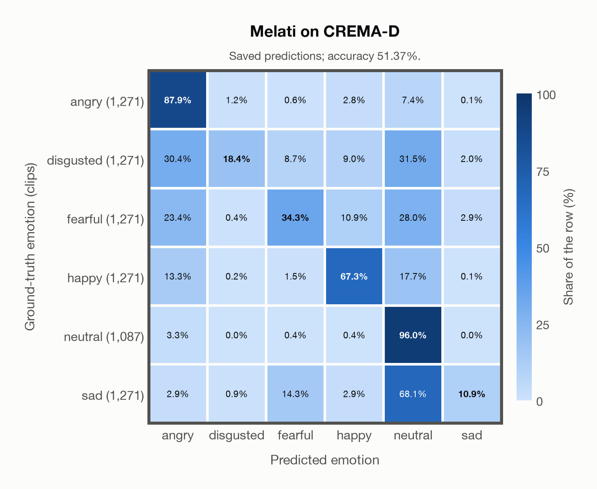
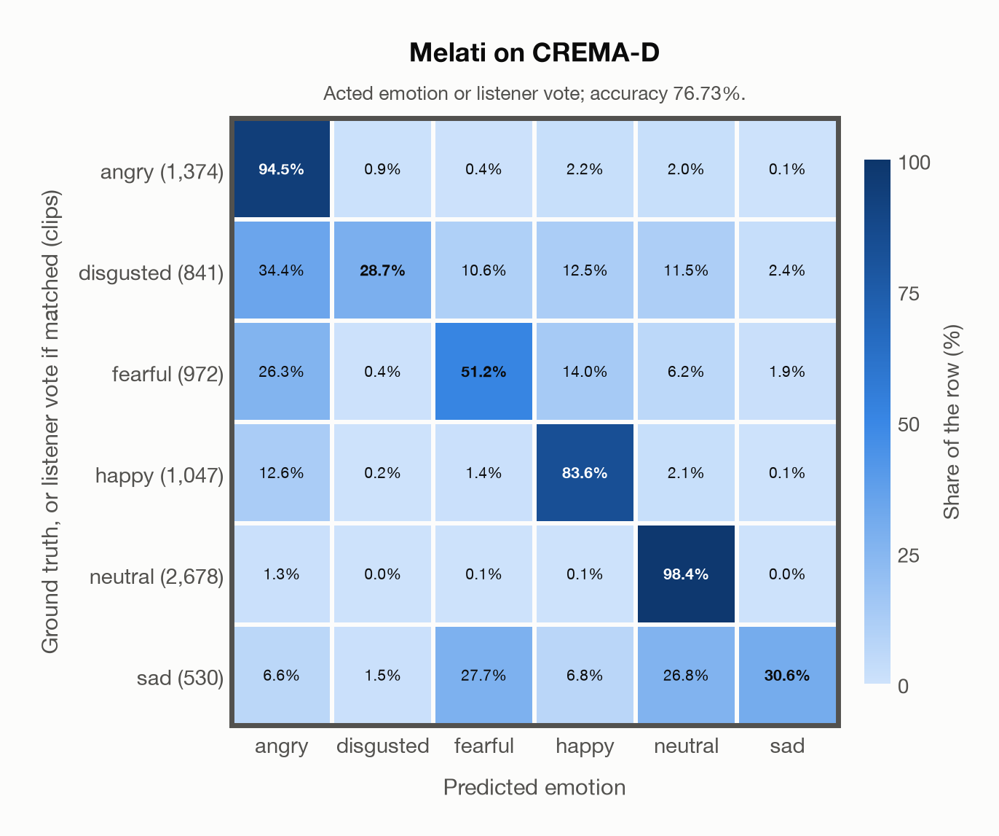

# Melati on CREMA-D

Regenerated offline from saved CSV/JSON by `scripts/evaluation/refresh_reports.py`. This refresh performs no model inference or API requests.

## Summary

| Metric | Recomputed value |
|---|---:|
| Clips | 7,442 |
| Accuracy: acted emotion | 51.37% |
| UAR: mean ground-truth-row recall | 52.45% |
| Macro F1 | 46.73% |
| Weighted F1: true-support weighted | 46.61% |
| Accuracy: all model classes | 51.30% |
| Accuracy: acted emotion or listener vote | 76.73% |
| Single listener vote vs acted emotion | 45.59% |
| Model vs single listener vote | 59.69% |

## Imported run and verification

- Source: [prediction CSV](../../outputs/melati_emotion/crema_d_predictions.csv) and [metadata JSON](../../outputs/melati_emotion/crema_d_predictions.json); both remain byte-for-byte unchanged.
- Original execution date recorded in JSON: `2026-10-29`.
- Dataset scope recorded in JSON: **CREMA-D**, English; 7,442 / 7,442 clips.
- Ground-truth column: `acted_emotion`. Candidate classes: angry, disgusted, fearful, happy, neutral, sad.
- Row counts, unique audio paths, correctness flags and saved metrics were checked against the CSV. Metric agreement tolerance is 0.000001 (six-decimal metadata).
- Weighted F1 weights each class's F1 by its true support, using the same resolved truth as macro F1; invalid answers remain errors. New metrics absent from the source JSON are recorded in the offline audit and summaries; the source JSON is preserved.
- Original execution/client runtime metadata (reported by the imported run, not measured by this refresh): `{"device": "mps", "hardware": "Apple M4 Max", "seconds": 2739.7, "ms_per_clip": 368.1, "on_cpu": 0}`.

## Results per emotion

| Ground-truth emotion | Clips | Recall | Acted-or-listener recall |
|---|---:|---:|---:|
| angry | 1,271 | 87.88% | 94.02% |
| disgusted | 1,271 | 18.41% | 52.79% |
| fearful | 1,271 | 34.30% | 62.71% |
| happy | 1,271 | 67.27% | 86.47% |
| neutral | 1,087 | 95.95% | 96.14% |
| sad | 1,271 | 10.86% | 71.05% |

Precision/F1 use the same resolved-truth convention as the evaluation script. Weighted F1 uses the resolved-truth clip counts below as weights.

| Predicted emotion | Resolved-truth clips | Precision | Recall | F1 |
|---|---:|---:|---:|---:|
| angry | 1,271 | 54.65% | 87.88% | 67.39% |
| disgusted | 1,271 | 87.64% | 18.41% | 30.43% |
| fearful | 1,271 | 57.44% | 34.30% | 42.96% |
| happy | 1,271 | 72.09% | 67.27% | 69.60% |
| neutral | 1,087 | 34.95% | 95.95% | 51.24% |
| sad | 1,271 | 68.32% | 10.86% | 18.74% |

## Confusion matrix: acted emotion

| Ground truth \ Predicted | angry | disgusted | fearful | happy | neutral | sad |
|---|---|---|---|---|---|---|
| angry (1,271) | **87.9%** | 1.2% | 0.6% | 2.8% | 7.4% | 0.1% |
| disgusted (1,271) | 30.4% | **18.4%** | 8.7% | 9.0% | 31.5% | 2.0% |
| fearful (1,271) | 23.4% | 0.4% | **34.3%** | 10.9% | 28.0% | 2.9% |
| happy (1,271) | 13.3% | 0.2% | 1.5% | **67.3%** | 17.7% | 0.1% |
| neutral (1,087) | 3.3% | 0.0% | 0.4% | 0.4% | **96.0%** | 0.0% |
| sad (1,271) | 2.9% | 0.9% | 14.3% | 2.9% | 68.1% | **10.9%** |

## Confusion matrix: acted emotion or listener vote

A prediction accepted only through the listener vote is placed in that predicted emotion's row; other clips keep their original ground-truth row. Row supports can therefore change.

| Ground truth \ Predicted | angry | disgusted | fearful | happy | neutral | sad |
|---|---|---|---|---|---|---|
| angry (1,374) | **94.5%** | 0.9% | 0.4% | 2.2% | 2.0% | 0.1% |
| disgusted (841) | 34.4% | **28.7%** | 10.6% | 12.5% | 11.5% | 2.4% |
| fearful (972) | 26.3% | 0.4% | **51.2%** | 14.0% | 6.2% | 1.9% |
| happy (1,047) | 12.6% | 0.2% | 1.4% | **83.6%** | 2.1% | 0.1% |
| neutral (2,678) | 1.3% | 0.0% | 0.1% | 0.1% | **98.4%** | 0.0% |
| sad (530) | 6.6% | 1.5% | 27.7% | 6.8% | 26.8% | **30.6%** |

## Caveats

- **Training involvement for Melati: No corpus-specific evidence**. Source: Public SER head trained on nine named corpora including JL-Corpus and Emozionalmente; Whisper-v3 pretraining incompletely disclosed; author nEMO threshold calibration is counted as seen development use, although its thresholds are not applied here. Direct use and upstream teacher use both count as training involvement. No pattern: no corpus-specific evidence, not verified unseen. Corpus use is not test-clip leakage.
- The known empty CREMA-D recording 1076_MTI_SAD_XX.wav is retained in the saved predictions, matching the existing project evaluation scope.
- Internal CSV/JSON consistency does not authenticate the original model or remote request logs.

[Offline validation audit](crema_d_offline_audit.json)
