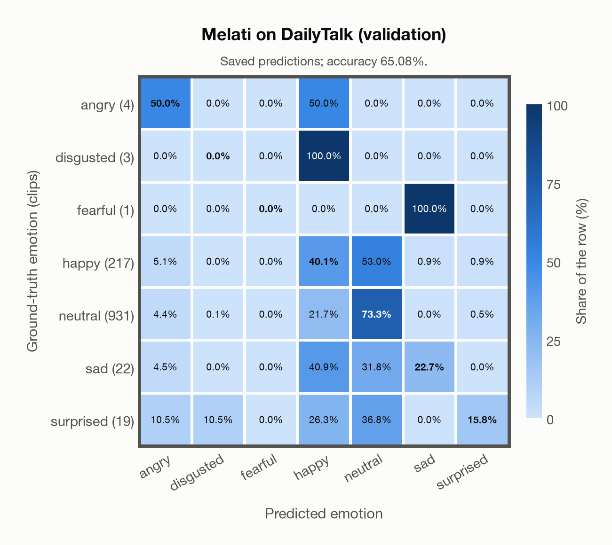

# Melati on DailyTalk (validation)

Regenerated offline from saved CSV/JSON by `scripts/evaluation/refresh_reports.py`. This refresh performs no model inference or API requests.

## Summary

| Metric | Recomputed value |
|---|---:|
| Clips | 1,197 |
| Accuracy: acted emotion | 65.08% |
| UAR: mean ground-truth-row recall | 28.84% |
| Macro F1 | 24.57% |
| Weighted F1: true-support weighted | 67.87% |
| Accuracy: all model classes | 65.08% |

## Imported run and verification

- Source: [prediction CSV](../../outputs/melati_emotion/dailytalk_predictions.csv) and [metadata JSON](../../outputs/melati_emotion/dailytalk_predictions.json); both remain byte-for-byte unchanged.
- Original execution date recorded in JSON: `2026-11-10`.
- Dataset scope recorded in JSON: **DailyTalk (validation)**, English; 1,197 / 1,197 clips.
- Ground-truth column: `acted_emotion`. Candidate classes: angry, disgusted, fearful, happy, neutral, sad, surprised.
- Row counts, unique audio paths, correctness flags and saved metrics were checked against the CSV. Metric agreement tolerance is 0.000001 (six-decimal metadata).
- Weighted F1 weights each class's F1 by its true support, using the same resolved truth as macro F1; invalid answers remain errors. New metrics absent from the source JSON are recorded in the offline audit and summaries; the source JSON is preserved.
- Original execution/client runtime metadata (reported by the imported run, not measured by this refresh): `{"device": "mps", "hardware": "Apple M3 Pro", "seconds": 742.2, "ms_per_clip": 620.1, "on_cpu": 0}`.

## Results per emotion

| Ground-truth emotion | Clips | Recall | Acted-or-listener recall |
|---|---:|---:|---:|
| angry | 4 | 50.00% | — |
| disgusted | 3 | 0.00% | — |
| fearful | 1 | 0.00% | — |
| happy | 217 | 40.09% | — |
| neutral | 931 | 73.25% | — |
| sad | 22 | 22.73% | — |
| surprised | 19 | 15.79% | — |

Precision/F1 use the same resolved-truth convention as the evaluation script. Weighted F1 uses the resolved-truth clip counts below as weights.

| Predicted emotion | Resolved-truth clips | Precision | Recall | F1 |
|---|---:|---:|---:|---:|
| angry | 4 | 3.51% | 50.00% | 6.56% |
| disgusted | 3 | 0.00% | 0.00% | 0.00% |
| fearful | 1 | 0.00% | 0.00% | 0.00% |
| happy | 217 | 28.25% | 40.09% | 33.14% |
| neutral | 931 | 84.09% | 73.25% | 78.30% |
| sad | 22 | 62.50% | 22.73% | 33.33% |
| surprised | 19 | 30.00% | 15.79% | 20.69% |

## Confusion matrix: acted emotion

| Ground truth \ Predicted | angry | disgusted | fearful | happy | neutral | sad | surprised |
|---|---|---|---|---|---|---|---|
| angry (4) | **50.0%** | 0.0% | 0.0% | 50.0% | 0.0% | 0.0% | 0.0% |
| disgusted (3) | 0.0% | **0.0%** | 0.0% | 100.0% | 0.0% | 0.0% | 0.0% |
| fearful (1) | 0.0% | 0.0% | **0.0%** | 0.0% | 0.0% | 100.0% | 0.0% |
| happy (217) | 5.1% | 0.0% | 0.0% | **40.1%** | 53.0% | 0.9% | 0.9% |
| neutral (931) | 4.4% | 0.1% | 0.0% | 21.7% | **73.3%** | 0.0% | 0.5% |
| sad (22) | 4.5% | 0.0% | 0.0% | 40.9% | 31.8% | **22.7%** | 0.0% |
| surprised (19) | 10.5% | 10.5% | 0.0% | 26.3% | 36.8% | 0.0% | **15.8%** |

## Caveats

- **Training involvement for Melati: No corpus-specific evidence**. Source: Public SER head trained on nine named corpora including JL-Corpus and Emozionalmente; Whisper-v3 pretraining incompletely disclosed; author nEMO threshold calibration is counted as seen development use, although its thresholds are not applied here. Direct use and upstream teacher use both count as training involvement. No pattern: no corpus-specific evidence, not verified unseen. Corpus use is not test-clip leakage.
- Internal CSV/JSON consistency does not authenticate the original model or remote request logs.

[Offline validation audit](dailytalk_offline_audit.json)
