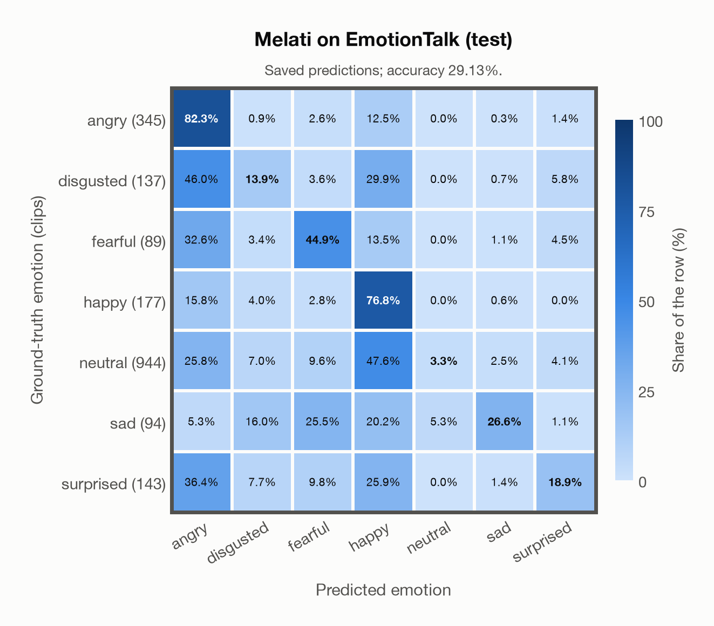

# Melati on EmotionTalk (test)

Regenerated offline from saved CSV/JSON by `scripts/evaluation/refresh_reports.py`. This refresh performs no model inference or API requests.

## Summary

| Metric | Recomputed value |
|---|---:|
| Clips | 1,929 |
| Accuracy: acted emotion | 29.13% |
| UAR: mean ground-truth-row recall | 38.10% |
| Macro F1 | 27.28% |
| Weighted F1: true-support weighted | 21.27% |
| Accuracy: all model classes | 29.13% |

## Imported run and verification

- Source: [prediction CSV](../../outputs/melati_emotion/emotiontalk_predictions.csv) and [metadata JSON](../../outputs/melati_emotion/emotiontalk_predictions.json); both remain byte-for-byte unchanged.
- Original execution date recorded in JSON: `2026-11-10`.
- Dataset scope recorded in JSON: **EmotionTalk (test)**, Mandarin; 1,929 / 1,929 clips.
- Ground-truth column: `acted_emotion`. Candidate classes: angry, disgusted, fearful, happy, neutral, sad, surprised.
- Row counts, unique audio paths, correctness flags and saved metrics were checked against the CSV. Metric agreement tolerance is 0.000001 (six-decimal metadata).
- Weighted F1 weights each class's F1 by its true support, using the same resolved truth as macro F1; invalid answers remain errors. New metrics absent from the source JSON are recorded in the offline audit and summaries; the source JSON is preserved.
- Original execution/client runtime metadata (reported by the imported run, not measured by this refresh): `{"device": "mps", "hardware": "Apple M3 Pro", "seconds": 1148.2, "ms_per_clip": 595.3, "on_cpu": 0}`.

## Results per emotion

| Ground-truth emotion | Clips | Recall | Acted-or-listener recall |
|---|---:|---:|---:|
| angry | 345 | 82.32% | — |
| disgusted | 137 | 13.87% | — |
| fearful | 89 | 44.94% | — |
| happy | 177 | 76.84% | — |
| neutral | 944 | 3.28% | — |
| sad | 94 | 26.60% | — |
| surprised | 143 | 18.88% | — |

Precision/F1 use the same resolved-truth convention as the evaluation script. Weighted F1 uses the resolved-truth clip counts below as weights.

| Predicted emotion | Resolved-truth clips | Precision | Recall | F1 |
|---|---:|---:|---:|---:|
| angry | 345 | 40.28% | 82.32% | 54.10% |
| disgusted | 137 | 15.32% | 13.87% | 14.56% |
| fearful | 89 | 21.28% | 44.94% | 28.88% |
| happy | 177 | 18.45% | 76.84% | 29.76% |
| neutral | 944 | 86.11% | 3.28% | 6.33% |
| sad | 94 | 45.45% | 26.60% | 33.56% |
| surprised | 143 | 32.14% | 18.88% | 23.79% |

## Confusion matrix: acted emotion

| Ground truth \ Predicted | angry | disgusted | fearful | happy | neutral | sad | surprised |
|---|---|---|---|---|---|---|---|
| angry (345) | **82.3%** | 0.9% | 2.6% | 12.5% | 0.0% | 0.3% | 1.4% |
| disgusted (137) | 46.0% | **13.9%** | 3.6% | 29.9% | 0.0% | 0.7% | 5.8% |
| fearful (89) | 32.6% | 3.4% | **44.9%** | 13.5% | 0.0% | 1.1% | 4.5% |
| happy (177) | 15.8% | 4.0% | 2.8% | **76.8%** | 0.0% | 0.6% | 0.0% |
| neutral (944) | 25.8% | 7.0% | 9.6% | 47.6% | **3.3%** | 2.5% | 4.1% |
| sad (94) | 5.3% | 16.0% | 25.5% | 20.2% | 5.3% | **26.6%** | 1.1% |
| surprised (143) | 36.4% | 7.7% | 9.8% | 25.9% | 0.0% | 1.4% | **18.9%** |

## Caveats

- **Training involvement for Melati: No corpus-specific evidence**. Source: Public SER head trained on nine named corpora including JL-Corpus and Emozionalmente; Whisper-v3 pretraining incompletely disclosed; author nEMO threshold calibration is counted as seen development use, although its thresholds are not applied here. Direct use and upstream teacher use both count as training involvement. No pattern: no corpus-specific evidence, not verified unseen. Corpus use is not test-clip leakage.
- Internal CSV/JSON consistency does not authenticate the original model or remote request logs.

[Offline validation audit](emotiontalk_offline_audit.json)
