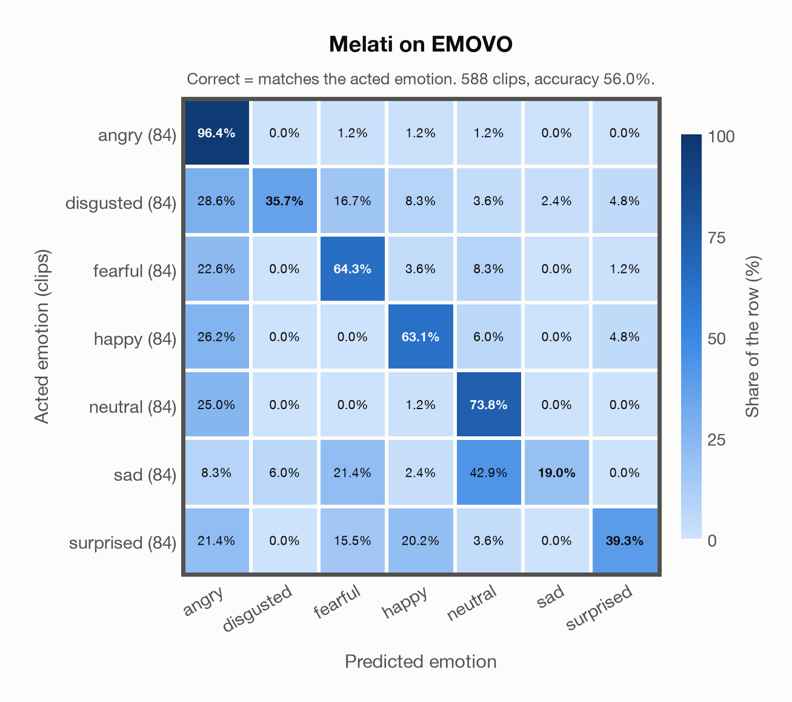

# Melati on EMOVO

Generated by `scripts/evaluation/evaluate.py` on 2026-11-06.

## Summary

| Metric | Value |
|---|---|
| Clips evaluated | 588 (Italian) |
| **Accuracy: prediction matches the acted emotion** | **56.0%** |
| Unweighted accuracy (mean recall of the 7 acted emotions) | 56.0% |
| Macro F1 (acted emotion) | 53.8% |
| Accuracy, all 7 model classes (acted emotion) | 56.0% |
| Chance level (7 emotions) | 14.3% |

## Setup

- **Model**: Melati (`Scicom-intl/Melati-Emotion-Whisper-Large-V3`) as released (no fine-tuning), transformers 5.18.0, loaded by `scripts/models/melati.py`. Each clip (at most 30 s) becomes Whisper-large-v3 log-mel features padded to 30 s; the encoder layers are averaged over the clip's own frames only (50 per second), as in the official melati_emotion.py. Precision: float16 encoder, float32 head. The prediction is the most probable of the raw probabilities. The official thresholds (melati_emotion.py, label()) are not applied: they were set for precise tagging of podcasts, would turn most clips into neutral, and never return disgusted.
- **Data**: 588 clips of EMOVO (Italian) from `data/emovo/`.
- **Ground truth (acted emotion)**: the emotion each actor was asked to portray, from the first part of the file name (`dis`gusto, `gio`ia, `neu`trale, `pau`ra, `rab`bia, `sor`presa, `tri`stezza).
- Label mapping: rabbia = angry, disgusto = disgusted, paura = fearful, gioia = happy, neutrale = neutral, tristezza = sad, sorpresa = surprised.
- 6 professional actors (3 female, 3 male) say the same 14 sentences (some of them nonsense sentences) in each of the 7 emotions: 588 clips.
- **7 emotions**: the prediction is the most probable of the 7 emotions in this dataset (angry, disgusted, fearful, happy, neutral, sad, surprised); the model has no other classes. **All 7 model classes**: the prediction is the most probable of all 7 model classes, so choosing a class that the dataset does not have counts as wrong.
- **Hardware**: Apple M4 Max, device `mps`, PyTorch 2.7.1. Inference took 2.9 min (297 ms per clip).
- **Per-clip predictions**: `outputs/melati_emotion/emovo_predictions.csv` (in git, so the results can be checked clip by clip). The JSON file next to it describes the columns.

## Results per emotion

Rows: acted emotion. Precision, recall and F1 compare the prediction with the acted emotion.

| Emotion | Clips | Precision | Recall | F1 |
|---|---|---|---|---|
| angry | 84 | 42.2% | 96.4% | 58.7% |
| disgusted | 84 | 85.7% | 35.7% | 50.4% |
| fearful | 84 | 54.0% | 64.3% | 58.7% |
| happy | 84 | 63.1% | 63.1% | 63.1% |
| neutral | 84 | 53.0% | 73.8% | 61.7% |
| sad | 84 | 88.9% | 19.0% | 31.4% |
| surprised | 84 | 78.6% | 39.3% | 52.4% |

## Confusion matrix: acted emotion

The same numbers as a table. Rows: acted emotion. Columns: predicted emotion. Each row adds up to 100%.

| Acted \ Predicted | angry | disgusted | fearful | happy | neutral | sad | surprised |
|---|---|---|---|---|---|---|---|
| angry (84) | **96.4%** | 0.0% | 1.2% | 1.2% | 1.2% | 0.0% | 0.0% |
| disgusted (84) | 28.6% | **35.7%** | 16.7% | 8.3% | 3.6% | 2.4% | 4.8% |
| fearful (84) | 22.6% | 0.0% | **64.3%** | 3.6% | 8.3% | 0.0% | 1.2% |
| happy (84) | 26.2% | 0.0% | 0.0% | **63.1%** | 6.0% | 0.0% | 4.8% |
| neutral (84) | 25.0% | 0.0% | 0.0% | 1.2% | **73.8%** | 0.0% | 0.0% |
| sad (84) | 8.3% | 6.0% | 21.4% | 2.4% | 42.9% | **19.0%** | 0.0% |
| surprised (84) | 21.4% | 0.0% | 15.5% | 20.2% | 3.6% | 0.0% | **39.3%** |

Most frequent confusions: sad predicted as neutral (42.9%), disgusted predicted as angry (28.6%), happy predicted as angry (26.2%).

## Caveats

- **Not in Melati's training data** (nine acted corpora, JL-Corpus among them).
- **Unofficial copy.** The official site (voice.fub.it) is gone and there is no official mirror; the files come from a copy on DagsHub (kingabzpro/EMOVO), checked only against the file names and count of the corpus.
- No listeners' labels per clip are published (the authors' listening test covered 2 sentences per actor). Only six speakers. Audio: 48 kHz WAV, stereo except one file (the channels are averaged), resampled to 16 kHz.
