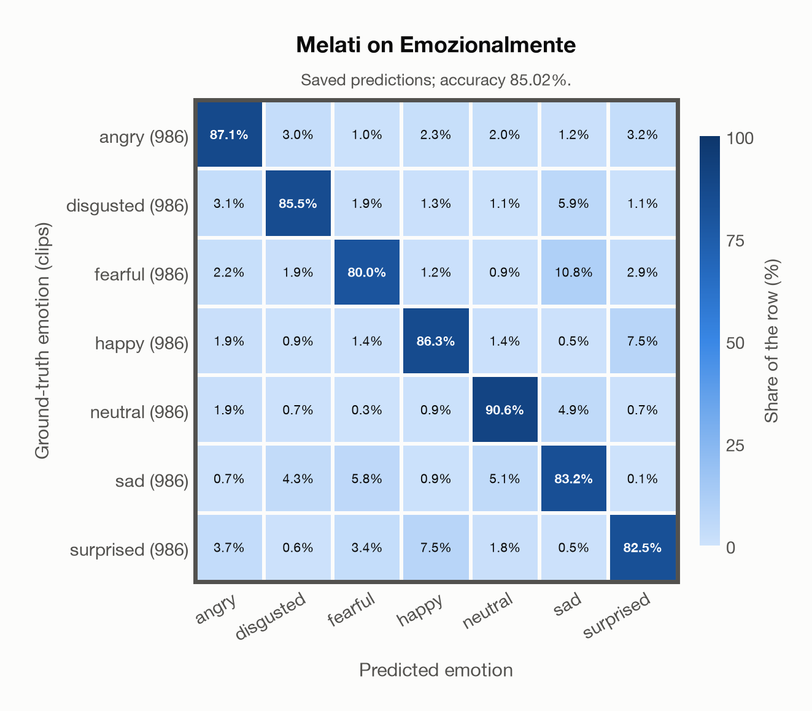
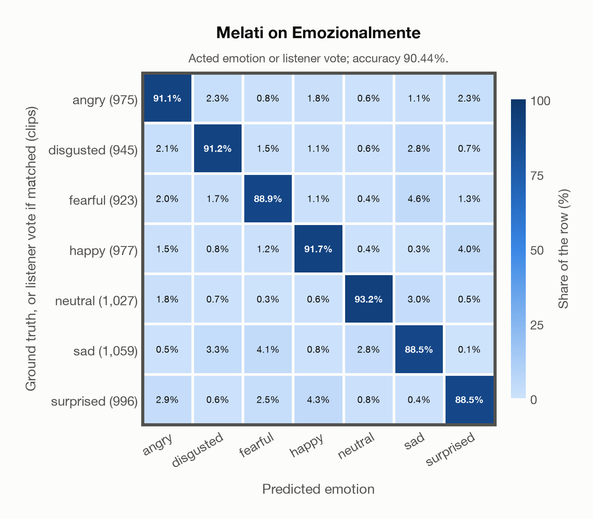

# Melati on Emozionalmente

Regenerated offline from saved CSV/JSON by `scripts/evaluation/refresh_reports.py`. This refresh performs no model inference or API requests.

## Summary

| Metric | Recomputed value |
|---|---:|
| Clips | 6,902 |
| Accuracy: acted emotion | 85.02% |
| UAR: mean ground-truth-row recall | 85.02% |
| Macro F1 | 85.02% |
| Weighted F1: true-support weighted | 85.02% |
| Accuracy: all model classes | 85.02% |
| Accuracy: acted emotion or listener vote | 90.44% |
| Single listener vote vs acted emotion | 81.22% |
| Model vs single listener vote | 78.18% |

## Imported run and verification

- Source: [prediction CSV](../../outputs/melati_emotion/emozionalmente_predictions.csv) and [metadata JSON](../../outputs/melati_emotion/emozionalmente_predictions.json); both remain byte-for-byte unchanged.
- Original execution date recorded in JSON: `2026-11-06`.
- Dataset scope recorded in JSON: **Emozionalmente**, Italian; 6,902 / 6,902 clips.
- Ground-truth column: `acted_emotion`. Candidate classes: angry, disgusted, fearful, happy, neutral, sad, surprised.
- Row counts, unique audio paths, correctness flags and saved metrics were checked against the CSV. Metric agreement tolerance is 0.000001 (six-decimal metadata).
- Weighted F1 weights each class's F1 by its true support, using the same resolved truth as macro F1; invalid answers remain errors. New metrics absent from the source JSON are recorded in the offline audit and summaries; the source JSON is preserved.
- Original execution/client runtime metadata (reported by the imported run, not measured by this refresh): `{"device": "mps", "hardware": "Apple M4 Max", "seconds": 2466.3, "ms_per_clip": 357.3, "on_cpu": 0}`.

## Results per emotion

| Ground-truth emotion | Clips | Recall | Acted-or-listener recall |
|---|---:|---:|---:|
| angry | 986 | 87.12% | 91.18% |
| disgusted | 986 | 85.50% | 91.58% |
| fearful | 986 | 80.02% | 89.66% |
| happy | 986 | 86.31% | 91.78% |
| neutral | 986 | 90.57% | 92.90% |
| sad | 986 | 83.16% | 87.63% |
| surprised | 986 | 82.45% | 88.34% |

Precision/F1 use the same resolved-truth convention as the evaluation script. Weighted F1 uses the resolved-truth clip counts below as weights.

| Predicted emotion | Resolved-truth clips | Precision | Recall | F1 |
|---|---:|---:|---:|---:|
| angry | 986 | 86.51% | 87.12% | 86.81% |
| disgusted | 986 | 88.18% | 85.50% | 86.82% |
| fearful | 986 | 85.21% | 80.02% | 82.53% |
| happy | 986 | 85.87% | 86.31% | 86.09% |
| neutral | 986 | 87.98% | 90.57% | 89.26% |
| sad | 986 | 77.80% | 83.16% | 80.39% |
| surprised | 986 | 84.07% | 82.45% | 83.26% |

## Confusion matrix: acted emotion

| Ground truth \ Predicted | angry | disgusted | fearful | happy | neutral | sad | surprised |
|---|---|---|---|---|---|---|---|
| angry (986) | **87.1%** | 3.0% | 1.0% | 2.3% | 2.0% | 1.2% | 3.2% |
| disgusted (986) | 3.1% | **85.5%** | 1.9% | 1.3% | 1.1% | 5.9% | 1.1% |
| fearful (986) | 2.2% | 1.9% | **80.0%** | 1.2% | 0.9% | 10.8% | 2.9% |
| happy (986) | 1.9% | 0.9% | 1.4% | **86.3%** | 1.4% | 0.5% | 7.5% |
| neutral (986) | 1.9% | 0.7% | 0.3% | 0.9% | **90.6%** | 4.9% | 0.7% |
| sad (986) | 0.7% | 4.3% | 5.8% | 0.9% | 5.1% | **83.2%** | 0.1% |
| surprised (986) | 3.7% | 0.6% | 3.4% | 7.5% | 1.8% | 0.5% | **82.5%** |

## Confusion matrix: acted emotion or listener vote

A prediction accepted only through the listener vote is placed in that predicted emotion's row; other clips keep their original ground-truth row. Row supports can therefore change.

| Ground truth \ Predicted | angry | disgusted | fearful | happy | neutral | sad | surprised |
|---|---|---|---|---|---|---|---|
| angry (975) | **91.1%** | 2.3% | 0.8% | 1.8% | 0.6% | 1.1% | 2.3% |
| disgusted (945) | 2.1% | **91.2%** | 1.5% | 1.1% | 0.6% | 2.8% | 0.7% |
| fearful (923) | 2.0% | 1.7% | **88.9%** | 1.1% | 0.4% | 4.6% | 1.3% |
| happy (977) | 1.5% | 0.8% | 1.2% | **91.7%** | 0.4% | 0.3% | 4.0% |
| neutral (1,027) | 1.8% | 0.7% | 0.3% | 0.6% | **93.2%** | 3.0% | 0.5% |
| sad (1,059) | 0.5% | 3.3% | 4.1% | 0.8% | 2.8% | **88.5%** | 0.1% |
| surprised (996) | 2.9% | 0.6% | 2.5% | 4.3% | 0.8% | 0.4% | **88.5%** |

## Caveats

- **Training involvement for Melati: Used directly**. Source: Public SER head trained on nine named corpora including JL-Corpus and Emozionalmente; Whisper-v3 pretraining incompletely disclosed; author nEMO threshold calibration is counted as seen development use, although its thresholds are not applied here. Direct use and upstream teacher use both count as training involvement. No pattern: no corpus-specific evidence, not verified unseen. Corpus use is not test-clip leakage.
- Internal CSV/JSON consistency does not authenticate the original model or remote request logs.

[Offline validation audit](emozionalmente_offline_audit.json)
