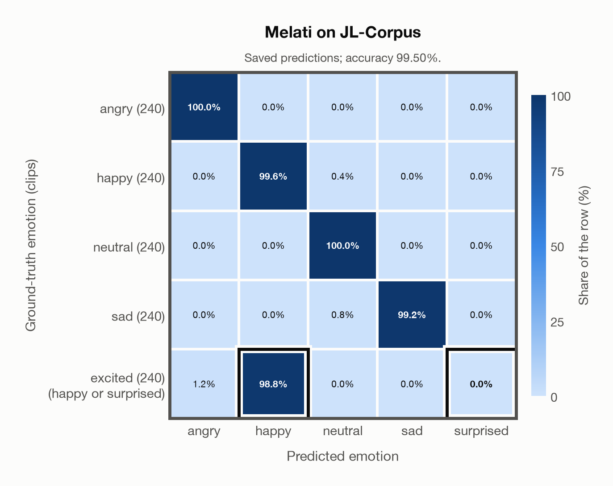

# Melati on JL-Corpus

Regenerated offline from saved CSV/JSON by `scripts/evaluation/refresh_reports.py`. This refresh performs no model inference or API requests.

## Summary

| Metric | Recomputed value |
|---|---:|
| Clips | 1,200 |
| Accuracy: acted emotion | 99.50% |
| UAR: mean ground-truth-row recall | 99.50% |
| Macro F1 | 99.48% |
| Weighted F1: true-support weighted | 99.50% |
| Accuracy: all model classes | 99.33% |

## Imported run and verification

- Source: [prediction CSV](../../outputs/melati_emotion/jl_corpus_predictions.csv) and [metadata JSON](../../outputs/melati_emotion/jl_corpus_predictions.json); both remain byte-for-byte unchanged.
- Original execution date recorded in JSON: `2026-10-29`.
- Dataset scope recorded in JSON: **JL-Corpus**, English (New Zealand); 1,200 / 1,200 clips.
- Ground-truth column: `acted_emotion`. Candidate classes: angry, happy, neutral, sad, surprised.
- Row counts, unique audio paths, correctness flags and saved metrics were checked against the CSV. Metric agreement tolerance is 0.000001 (six-decimal metadata).
- Weighted F1 weights each class's F1 by its true support, using the same resolved truth as macro F1; invalid answers remain errors. New metrics absent from the source JSON are recorded in the offline audit and summaries; the source JSON is preserved.
- Original execution/client runtime metadata (reported by the imported run, not measured by this refresh): `{"device": "mps", "hardware": "Apple M4 Max", "seconds": 444.2, "ms_per_clip": 370.2, "on_cpu": 0}`.
- Composite labels follow the existing accepted-label rule: excited accepts happy or surprised. F1 resolves a correct composite to the predicted class, otherwise to its first accepted class. Weighted F1 uses the resulting resolved-truth support, which can depend on the predictions.

## Results per emotion

| Ground-truth emotion | Clips | Recall | Acted-or-listener recall |
|---|---:|---:|---:|
| angry | 240 | 100.00% | — |
| happy | 240 | 99.58% | — |
| neutral | 240 | 100.00% | — |
| sad | 240 | 99.17% | — |
| excited (happy or surprised) | 240 | 98.75% | — |

Precision/F1 use the same resolved-truth convention as the evaluation script. Weighted F1 uses the resolved-truth clip counts below as weights.

| Predicted emotion | Resolved-truth clips | Precision | Recall | F1 |
|---|---:|---:|---:|---:|
| angry | 240 | 98.77% | 100.00% | 99.38% |
| happy | 480 | 100.00% | 99.17% | 99.58% |
| neutral | 240 | 98.77% | 100.00% | 99.38% |
| sad | 240 | 100.00% | 99.17% | 99.58% |
| surprised | 0 | — | — | — |

## Confusion matrix: acted emotion

| Ground truth \ Predicted | angry | happy | neutral | sad | surprised |
|---|---|---|---|---|---|
| angry (240) | **100.0%** | 0.0% | 0.0% | 0.0% | 0.0% |
| happy (240) | 0.0% | **99.6%** | 0.4% | 0.0% | 0.0% |
| neutral (240) | 0.0% | 0.0% | **100.0%** | 0.0% | 0.0% |
| sad (240) | 0.0% | 0.0% | 0.8% | **99.2%** | 0.0% |
| excited (happy or surprised) (240) | 1.2% | **98.8%** | 0.0% | 0.0% | **0.0%** |

## Caveats

- **Training involvement for Melati: Used directly**. Source: Public SER head trained on nine named corpora including JL-Corpus and Emozionalmente; Whisper-v3 pretraining incompletely disclosed; author nEMO threshold calibration is counted as seen development use, although its thresholds are not applied here. Direct use and upstream teacher use both count as training involvement. No pattern: no corpus-specific evidence, not verified unseen. Corpus use is not test-clip leakage.
- Internal CSV/JSON consistency does not authenticate the original model or remote request logs.

[Offline validation audit](jl_corpus_offline_audit.json)
