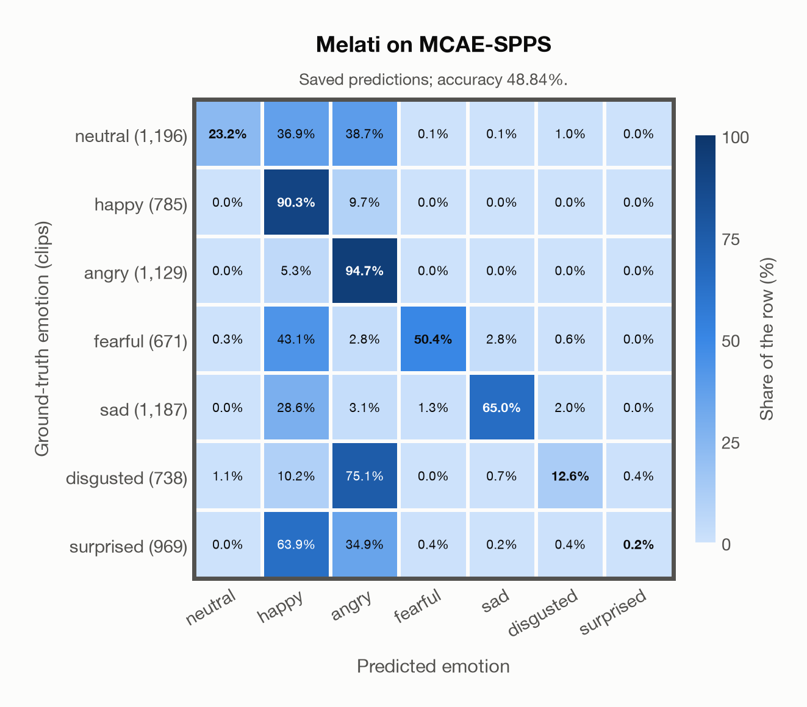
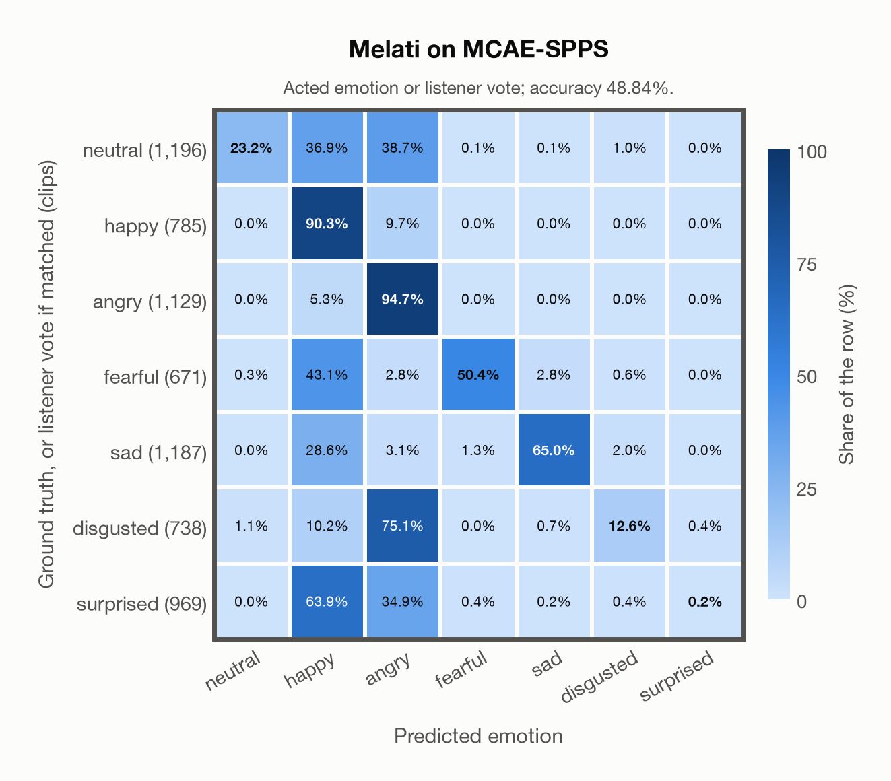

# Melati on MCAE-SPPS

Regenerated offline from saved CSV/JSON by `scripts/evaluation/refresh_reports.py`. This refresh performs no model inference or API requests.

## Summary

| Metric | Recomputed value |
|---|---:|
| Clips | 6,675 |
| Accuracy: acted emotion | 48.84% |
| UAR: mean ground-truth-row recall | 48.05% |
| Macro F1 | 43.32% |
| Weighted F1: true-support weighted | 44.38% |
| Accuracy: all model classes | 48.84% |
| Accuracy: acted emotion or listener vote | 48.84% |
| Single listener vote vs acted emotion | 100.00% |
| Model vs single listener vote | 48.84% |

## Imported run and verification

- Source: [prediction CSV](../../outputs/melati_emotion/mcae_spps_predictions.csv) and [metadata JSON](../../outputs/melati_emotion/mcae_spps_predictions.json); both remain byte-for-byte unchanged.
- Original execution date recorded in JSON: `2026-10-29`.
- Dataset scope recorded in JSON: **MCAE-SPPS**, Mandarin; 6,675 / 6,675 clips.
- Ground-truth column: `acted_emotion`. Candidate classes: neutral, happy, angry, fearful, sad, disgusted, surprised.
- Row counts, unique audio paths, correctness flags and saved metrics were checked against the CSV. Metric agreement tolerance is 0.000001 (six-decimal metadata).
- Weighted F1 weights each class's F1 by its true support, using the same resolved truth as macro F1; invalid answers remain errors. New metrics absent from the source JSON are recorded in the offline audit and summaries; the source JSON is preserved.
- Original execution/client runtime metadata (reported by the imported run, not measured by this refresh): `{"device": "mps", "hardware": "Apple M4 Max", "seconds": 2473.2, "ms_per_clip": 370.5, "on_cpu": 0}`.

## Results per emotion

| Ground-truth emotion | Clips | Recall | Acted-or-listener recall |
|---|---:|---:|---:|
| neutral | 1,196 | 23.24% | 23.24% |
| happy | 785 | 90.32% | 90.32% |
| angry | 1,129 | 94.69% | 94.69% |
| fearful | 671 | 50.37% | 50.37% |
| sad | 1,187 | 64.95% | 64.95% |
| disgusted | 738 | 12.60% | 12.60% |
| surprised | 969 | 0.21% | 0.21% |

Precision/F1 use the same resolved-truth convention as the evaluation script. Weighted F1 uses the resolved-truth clip counts below as weights.

| Predicted emotion | Resolved-truth clips | Precision | Recall | F1 |
|---|---:|---:|---:|---:|
| neutral | 1,196 | 96.53% | 23.24% | 37.47% |
| happy | 785 | 27.99% | 90.32% | 42.74% |
| angry | 1,129 | 41.82% | 94.69% | 58.02% |
| fearful | 671 | 94.41% | 50.37% | 65.69% |
| sad | 1,187 | 96.62% | 64.95% | 77.68% |
| disgusted | 738 | 67.88% | 12.60% | 21.26% |
| surprised | 969 | 40.00% | 0.21% | 0.41% |

## Confusion matrix: acted emotion

| Ground truth \ Predicted | neutral | happy | angry | fearful | sad | disgusted | surprised |
|---|---|---|---|---|---|---|---|
| neutral (1,196) | **23.2%** | 36.9% | 38.7% | 0.1% | 0.1% | 1.0% | 0.0% |
| happy (785) | 0.0% | **90.3%** | 9.7% | 0.0% | 0.0% | 0.0% | 0.0% |
| angry (1,129) | 0.0% | 5.3% | **94.7%** | 0.0% | 0.0% | 0.0% | 0.0% |
| fearful (671) | 0.3% | 43.1% | 2.8% | **50.4%** | 2.8% | 0.6% | 0.0% |
| sad (1,187) | 0.0% | 28.6% | 3.1% | 1.3% | **65.0%** | 2.0% | 0.0% |
| disgusted (738) | 1.1% | 10.2% | 75.1% | 0.0% | 0.7% | **12.6%** | 0.4% |
| surprised (969) | 0.0% | 63.9% | 34.9% | 0.4% | 0.2% | 0.4% | **0.2%** |

## Confusion matrix: acted emotion or listener vote

A prediction accepted only through the listener vote is placed in that predicted emotion's row; other clips keep their original ground-truth row. Row supports can therefore change.

| Ground truth \ Predicted | neutral | happy | angry | fearful | sad | disgusted | surprised |
|---|---|---|---|---|---|---|---|
| neutral (1,196) | **23.2%** | 36.9% | 38.7% | 0.1% | 0.1% | 1.0% | 0.0% |
| happy (785) | 0.0% | **90.3%** | 9.7% | 0.0% | 0.0% | 0.0% | 0.0% |
| angry (1,129) | 0.0% | 5.3% | **94.7%** | 0.0% | 0.0% | 0.0% | 0.0% |
| fearful (671) | 0.3% | 43.1% | 2.8% | **50.4%** | 2.8% | 0.6% | 0.0% |
| sad (1,187) | 0.0% | 28.6% | 3.1% | 1.3% | **65.0%** | 2.0% | 0.0% |
| disgusted (738) | 1.1% | 10.2% | 75.1% | 0.0% | 0.7% | **12.6%** | 0.4% |
| surprised (969) | 0.0% | 63.9% | 34.9% | 0.4% | 0.2% | 0.4% | **0.2%** |

## Caveats

- **Training involvement for Melati: No corpus-specific evidence**. Source: Public SER head trained on nine named corpora including JL-Corpus and Emozionalmente; Whisper-v3 pretraining incompletely disclosed; author nEMO threshold calibration is counted as seen development use, although its thresholds are not applied here. Direct use and upstream teacher use both count as training involvement. No pattern: no corpus-specific evidence, not verified unseen. Corpus use is not test-clip leakage.
- Internal CSV/JSON consistency does not authenticate the original model or remote request logs.

[Offline validation audit](mcae_spps_offline_audit.json)
