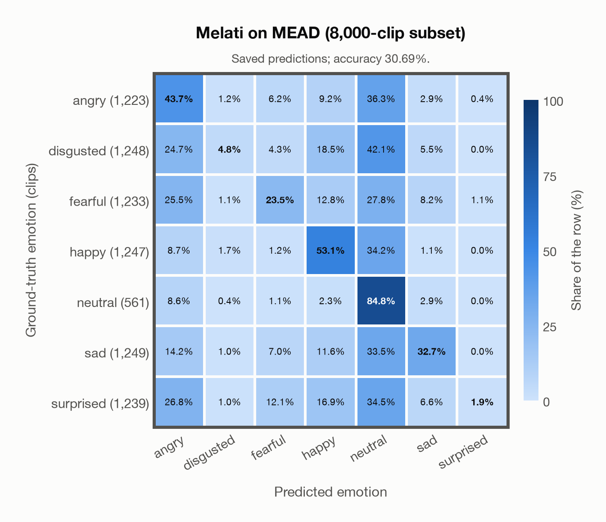

# Melati on MEAD (8,000-clip subset)

Regenerated offline from saved CSV/JSON by `scripts/evaluation/refresh_reports.py`. This refresh performs no model inference or API requests.

## Summary

| Metric | Recomputed value |
|---|---:|
| Clips | 8,000 |
| Accuracy: acted emotion | 30.69% |
| UAR: mean ground-truth-row recall | 34.94% |
| Macro F1 | 27.59% |
| Weighted F1: true-support weighted | 27.70% |
| Accuracy: all model classes | 30.69% |

## Imported run and verification

- Source: [prediction CSV](../../outputs/melati_emotion/mead_predictions.csv) and [metadata JSON](../../outputs/melati_emotion/mead_predictions.json); both remain byte-for-byte unchanged.
- Original execution date recorded in JSON: `2026-11-06`.
- Dataset scope recorded in JSON: **MEAD (8,000-clip subset)**, English; 8,000 / 8,000 clips.
- Ground-truth column: `acted_emotion`. Candidate classes: angry, disgusted, fearful, happy, neutral, sad, surprised.
- Row counts, unique audio paths, correctness flags and saved metrics were checked against the CSV. Metric agreement tolerance is 0.000001 (six-decimal metadata).
- Weighted F1 weights each class's F1 by its true support, using the same resolved truth as macro F1; invalid answers remain errors. New metrics absent from the source JSON are recorded in the offline audit and summaries; the source JSON is preserved.
- Original execution/client runtime metadata (reported by the imported run, not measured by this refresh): `{"device": "mps", "hardware": "Apple M4 Max", "seconds": 2410.7, "ms_per_clip": 301.3, "on_cpu": 0}`.

## Results per emotion

| Ground-truth emotion | Clips | Recall | Acted-or-listener recall |
|---|---:|---:|---:|
| angry | 1,223 | 43.66% | — |
| disgusted | 1,248 | 4.81% | — |
| fearful | 1,233 | 23.52% | — |
| happy | 1,247 | 53.09% | — |
| neutral | 561 | 84.85% | — |
| sad | 1,249 | 32.75% | — |
| surprised | 1,239 | 1.94% | — |

Precision/F1 use the same resolved-truth convention as the evaluation script. Weighted F1 uses the resolved-truth clip counts below as weights.

| Predicted emotion | Resolved-truth clips | Precision | Recall | F1 |
|---|---:|---:|---:|---:|
| angry | 1,223 | 29.31% | 43.66% | 35.07% |
| disgusted | 1,248 | 44.12% | 4.81% | 8.67% |
| fearful | 1,233 | 42.77% | 23.52% | 30.35% |
| happy | 1,247 | 43.21% | 53.09% | 47.64% |
| neutral | 561 | 15.55% | 84.85% | 26.28% |
| sad | 1,249 | 56.26% | 32.75% | 41.40% |
| surprised | 1,239 | 55.81% | 1.94% | 3.74% |

## Confusion matrix: acted emotion

| Ground truth \ Predicted | angry | disgusted | fearful | happy | neutral | sad | surprised |
|---|---|---|---|---|---|---|---|
| angry (1,223) | **43.7%** | 1.2% | 6.2% | 9.2% | 36.3% | 2.9% | 0.4% |
| disgusted (1,248) | 24.7% | **4.8%** | 4.3% | 18.5% | 42.1% | 5.5% | 0.0% |
| fearful (1,233) | 25.5% | 1.1% | **23.5%** | 12.8% | 27.8% | 8.2% | 1.1% |
| happy (1,247) | 8.7% | 1.7% | 1.2% | **53.1%** | 34.2% | 1.1% | 0.0% |
| neutral (561) | 8.6% | 0.4% | 1.1% | 2.3% | **84.8%** | 2.9% | 0.0% |
| sad (1,249) | 14.2% | 1.0% | 7.0% | 11.6% | 33.5% | **32.7%** | 0.0% |
| surprised (1,239) | 26.8% | 1.0% | 12.1% | 16.9% | 34.5% | 6.6% | **1.9%** |

## Caveats

- **Training involvement for Melati: No corpus-specific evidence**. Source: Public SER head trained on nine named corpora including JL-Corpus and Emozionalmente; Whisper-v3 pretraining incompletely disclosed; author nEMO threshold calibration is counted as seen development use, although its thresholds are not applied here. Direct use and upstream teacher use both count as training involvement. No pattern: no corpus-specific evidence, not verified unseen. Corpus use is not test-clip leakage.
- Internal CSV/JSON consistency does not authenticate the original model or remote request logs.

[Offline validation audit](mead_offline_audit.json)
