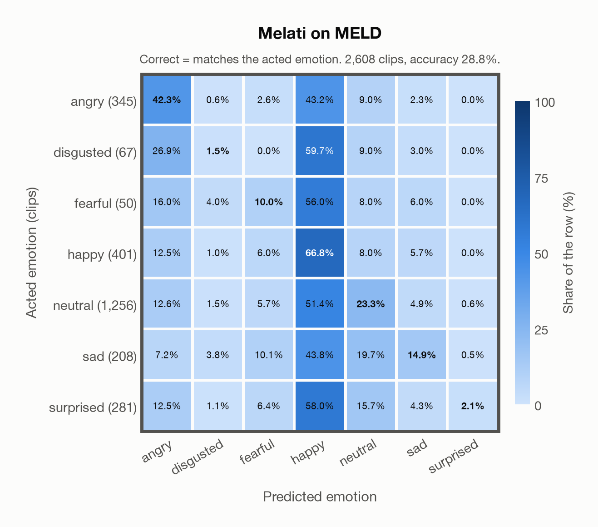

# Melati on MELD

Generated by `scripts/evaluation/evaluate.py` on 2026-11-06.

## Summary

| Metric | Value |
|---|---|
| Clips evaluated | 2,608 (English) |
| **Accuracy: prediction matches the acted emotion** | **28.8%** |
| Unweighted accuracy (mean recall of the 7 acted emotions) | 23.0% |
| Macro F1 (acted emotion) | 18.7% |
| Accuracy, all 7 model classes (acted emotion) | 28.8% |
| Chance level (7 emotions) | 14.3% |

## Setup

- **Model**: Melati (`Scicom-intl/Melati-Emotion-Whisper-Large-V3`) as released (no fine-tuning), transformers 5.18.0, loaded by `scripts/models/melati.py`. Each clip (at most 30 s) becomes Whisper-large-v3 log-mel features padded to 30 s; the encoder layers are averaged over the clip's own frames only (50 per second), as in the official melati_emotion.py. Precision: float16 encoder, float32 head. The prediction is the most probable of the raw probabilities. The official thresholds (melati_emotion.py, label()) are not applied: they were set for precise tagging of podcasts, would turn most clips into neutral, and never return disgusted.
- **Data**: 2,608 clips of MELD (English) from `data/meld/`.
- **Ground truth (acted emotion)**: the label of each utterance (`Emotion` in `test_sent_emo.csv`): the majority of three annotators who watched the video and read the transcript; the speakers were not asked to act an emotion.
- Label mapping: anger = angry, disgust = disgusted, fear = fearful, joy = happy, neutral = neutral, sadness = sad, surprise = surprised.
- Only the official **test split** (2,610 utterances of 280 dialogues): it is the standard split for reporting results, and the train and dev splits were used to train several of the models.
- Utterances from the TV series *Friends*, converted from the test videos to 16 kHz mono WAV by scripts/common/download_data.py. Left out: `dia38_utt4` (joy) and `dia220_utt0` (disgust), whose time stamps are wrong (each clip holds 4–5 minutes of the episode for one short line).
- **7 emotions**: the prediction is the most probable of the 7 emotions in this dataset (angry, disgusted, fearful, happy, neutral, sad, surprised); the model has no other classes. **All 7 model classes**: the prediction is the most probable of all 7 model classes, so choosing a class that the dataset does not have counts as wrong.
- **Hardware**: Apple M4 Max, device `mps`, PyTorch 2.7.1. Inference took 12.9 min (297 ms per clip).
- **Per-clip predictions**: `outputs/melati_emotion/meld_predictions.csv` (in git, so the results can be checked clip by clip). The JSON file next to it describes the columns.

## Results per emotion

Rows: acted emotion. Precision, recall and F1 compare the prediction with the acted emotion.

| Emotion | Clips | Precision | Recall | F1 |
|---|---|---|---|---|
| angry | 345 | 34.0% | 42.3% | 37.7% |
| disgusted | 67 | 2.6% | 1.5% | 1.9% |
| fearful | 50 | 3.4% | 10.0% | 5.1% |
| happy | 401 | 19.4% | 66.8% | 30.0% |
| neutral | 1,256 | 65.0% | 23.3% | 34.3% |
| sad | 208 | 22.0% | 14.9% | 17.8% |
| surprised | 281 | 42.9% | 2.1% | 4.1% |

## Confusion matrix: acted emotion

The same numbers as a table. Rows: acted emotion. Columns: predicted emotion. Each row adds up to 100%.

| Acted \ Predicted | angry | disgusted | fearful | happy | neutral | sad | surprised |
|---|---|---|---|---|---|---|---|
| angry (345) | **42.3%** | 0.6% | 2.6% | 43.2% | 9.0% | 2.3% | 0.0% |
| disgusted (67) | 26.9% | **1.5%** | 0.0% | 59.7% | 9.0% | 3.0% | 0.0% |
| fearful (50) | 16.0% | 4.0% | **10.0%** | 56.0% | 8.0% | 6.0% | 0.0% |
| happy (401) | 12.5% | 1.0% | 6.0% | **66.8%** | 8.0% | 5.7% | 0.0% |
| neutral (1,256) | 12.6% | 1.5% | 5.7% | 51.4% | **23.3%** | 4.9% | 0.6% |
| sad (208) | 7.2% | 3.8% | 10.1% | 43.8% | 19.7% | **14.9%** | 0.5% |
| surprised (281) | 12.5% | 1.1% | 6.4% | 58.0% | 15.7% | 4.3% | **2.1%** |

Most frequent confusions: disgusted predicted as happy (59.7%), surprised predicted as happy (58.0%), fearful predicted as happy (56.0%).

## Caveats

- **Not in Melati's training data** (nine acted corpora, JL-Corpus among them).
- **In-the-wild speech with noisy labels.** The annotators saw the video and the transcript, not the voice alone, and agreed moderately (Fleiss' kappa 0.43); the classes are very unbalanced (48% neutral, 2% fear).
- Several speakers, laughter of the studio audience and background music can be heard in a clip; a third of the clips are shorter than 2 s.
- MELD's train split is in the training data of MERaLiON-SER-v1 and of EmoBox (emotion2vec+), so these models have heard the same speakers and show.
- The clips come from a copyrighted TV show (the authors rely on fair use); the repository is GPL-3.0.
