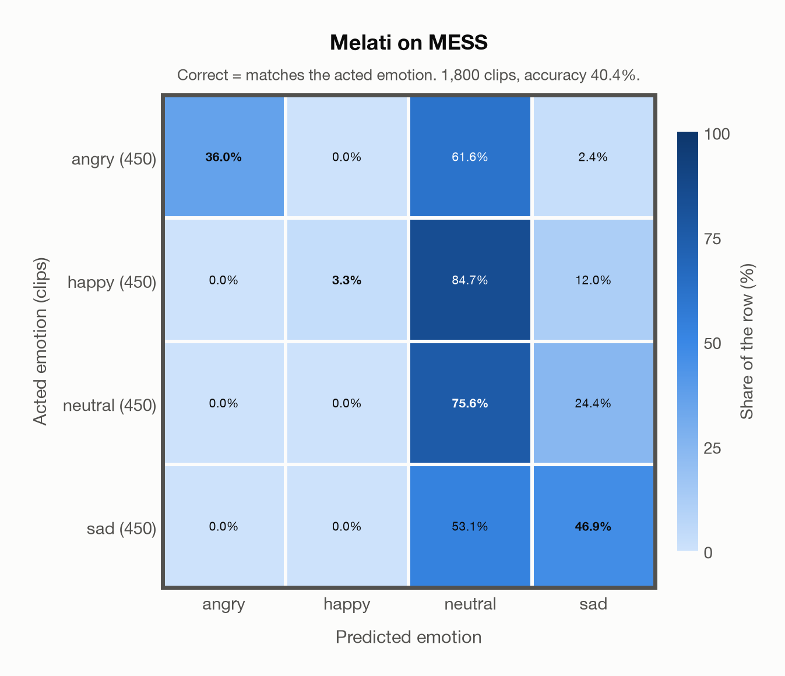

# Melati on MESS

Generated by `scripts/evaluation/evaluate.py` on 2026-10-29.

## Summary

| Metric | Value |
|---|---|
| Clips evaluated | 1,800 (English) |
| **Accuracy: prediction matches the acted emotion** | **40.4%** |
| Unweighted accuracy (mean recall of the 4 acted emotions) | 40.4% |
| Macro F1 (acted emotion) | 37.5% |
| Accuracy, all 7 model classes (acted emotion) | 40.1% |
| Chance level (4 emotions) | 25.0% |

## Setup

- **Model**: Melati (`Scicom-intl/Melati-Emotion-Whisper-Large-V3`) as released (no fine-tuning), transformers 5.18.0, loaded by `scripts/models/melati.py`. Each clip (at most 30 s) becomes Whisper-large-v3 log-mel features padded to 30 s; the encoder layers are averaged over the clip's own frames only (50 per second), as in the official melati_emotion.py. Precision: float16 encoder, float32 head. The prediction is the most probable of the raw probabilities. The official thresholds (melati_emotion.py, label()) are not applied: they were set for precise tagging of podcasts, would turn most clips into neutral, and never return disgusted.
- **Data**: 1,800 clips of MESS (English) from `data/mess/`.
- **Ground truth (acted emotion)**: the emotion each speaker was asked to portray, from the first letter of the file name (`A`ngry, `C`alm, `H`appy, `S`ad).
- Label mapping: angry = angry, happy = happy, sad = sad, and **calm = neutral** (the project's emotions have no *calm*).
- **4 emotions**: the prediction is the most probable of the 4 emotions in this dataset (angry, happy, neutral, sad); the model's other classes (`surprised`, `fearful`, `disgusted`) are ignored. **All 7 model classes**: the prediction is the most probable of all 7 model classes, so choosing a class that the dataset does not have counts as wrong.
- **Hardware**: Apple M4 Max, device `mps`, PyTorch 2.5.1. Inference took 11.2 min (375 ms per clip).
- **Per-clip predictions**: `outputs/melati_emotion/mess_predictions.csv` (in git, so the results can be checked clip by clip). The JSON file next to it describes the columns.

## Results per emotion

Rows: acted emotion. Precision, recall and F1 compare the prediction with the acted emotion.

| Emotion | Clips | Precision | Recall | F1 |
|---|---|---|---|---|
| angry | 450 | 100.0% | 36.0% | 52.9% |
| happy | 450 | 100.0% | 3.3% | 6.5% |
| neutral | 450 | 27.5% | 75.6% | 40.3% |
| sad | 450 | 54.7% | 46.9% | 50.5% |

## Confusion matrix: acted emotion

The same numbers as a table. Rows: acted emotion. Columns: predicted emotion. Each row adds up to 100%.

| Acted \ Predicted | angry | happy | neutral | sad |
|---|---|---|---|---|
| angry (450) | **36.0%** | 0.0% | 61.6% | 2.4% |
| happy (450) | 0.0% | **3.3%** | 84.7% | 12.0% |
| neutral (450) | 0.0% | 0.0% | **75.6%** | 24.4% |
| sad (450) | 0.0% | 0.0% | 53.1% | **46.9%** |

Most frequent confusions: happy predicted as neutral (84.7%), angry predicted as neutral (61.6%), sad predicted as neutral (53.1%).

## Predictions outside the 4 emotions

With all 7 model classes, the model chose a class that this dataset does not have for 9 clips (0.5%): `surprised` 0, `fearful` 1, `disgusted` 8.

## Caveats

- **Not in Melati's training data** (nine acted corpora, JL-Corpus among them).
- *Calm* is not quite *neutral*: calm clips predicted as neutral count as correct.
- The public version has 1,800 clips and acted labels only; the listeners' ratings are available from the author on request. Audio is sampled at 24,414 Hz, resampled to 16 kHz.
