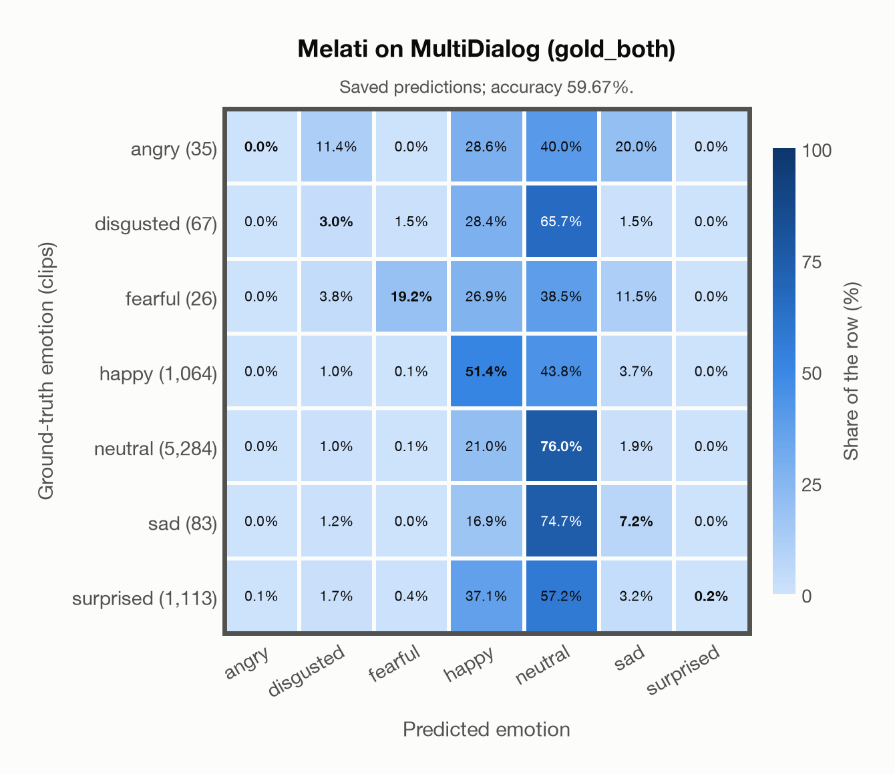

# Melati on MultiDialog (gold_both)

Regenerated offline from saved CSV/JSON by `scripts/evaluation/refresh_reports.py`. This refresh performs no model inference or API requests.

## Summary

| Metric | Recomputed value |
|---|---:|
| Clips | 7,672 |
| Accuracy: acted emotion | 59.67% |
| UAR: mean ground-truth-row recall | 22.43% |
| Macro F1 | 20.24% |
| Weighted F1: true-support weighted | 57.49% |
| Accuracy: all model classes | 59.67% |

## Imported run and verification

- Source: [prediction CSV](../../outputs/melati_emotion/multidialog_predictions.csv) and [metadata JSON](../../outputs/melati_emotion/multidialog_predictions.json); both remain byte-for-byte unchanged.
- Original execution date recorded in JSON: `2026-11-11`.
- Dataset scope recorded in JSON: **MultiDialog (gold_both)**, English; 7,672 / 7,672 clips.
- Ground-truth column: `acted_emotion`. Candidate classes: angry, disgusted, fearful, happy, neutral, sad, surprised.
- Row counts, unique audio paths, correctness flags and saved metrics were checked against the CSV. Metric agreement tolerance is 0.000001 (six-decimal metadata).
- Weighted F1 weights each class's F1 by its true support, using the same resolved truth as macro F1; invalid answers remain errors. New metrics absent from the source JSON are recorded in the offline audit and summaries; the source JSON is preserved.
- Original execution/client runtime metadata (reported by the imported run, not measured by this refresh): `{"device": "mps", "hardware": "Apple M3 Pro", "seconds": 6491.1, "ms_per_clip": 846.1, "on_cpu": 0}`.

## Results per emotion

| Ground-truth emotion | Clips | Recall | Acted-or-listener recall |
|---|---:|---:|---:|
| angry | 35 | 0.00% | — |
| disgusted | 67 | 2.99% | — |
| fearful | 26 | 19.23% | — |
| happy | 1,064 | 51.41% | — |
| neutral | 5,284 | 76.00% | — |
| sad | 83 | 7.23% | — |
| surprised | 1,113 | 0.18% | — |

Precision/F1 use the same resolved-truth convention as the evaluation script. Weighted F1 uses the resolved-truth clip counts below as weights.

| Predicted emotion | Resolved-truth clips | Precision | Recall | F1 |
|---|---:|---:|---:|---:|
| angry | 35 | 0.00% | 0.00% | 0.00% |
| disgusted | 67 | 2.22% | 2.99% | 2.55% |
| fearful | 26 | 31.25% | 19.23% | 23.81% |
| happy | 1,064 | 25.79% | 51.41% | 34.35% |
| neutral | 5,284 | 76.51% | 76.00% | 76.26% |
| sad | 83 | 3.14% | 7.23% | 4.38% |
| surprised | 1,113 | 50.00% | 0.18% | 0.36% |

## Confusion matrix: acted emotion

| Ground truth \ Predicted | angry | disgusted | fearful | happy | neutral | sad | surprised |
|---|---|---|---|---|---|---|---|
| angry (35) | **0.0%** | 11.4% | 0.0% | 28.6% | 40.0% | 20.0% | 0.0% |
| disgusted (67) | 0.0% | **3.0%** | 1.5% | 28.4% | 65.7% | 1.5% | 0.0% |
| fearful (26) | 0.0% | 3.8% | **19.2%** | 26.9% | 38.5% | 11.5% | 0.0% |
| happy (1,064) | 0.0% | 1.0% | 0.1% | **51.4%** | 43.8% | 3.7% | 0.0% |
| neutral (5,284) | 0.0% | 1.0% | 0.1% | 21.0% | **76.0%** | 1.9% | 0.0% |
| sad (83) | 0.0% | 1.2% | 0.0% | 16.9% | 74.7% | **7.2%** | 0.0% |
| surprised (1,113) | 0.1% | 1.7% | 0.4% | 37.1% | 57.2% | 3.2% | **0.2%** |

## Caveats

- **Training involvement for Melati: No corpus-specific evidence**. Source: Public SER head trained on nine named corpora including JL-Corpus and Emozionalmente; Whisper-v3 pretraining incompletely disclosed; author nEMO threshold calibration is counted as seen development use, although its thresholds are not applied here. Direct use and upstream teacher use both count as training involvement. No pattern: no corpus-specific evidence, not verified unseen. Corpus use is not test-clip leakage.
- Internal CSV/JSON consistency does not authenticate the original model or remote request logs.

[Offline validation audit](multidialog_offline_audit.json)
