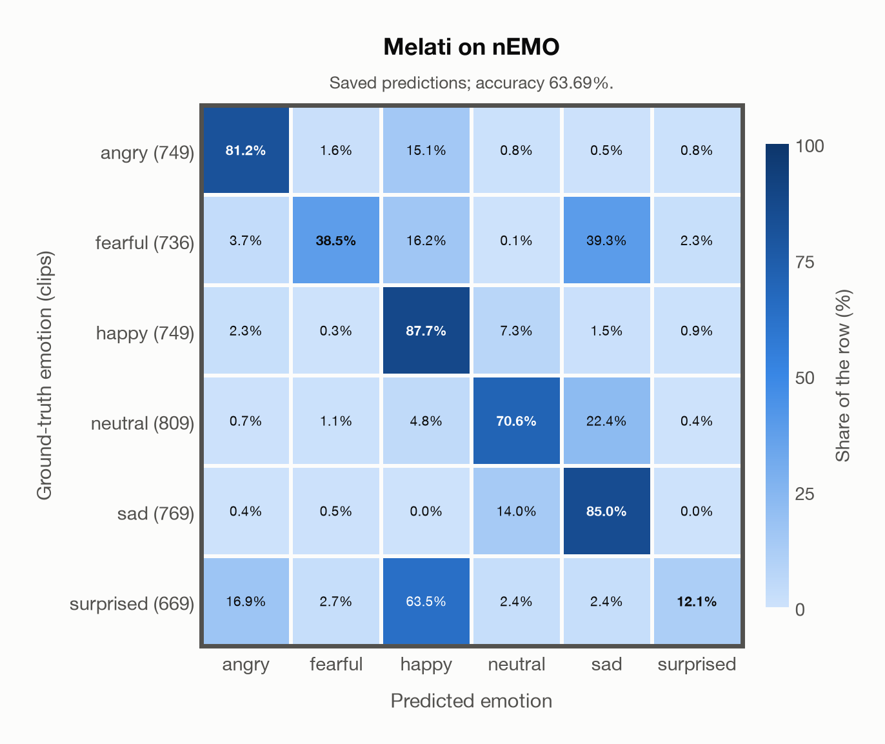

# Melati on nEMO

Regenerated offline from saved CSV/JSON by `scripts/evaluation/refresh_reports.py`. This refresh performs no model inference or API requests.

## Summary

| Metric | Recomputed value |
|---|---:|
| Clips | 4,481 |
| Accuracy: acted emotion | 63.69% |
| UAR: mean ground-truth-row recall | 62.51% |
| Macro F1 | 59.52% |
| Weighted F1: true-support weighted | 60.45% |
| Accuracy: all model classes | 58.31% |

## Imported run and verification

- Source: [prediction CSV](../../outputs/melati_emotion/nemo_predictions.csv) and [metadata JSON](../../outputs/melati_emotion/nemo_predictions.json); both remain byte-for-byte unchanged.
- Original execution date recorded in JSON: `2026-11-06`.
- Dataset scope recorded in JSON: **nEMO**, Polish; 4,481 / 4,481 clips.
- Ground-truth column: `acted_emotion`. Candidate classes: angry, fearful, happy, neutral, sad, surprised.
- Row counts, unique audio paths, correctness flags and saved metrics were checked against the CSV. Metric agreement tolerance is 0.000001 (six-decimal metadata).
- Weighted F1 weights each class's F1 by its true support, using the same resolved truth as macro F1; invalid answers remain errors. New metrics absent from the source JSON are recorded in the offline audit and summaries; the source JSON is preserved.
- Original execution/client runtime metadata (reported by the imported run, not measured by this refresh): `{"device": "mps", "hardware": "Apple M4 Max", "seconds": 1343.8, "ms_per_clip": 299.9, "on_cpu": 0}`.

## Results per emotion

| Ground-truth emotion | Clips | Recall | Acted-or-listener recall |
|---|---:|---:|---:|
| angry | 749 | 81.17% | — |
| fearful | 736 | 38.45% | — |
| happy | 749 | 87.72% | — |
| neutral | 809 | 70.58% | — |
| sad | 769 | 85.05% | — |
| surprised | 669 | 12.11% | — |

Precision/F1 use the same resolved-truth convention as the evaluation script. Weighted F1 uses the resolved-truth clip counts below as weights.

| Predicted emotion | Resolved-truth clips | Precision | Recall | F1 |
|---|---:|---:|---:|---:|
| angry | 749 | 78.55% | 81.17% | 79.84% |
| fearful | 736 | 86.28% | 38.45% | 53.20% |
| happy | 749 | 48.56% | 87.72% | 62.51% |
| neutral | 809 | 75.43% | 70.58% | 72.92% |
| sad | 769 | 56.62% | 85.05% | 67.98% |
| surprised | 669 | 71.05% | 12.11% | 20.69% |

## Confusion matrix: acted emotion

| Ground truth \ Predicted | angry | fearful | happy | neutral | sad | surprised |
|---|---|---|---|---|---|---|
| angry (749) | **81.2%** | 1.6% | 15.1% | 0.8% | 0.5% | 0.8% |
| fearful (736) | 3.7% | **38.5%** | 16.2% | 0.1% | 39.3% | 2.3% |
| happy (749) | 2.3% | 0.3% | **87.7%** | 7.3% | 1.5% | 0.9% |
| neutral (809) | 0.7% | 1.1% | 4.8% | **70.6%** | 22.4% | 0.4% |
| sad (769) | 0.4% | 0.5% | 0.0% | 14.0% | **85.0%** | 0.0% |
| surprised (669) | 16.9% | 2.7% | 63.5% | 2.4% | 2.4% | **12.1%** |

## Caveats

- **Training involvement for Melati: Used directly**. Evidence scope: author development calibration not applied. The author used nEMO to tune podcast thresholds, but did not fit the public SER head on it; this project uses raw argmax and does not apply those thresholds. Counted as seen in the broader development pipeline; the scope is calibration, not weight fitting. Source: Public SER head trained on nine named corpora including JL-Corpus and Emozionalmente; Whisper-v3 pretraining incompletely disclosed; author nEMO threshold calibration is counted as seen development use, although its thresholds are not applied here. Direct use and upstream teacher use both count as training involvement. No pattern: no corpus-specific evidence, not verified unseen. Corpus use is not test-clip leakage.
- Internal CSV/JSON consistency does not authenticate the original model or remote request logs.

[Offline validation audit](nemo_offline_audit.json)
