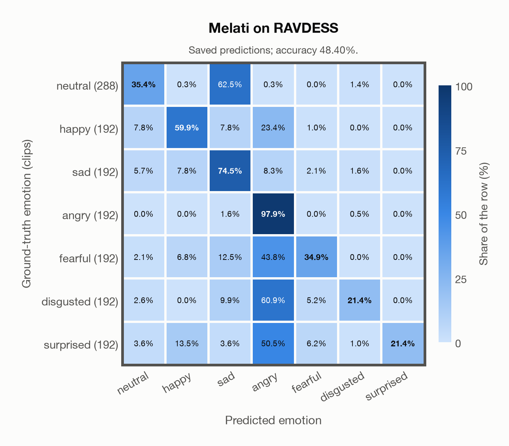

# Melati on RAVDESS

Regenerated offline from saved CSV/JSON by `scripts/evaluation/refresh_reports.py`. This refresh performs no model inference or API requests.

## Summary

| Metric | Recomputed value |
|---|---:|
| Clips | 1,440 |
| Accuracy: acted emotion | 48.40% |
| UAR: mean ground-truth-row recall | 49.33% |
| Macro F1 | 46.61% |
| Weighted F1: true-support weighted | 46.65% |
| Accuracy: all model classes | 48.40% |

## Imported run and verification

- Source: [prediction CSV](../../outputs/melati_emotion/ravdess_predictions.csv) and [metadata JSON](../../outputs/melati_emotion/ravdess_predictions.json); both remain byte-for-byte unchanged.
- Original execution date recorded in JSON: `2026-10-29`.
- Dataset scope recorded in JSON: **RAVDESS**, English; 1,440 / 1,440 clips.
- Ground-truth column: `acted_emotion`. Candidate classes: neutral, happy, sad, angry, fearful, disgusted, surprised.
- Row counts, unique audio paths, correctness flags and saved metrics were checked against the CSV. Metric agreement tolerance is 0.000001 (six-decimal metadata).
- Weighted F1 weights each class's F1 by its true support, using the same resolved truth as macro F1; invalid answers remain errors. New metrics absent from the source JSON are recorded in the offline audit and summaries; the source JSON is preserved.
- Original execution/client runtime metadata (reported by the imported run, not measured by this refresh): `{"device": "mps", "hardware": "Apple M4 Max", "seconds": 533.3, "ms_per_clip": 370.3, "on_cpu": 0}`.

## Results per emotion

| Ground-truth emotion | Clips | Recall | Acted-or-listener recall |
|---|---:|---:|---:|
| neutral | 288 | 35.42% | — |
| happy | 192 | 59.90% | — |
| sad | 192 | 74.48% | — |
| angry | 192 | 97.92% | — |
| fearful | 192 | 34.90% | — |
| disgusted | 192 | 21.35% | — |
| surprised | 192 | 21.35% | — |

Precision/F1 use the same resolved-truth convention as the evaluation script. Weighted F1 uses the resolved-truth clip counts below as weights.

| Predicted emotion | Resolved-truth clips | Precision | Recall | F1 |
|---|---:|---:|---:|---:|
| neutral | 288 | 70.83% | 35.42% | 47.22% |
| happy | 192 | 67.65% | 59.90% | 63.54% |
| sad | 192 | 36.57% | 74.48% | 49.06% |
| angry | 192 | 34.31% | 97.92% | 50.81% |
| fearful | 192 | 70.53% | 34.90% | 46.69% |
| disgusted | 192 | 80.39% | 21.35% | 33.74% |
| surprised | 192 | 100.00% | 21.35% | 35.19% |

## Confusion matrix: acted emotion

| Ground truth \ Predicted | neutral | happy | sad | angry | fearful | disgusted | surprised |
|---|---|---|---|---|---|---|---|
| neutral (288) | **35.4%** | 0.3% | 62.5% | 0.3% | 0.0% | 1.4% | 0.0% |
| happy (192) | 7.8% | **59.9%** | 7.8% | 23.4% | 1.0% | 0.0% | 0.0% |
| sad (192) | 5.7% | 7.8% | **74.5%** | 8.3% | 2.1% | 1.6% | 0.0% |
| angry (192) | 0.0% | 0.0% | 1.6% | **97.9%** | 0.0% | 0.5% | 0.0% |
| fearful (192) | 2.1% | 6.8% | 12.5% | 43.8% | **34.9%** | 0.0% | 0.0% |
| disgusted (192) | 2.6% | 0.0% | 9.9% | 60.9% | 5.2% | **21.4%** | 0.0% |
| surprised (192) | 3.6% | 13.5% | 3.6% | 50.5% | 6.2% | 1.0% | **21.4%** |

## Caveats

- **Training involvement for Melati: No corpus-specific evidence**. Source: Public SER head trained on nine named corpora including JL-Corpus and Emozionalmente; Whisper-v3 pretraining incompletely disclosed; author nEMO threshold calibration is counted as seen development use, although its thresholds are not applied here. Direct use and upstream teacher use both count as training involvement. No pattern: no corpus-specific evidence, not verified unseen. Corpus use is not test-clip leakage.
- Internal CSV/JSON consistency does not authenticate the original model or remote request logs.

[Offline validation audit](ravdess_offline_audit.json)
