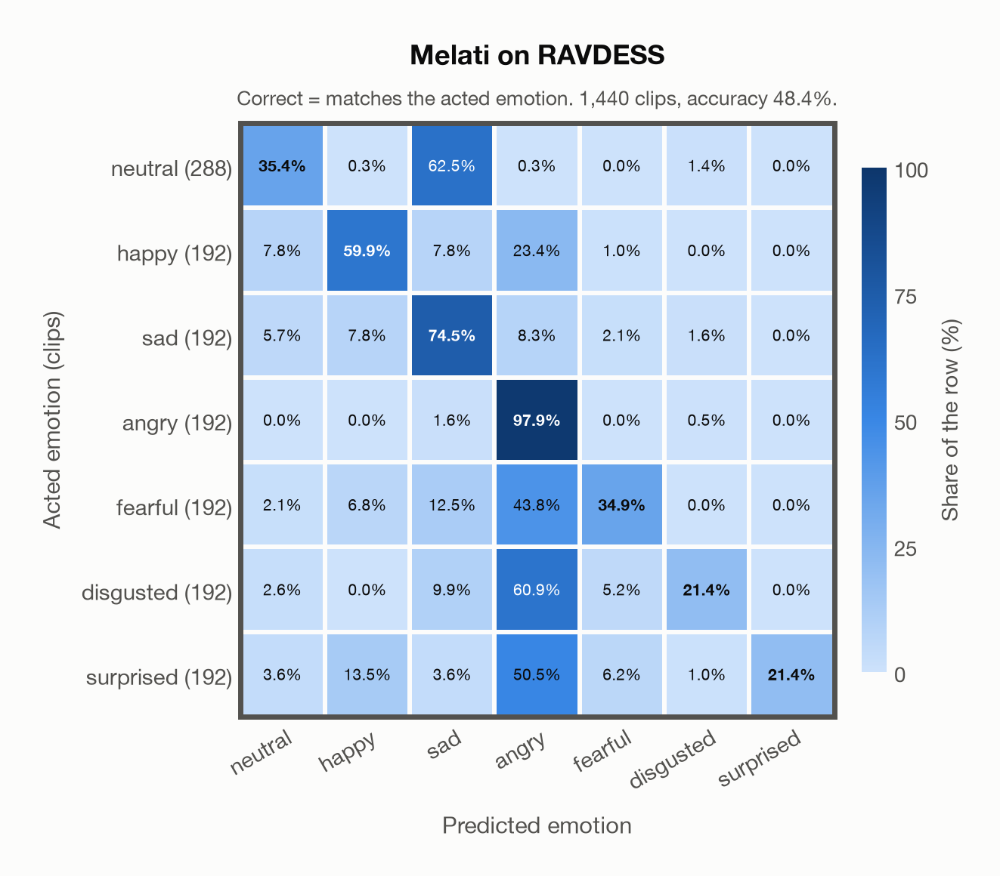

# Melati on RAVDESS

Generated by `scripts/evaluation/evaluate.py` on 2026-10-29.

## Summary

| Metric | Value |
|---|---|
| Clips evaluated | 1,440 (English) |
| **Accuracy: prediction matches the acted emotion** | **48.4%** |
| Unweighted accuracy (mean recall of the 7 acted emotions) | 49.3% |
| Macro F1 (acted emotion) | 46.6% |
| Accuracy, all 7 model classes (acted emotion) | 48.4% |
| Chance level (7 emotions) | 14.3% |

## Setup

- **Model**: Melati (`Scicom-intl/Melati-Emotion-Whisper-Large-V3`) as released (no fine-tuning), transformers 5.18.0, loaded by `scripts/models/melati.py`. Each clip (at most 30 s) becomes Whisper-large-v3 log-mel features padded to 30 s; the encoder layers are averaged over the clip's own frames only (50 per second), as in the official melati_emotion.py. Precision: float16 encoder, float32 head. The prediction is the most probable of the raw probabilities. The official thresholds (melati_emotion.py, label()) are not applied: they were set for precise tagging of podcasts, would turn most clips into neutral, and never return disgusted.
- **Data**: 1,440 clips of RAVDESS (English) from `data/ravdess/`.
- **Ground truth (acted emotion)**: the emotion each actor was asked to portray, from the third number in the file name (01 neutral, 02 calm, 03 happy, 04 sad, 05 angry, 06 fearful, 07 disgust, 08 surprised).
- Label mapping: neutral, happy, sad, angry, fearful and surprised keep their names; disgust = disgusted, and **calm = neutral** (the project's emotions have no *calm*), so neutral has 288 clips: 96 acted neutral and 192 acted calm.
- 24 professional actors (12 female, 12 male) say two sentences, "Kids are talking by the door" and "Dogs are sitting by the door", twice in each emotion, at two intensities (normal and strong) except for neutral.
- **7 emotions**: the prediction is the most probable of the 7 emotions in this dataset (neutral, happy, sad, angry, fearful, disgusted, surprised); the model has no other classes. **All 7 model classes**: the prediction is the most probable of all 7 model classes, so choosing a class that the dataset does not have counts as wrong.
- **Hardware**: Apple M4 Max, device `mps`, PyTorch 2.5.1. Inference took 8.9 min (370 ms per clip).
- **Per-clip predictions**: `outputs/melati_emotion/ravdess_predictions.csv` (in git, so the results can be checked clip by clip). The JSON file next to it describes the columns.

## Results per emotion

Rows: acted emotion. Precision, recall and F1 compare the prediction with the acted emotion.

| Emotion | Clips | Precision | Recall | F1 |
|---|---|---|---|---|
| neutral | 288 | 70.8% | 35.4% | 47.2% |
| happy | 192 | 67.6% | 59.9% | 63.5% |
| sad | 192 | 36.6% | 74.5% | 49.1% |
| angry | 192 | 34.3% | 97.9% | 50.8% |
| fearful | 192 | 70.5% | 34.9% | 46.7% |
| disgusted | 192 | 80.4% | 21.4% | 33.7% |
| surprised | 192 | 100.0% | 21.4% | 35.2% |

## Confusion matrix: acted emotion

The same numbers as a table. Rows: acted emotion. Columns: predicted emotion. Each row adds up to 100%.

| Acted \ Predicted | neutral | happy | sad | angry | fearful | disgusted | surprised |
|---|---|---|---|---|---|---|---|
| neutral (288) | **35.4%** | 0.3% | 62.5% | 0.3% | 0.0% | 1.4% | 0.0% |
| happy (192) | 7.8% | **59.9%** | 7.8% | 23.4% | 1.0% | 0.0% | 0.0% |
| sad (192) | 5.7% | 7.8% | **74.5%** | 8.3% | 2.1% | 1.6% | 0.0% |
| angry (192) | 0.0% | 0.0% | 1.6% | **97.9%** | 0.0% | 0.5% | 0.0% |
| fearful (192) | 2.1% | 6.8% | 12.5% | 43.8% | **34.9%** | 0.0% | 0.0% |
| disgusted (192) | 2.6% | 0.0% | 9.9% | 60.9% | 5.2% | **21.4%** | 0.0% |
| surprised (192) | 3.6% | 13.5% | 3.6% | 50.5% | 6.2% | 1.0% | **21.4%** |

Most frequent confusions: neutral predicted as sad (62.5%), disgusted predicted as angry (60.9%), surprised predicted as angry (50.5%).

## Caveats

- **Not in Melati's training data** (nine acted corpora, JL-Corpus among them).
- *Calm* is not quite *neutral*: calm clips predicted as neutral count as correct.
- Listeners rated every file 10 times (247 listeners). The paper publishes their ratings as recognition rates per file, not as a vote for an emotion, so this report has no listeners' labels.
- Audio: 48 kHz WAV, resampled to 16 kHz; 5 files are stereo, and their channels are averaged.
