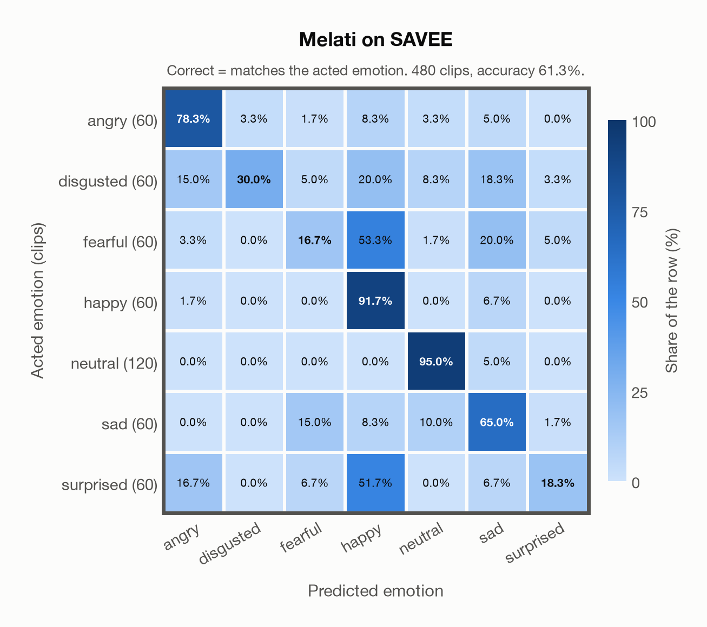

# Melati on SAVEE

Generated by `scripts/evaluation/evaluate.py` on 2026-11-06.

## Summary

| Metric | Value |
|---|---|
| Clips evaluated | 480 (English (British)) |
| **Accuracy: prediction matches the acted emotion** | **61.3%** |
| Unweighted accuracy (mean recall of the 7 acted emotions) | 56.4% |
| Macro F1 (acted emotion) | 53.2% |
| Accuracy, all 7 model classes (acted emotion) | 61.3% |
| Chance level (7 emotions) | 14.3% |

## Setup

- **Model**: Melati (`Scicom-intl/Melati-Emotion-Whisper-Large-V3`) as released (no fine-tuning), transformers 5.18.0, loaded by `scripts/models/melati.py`. Each clip (at most 30 s) becomes Whisper-large-v3 log-mel features padded to 30 s; the encoder layers are averaged over the clip's own frames only (50 per second), as in the official melati_emotion.py. Precision: float16 encoder, float32 head. The prediction is the most probable of the raw probabilities. The official thresholds (melati_emotion.py, label()) are not applied: they were set for precise tagging of podcasts, would turn most clips into neutral, and never return disgusted.
- **Data**: 480 clips of SAVEE (English (British)) from `data/savee/`.
- **Ground truth (acted emotion)**: the emotion each actor was asked to portray, from the letters after the speaker in the file name (`a`nger, `d`isgust, `f`ear, `h`appiness, `n`eutral, `sa`dness, `su`rprise).
- Label mapping: anger = angry, disgust = disgusted, fear = fearful, happiness = happy, neutral = neutral, sadness = sad, surprise = surprised.
- 4 male speakers (DC, JE, JK, KL) say 15 sentences in each emotion (only 3 of them are the same in every emotion) and 30 in neutral: 480 clips. Audio: 44.1 kHz mono WAV, resampled to 16 kHz.
- **7 emotions**: the prediction is the most probable of the 7 emotions in this dataset (angry, disgusted, fearful, happy, neutral, sad, surprised); the model has no other classes. **All 7 model classes**: the prediction is the most probable of all 7 model classes, so choosing a class that the dataset does not have counts as wrong.
- **Hardware**: Apple M4 Max, device `mps`, PyTorch 2.7.1. Inference took 3.3 min (407 ms per clip).
- **Per-clip predictions**: `outputs/melati_emotion/savee_predictions.csv` (in git, so the results can be checked clip by clip). The JSON file next to it describes the columns.

## Results per emotion

Rows: acted emotion. Precision, recall and F1 compare the prediction with the acted emotion.

| Emotion | Clips | Precision | Recall | F1 |
|---|---|---|---|---|
| angry | 60 | 68.1% | 78.3% | 72.9% |
| disgusted | 60 | 90.0% | 30.0% | 45.0% |
| fearful | 60 | 37.0% | 16.7% | 23.0% |
| happy | 60 | 39.3% | 91.7% | 55.0% |
| neutral | 120 | 89.1% | 95.0% | 91.9% |
| sad | 60 | 49.4% | 65.0% | 56.1% |
| surprised | 60 | 64.7% | 18.3% | 28.6% |

## Confusion matrix: acted emotion

The same numbers as a table. Rows: acted emotion. Columns: predicted emotion. Each row adds up to 100%.

| Acted \ Predicted | angry | disgusted | fearful | happy | neutral | sad | surprised |
|---|---|---|---|---|---|---|---|
| angry (60) | **78.3%** | 3.3% | 1.7% | 8.3% | 3.3% | 5.0% | 0.0% |
| disgusted (60) | 15.0% | **30.0%** | 5.0% | 20.0% | 8.3% | 18.3% | 3.3% |
| fearful (60) | 3.3% | 0.0% | **16.7%** | 53.3% | 1.7% | 20.0% | 5.0% |
| happy (60) | 1.7% | 0.0% | 0.0% | **91.7%** | 0.0% | 6.7% | 0.0% |
| neutral (120) | 0.0% | 0.0% | 0.0% | 0.0% | **95.0%** | 5.0% | 0.0% |
| sad (60) | 0.0% | 0.0% | 15.0% | 8.3% | 10.0% | **65.0%** | 1.7% |
| surprised (60) | 16.7% | 0.0% | 6.7% | 51.7% | 0.0% | 6.7% | **18.3%** |

Most frequent confusions: fearful predicted as happy (53.3%), surprised predicted as happy (51.7%), fearful predicted as sad (20.0%).

## Caveats

- **Not in Melati's training data** (nine acted corpora, JL-Corpus among them).
- **Unofficial copy.** The official corpus is free for research after registration and its licence forbids redistribution; the files come from an unofficial copy on Kaggle (ejlok1/surrey-audiovisual-expressed-emotion-savee), checked only against the file names and counts of the corpus.
- Only 4 speakers, all male. 10 evaluators validated the recordings originally; their results per clip are not published, so there is one way of counting a prediction as correct.
- Most sentences differ between emotions, and some of them are emotion-specific, so their words can hint at the emotion.
- SAVEE is in EmoBox, so it is in the training data of emotion2vec+.
