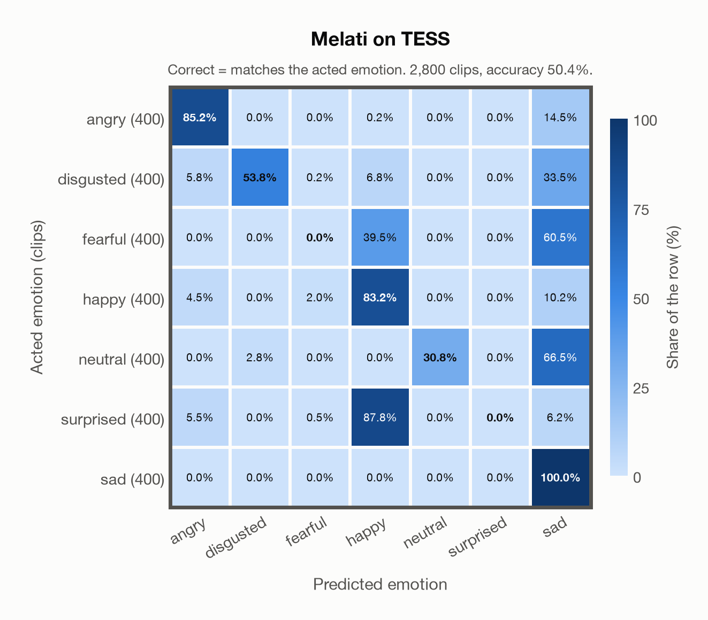

# Melati on TESS

Generated by `scripts/evaluation/evaluate.py` on 2026-10-29.

## Summary

| Metric | Value |
|---|---|
| Clips evaluated | 2,800 (English) |
| **Accuracy: prediction matches the acted emotion** | **50.4%** |
| Unweighted accuracy (mean recall of the 7 acted emotions) | 50.4% |
| Macro F1 (acted emotion) | 43.4% |
| Accuracy, all 7 model classes (acted emotion) | 50.4% |
| Chance level (7 emotions) | 14.3% |

## Setup

- **Model**: Melati (`Scicom-intl/Melati-Emotion-Whisper-Large-V3`) as released (no fine-tuning), transformers 5.18.0, loaded by `scripts/models/melati.py`. Each clip (at most 30 s) becomes Whisper-large-v3 log-mel features padded to 30 s; the encoder layers are averaged over the clip's own frames only (50 per second), as in the official melati_emotion.py. Precision: float16 encoder, float32 head. The prediction is the most probable of the raw probabilities. The official thresholds (melati_emotion.py, label()) are not applied: they were set for precise tagging of podcasts, would turn most clips into neutral, and never return disgusted.
- **Data**: 2,800 clips of TESS (English) from `data/tess/`.
- **Ground truth (acted emotion)**: the emotion each actress was asked to portray, from the last word of the file name (`angry`, `disgust`, `fear`, `happy`, `neutral`, `ps` for pleasant surprise, `sad`).
- Label mapping: angry, happy, neutral and sad keep their names; disgust = disgusted, fear = fearful, **pleasant surprise = surprised**.
- Two actresses, aged 26 and 64, say "Say the word ..." with the same 200 target words in each of the seven emotions.
- **7 emotions**: the prediction is the most probable of the 7 emotions in this dataset (angry, disgusted, fearful, happy, neutral, surprised, sad); the model has no other classes. **All 7 model classes**: the prediction is the most probable of all 7 model classes, so choosing a class that the dataset does not have counts as wrong.
- **Hardware**: Apple M4 Max, device `mps`, PyTorch 2.5.1. Inference took 17.5 min (376 ms per clip).
- **Per-clip predictions**: `outputs/melati_emotion/tess_predictions.csv` (not in git; re-run the script to recreate it). The JSON file next to it describes the columns.

## Results per emotion

Rows: acted emotion. Precision, recall and F1 compare the prediction with the acted emotion.

| Emotion | Clips | Precision | Recall | F1 |
|---|---|---|---|---|
| angry | 400 | 84.4% | 85.2% | 84.8% |
| disgusted | 400 | 95.1% | 53.8% | 68.7% |
| fearful | 400 | 0.0% | 0.0% | 0.0% |
| happy | 400 | 38.3% | 83.2% | 52.4% |
| neutral | 400 | 100.0% | 30.8% | 47.0% |
| surprised | 400 | 0.0% | 0.0% | 0.0% |
| sad | 400 | 34.3% | 100.0% | 51.1% |

## Confusion matrix: acted emotion

The same numbers as a table. Rows: acted emotion. Columns: predicted emotion. Each row adds up to 100%.

| Acted \ Predicted | angry | disgusted | fearful | happy | neutral | surprised | sad |
|---|---|---|---|---|---|---|---|
| angry (400) | **85.2%** | 0.0% | 0.0% | 0.2% | 0.0% | 0.0% | 14.5% |
| disgusted (400) | 5.8% | **53.8%** | 0.2% | 6.8% | 0.0% | 0.0% | 33.5% |
| fearful (400) | 0.0% | 0.0% | **0.0%** | 39.5% | 0.0% | 0.0% | 60.5% |
| happy (400) | 4.5% | 0.0% | 2.0% | **83.2%** | 0.0% | 0.0% | 10.2% |
| neutral (400) | 0.0% | 2.8% | 0.0% | 0.0% | **30.8%** | 0.0% | 66.5% |
| surprised (400) | 5.5% | 0.0% | 0.5% | 87.8% | 0.0% | **0.0%** | 6.2% |
| sad (400) | 0.0% | 0.0% | 0.0% | 0.0% | 0.0% | 0.0% | **100.0%** |

Most frequent confusions: surprised predicted as happy (87.8%), neutral predicted as sad (66.5%), fearful predicted as sad (60.5%).

## Caveats

- **Not in Melati's training data** (nine acted corpora, JL-Corpus among them).
- Only two speakers, so the result says little about other voices; models often score close to 100% on TESS.
- No listeners' labels are published with the dataset. Audio: 24,414 Hz WAV (one file, `OAF_food_fear.wav`, is 96 kHz), resampled to 16 kHz.
