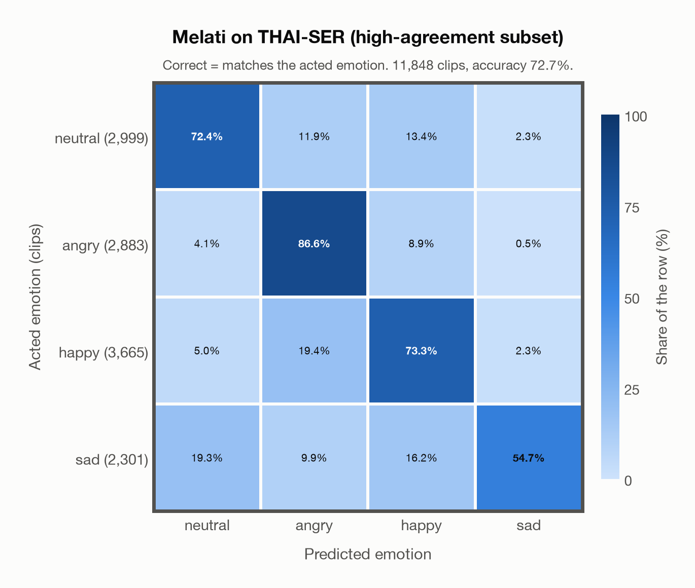
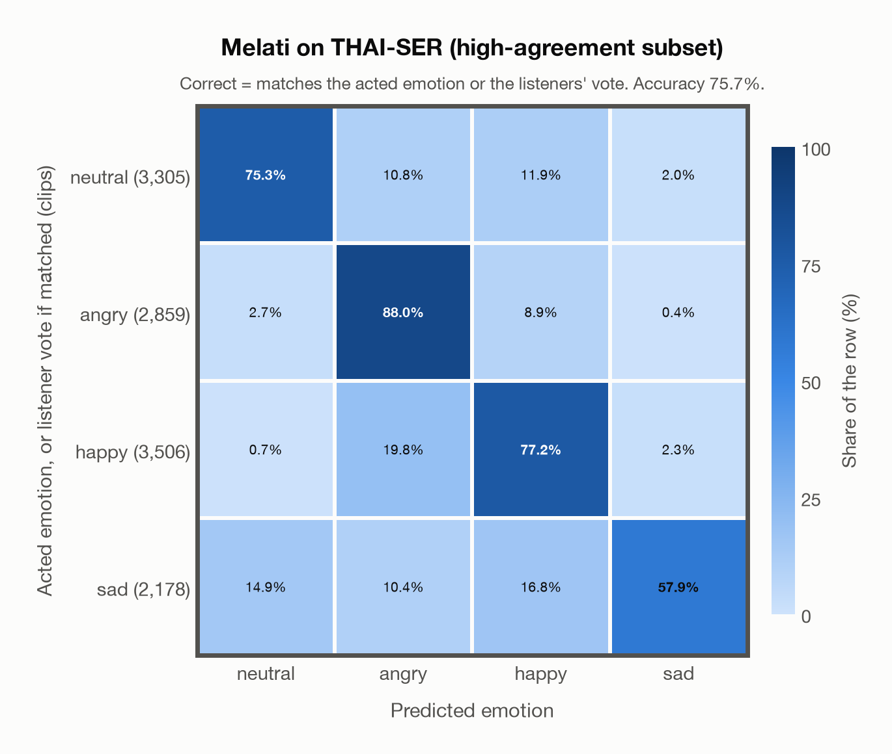

# Melati on THAI-SER (high-agreement subset)

Generated by `scripts/evaluation/evaluate.py` on 2026-11-06.

## Summary

| Metric | Value |
|---|---|
| Clips evaluated | 11,848 (Thai) |
| **Accuracy: prediction matches the acted emotion** | **72.7%** |
| **Accuracy: prediction matches the acted emotion or the listeners' vote** | **75.7%** |
| Unweighted accuracy (mean recall of the 4 acted emotions) | 71.8% |
| Macro F1 (acted emotion) | 72.2% |
| Accuracy, all 7 model classes (acted emotion) | 70.2% |
| Chance level (4 emotions) | 25.0% |
| Listeners' majority vote vs acted emotion | 77.2% |

## Setup

- **Model**: Melati (`Scicom-intl/Melati-Emotion-Whisper-Large-V3`) as released (no fine-tuning), transformers 5.18.0, loaded by `scripts/models/melati.py`. Each clip (at most 30 s) becomes Whisper-large-v3 log-mel features padded to 30 s; the encoder layers are averaged over the clip's own frames only (50 per second), as in the official melati_emotion.py. Precision: float16 encoder, float32 head. The prediction is the most probable of the raw probabilities. The official thresholds (melati_emotion.py, label()) are not applied: they were set for precise tagging of podcasts, would turn most clips into neutral, and never return disgusted.
- **Data**: 11,848 clips of THAI-SER (high-agreement subset) (Thai) from `data/thai_ser/`.
- **Ground truth (acted emotion)**: the emotion assigned to the actor for the scene (`assigned_emo`).
- **Listeners' vote**: the crowd-sourced majority label (`majority_emo`); clips without a majority have none.
- **High-agreement subset** (`subsets` in config/evaluation.yaml): only the clips with agreement >= 0.71 (`agreement`: the share of the crowd raters who chose the majority label), the subset the dataset authors recommend: 11,848 of the 22,584 clips of the four emotions (neutral 2,999, angry 2,883, happy 3,665, sad 2,301). Every model is evaluated on the same subset.
- Label mapping: Neutral = neutral, Angry = angry, Happy = happy, Sad = sad. Clips assigned *Frustrated* (5,270 of 27,854) are left out because none of the project's emotions matches it; a listener vote of *frustrated* can therefore never match.
- Audio: the condenser microphone for studio sessions and the Zoom recording for online sessions (44.1 kHz FLAC, resampled to 16 kHz).
- **4 emotions**: the prediction is the most probable of the 4 emotions in this dataset (neutral, angry, happy, sad); the model's other classes (`surprised`, `fearful`, `disgusted`) are ignored. **All 7 model classes**: the prediction is the most probable of all 7 model classes, so choosing a class that the dataset does not have counts as wrong.
- **Two ways to count a prediction as correct.** *Acted emotion*: it must match the acted emotion. *Acted emotion or listeners' vote*: it also counts when it matches the listeners' majority vote (for a tied vote, any of the tied emotions). Both are reported.
- **Hardware**: Apple M4 Max, device `mps`, PyTorch 2.7.1. Inference took 59.8 min (303 ms per clip).
- **Per-clip predictions**: `outputs/melati_emotion/thai_ser_predictions.csv` (in git, so the results can be checked clip by clip). The JSON file next to it describes the columns.

## Results per emotion

Rows: acted emotion. Precision, recall and F1 compare the prediction with the acted emotion; the last column also accepts the listeners' vote.

| Emotion | Clips | Precision | Recall | F1 | Correct, acted or listeners' vote |
|---|---|---|---|---|---|
| neutral | 2,999 | 74.5% | 72.4% | 73.4% | 72.8% |
| angry | 2,883 | 65.8% | 86.6% | 74.8% | 88.1% |
| happy | 3,665 | 72.3% | 73.3% | 72.8% | 78.1% |
| sad | 2,301 | 88.4% | 54.7% | 67.6% | 60.2% |

## Confusion matrix: acted emotion

The same numbers as a table. Rows: acted emotion. Columns: predicted emotion. Each row adds up to 100%.

| Acted \ Predicted | neutral | angry | happy | sad |
|---|---|---|---|---|
| neutral (2,999) | **72.4%** | 11.9% | 13.4% | 2.3% |
| angry (2,883) | 4.1% | **86.6%** | 8.9% | 0.5% |
| happy (3,665) | 5.0% | 19.4% | **73.3%** | 2.3% |
| sad (2,301) | 19.3% | 9.9% | 16.2% | **54.7%** |

Most frequent confusions: happy predicted as angry (19.4%), sad predicted as neutral (19.3%), sad predicted as happy (16.2%).

## Confusion matrix: acted emotion or listeners' vote

Here a prediction is correct when it matches the acted emotion or the listeners' vote. A clip goes into the row of the label its prediction matched, otherwise into the row of its acted emotion. The diagonal therefore holds every correct prediction, and the rows differ in size from the matrix above. 359 clips (3.0%) count as correct only because of the listeners' vote; the most common are acted happy predicted as neutral (159), acted sad predicted as neutral (119), acted angry predicted as neutral (40).

| Ground truth \ Predicted | neutral | angry | happy | sad |
|---|---|---|---|---|
| neutral (3,305) | **75.3%** | 10.8% | 11.9% | 2.0% |
| angry (2,859) | 2.7% | **88.0%** | 8.9% | 0.4% |
| happy (3,506) | 0.7% | 19.8% | **77.2%** | 2.3% |
| sad (2,178) | 14.9% | 10.4% | 16.8% | **57.9%** |

Most frequent confusions: happy predicted as angry (19.8%), sad predicted as happy (16.8%), sad predicted as neutral (14.9%).

## Predictions outside the 4 emotions

With all 7 model classes, the model chose a class that this dataset does not have for 658 clips (5.6%): `surprised` 77, `fearful` 197, `disgusted` 384.

## Comparison with human listeners

The listeners' majority vote matches the acted emotion for 77.2% of the 11,848 clips with a single (untied) vote. The model agrees with that vote for 63.4% of the same clips.

## Caveats

- **Not in Melati's training data** (nine acted corpora, JL-Corpus among them).
- **High agreement is not the acted emotion.** The raters agreed with each other, but for 2,698 of the 11,848 clips their majority label differs from the assigned one (often *frustrated* or *neutral*).
- Some sessions were recorded in an untreated studio room or over Zoom, so audio quality varies.
- **Acted labels are not perceived emotions.** The ground truth is what the actor intended; listeners sometimes heard something else, as the listeners' numbers above show.
