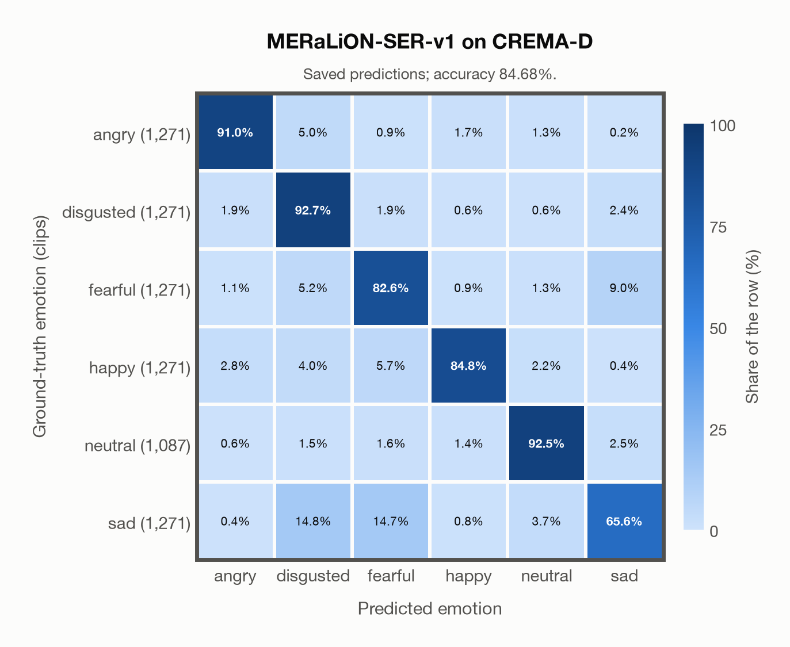
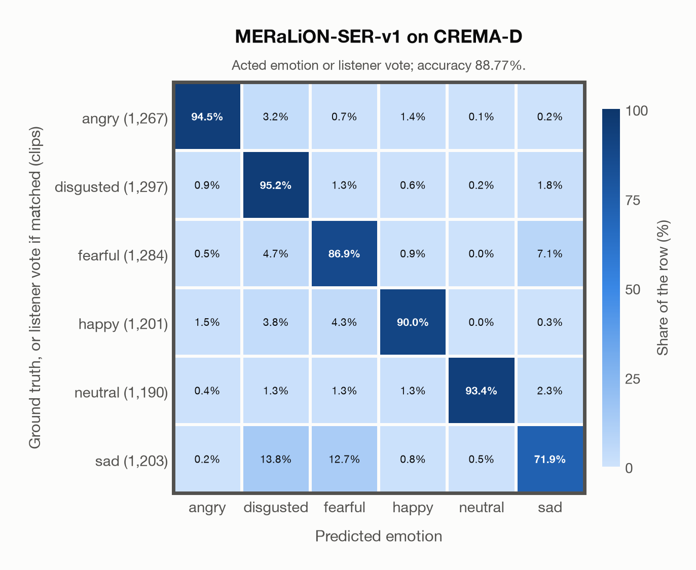

# MERaLiON-SER-v1 on CREMA-D

Regenerated offline from saved CSV/JSON by `scripts/evaluation/refresh_reports.py`. This refresh performs no model inference or API requests.

## Summary

| Metric | Recomputed value |
|---|---:|
| Clips | 7,442 |
| Accuracy: acted emotion | 84.68% |
| UAR: mean ground-truth-row recall | 84.87% |
| Macro F1 | 84.74% |
| Weighted F1: true-support weighted | 84.58% |
| Accuracy: all model classes | 84.68% |
| Accuracy: acted emotion or listener vote | 88.77% |
| Single listener vote vs acted emotion | 45.59% |
| Model vs single listener vote | 46.45% |

## Imported run and verification

- Source: [prediction CSV](../../outputs/meralion_ser_v1/crema_d_predictions.csv) and [metadata JSON](../../outputs/meralion_ser_v1/crema_d_predictions.json); both remain byte-for-byte unchanged.
- Original execution date recorded in JSON: `2026-10-28`.
- Dataset scope recorded in JSON: **CREMA-D**, English; 7,442 / 7,442 clips.
- Ground-truth column: `acted_emotion`. Candidate classes: angry, disgusted, fearful, happy, neutral, sad.
- Row counts, unique audio paths, correctness flags and saved metrics were checked against the CSV. Metric agreement tolerance is 0.000001 (six-decimal metadata).
- Weighted F1 weights each class's F1 by its true support, using the same resolved truth as macro F1; invalid answers remain errors. New metrics absent from the source JSON are recorded in the offline audit and summaries; the source JSON is preserved.
- Original execution/client runtime metadata (reported by the imported run, not measured by this refresh): `{"device": "mps", "hardware": "Apple M4 Max", "seconds": 1981.5, "ms_per_clip": 266.3, "on_cpu": 0}`.

## Results per emotion

| Ground-truth emotion | Clips | Recall | Acted-or-listener recall |
|---|---:|---:|---:|
| angry | 1,271 | 90.95% | 94.49% |
| disgusted | 1,271 | 92.68% | 95.12% |
| fearful | 1,271 | 82.61% | 86.78% |
| happy | 1,271 | 84.82% | 90.56% |
| neutral | 1,087 | 92.55% | 92.82% |
| sad | 1,271 | 65.62% | 73.41% |

Precision/F1 use the same resolved-truth convention as the evaluation script. Weighted F1 uses the resolved-truth clip counts below as weights.

| Predicted emotion | Resolved-truth clips | Precision | Recall | F1 |
|---|---:|---:|---:|---:|
| angry | 1,271 | 93.15% | 90.95% | 92.04% |
| disgusted | 1,271 | 75.37% | 92.68% | 83.13% |
| fearful | 1,271 | 77.09% | 82.61% | 79.76% |
| happy | 1,271 | 94.31% | 84.82% | 89.31% |
| neutral | 1,087 | 89.74% | 92.55% | 91.12% |
| sad | 1,271 | 82.41% | 65.62% | 73.06% |

## Confusion matrix: acted emotion

| Ground truth \ Predicted | angry | disgusted | fearful | happy | neutral | sad |
|---|---|---|---|---|---|---|
| angry (1,271) | **91.0%** | 5.0% | 0.9% | 1.7% | 1.3% | 0.2% |
| disgusted (1,271) | 1.9% | **92.7%** | 1.9% | 0.6% | 0.6% | 2.4% |
| fearful (1,271) | 1.1% | 5.2% | **82.6%** | 0.9% | 1.3% | 9.0% |
| happy (1,271) | 2.8% | 4.0% | 5.7% | **84.8%** | 2.2% | 0.4% |
| neutral (1,087) | 0.6% | 1.5% | 1.6% | 1.4% | **92.5%** | 2.5% |
| sad (1,271) | 0.4% | 14.8% | 14.7% | 0.8% | 3.7% | **65.6%** |

## Confusion matrix: acted emotion or listener vote

A prediction accepted only through the listener vote is placed in that predicted emotion's row; other clips keep their original ground-truth row. Row supports can therefore change.

| Ground truth \ Predicted | angry | disgusted | fearful | happy | neutral | sad |
|---|---|---|---|---|---|---|
| angry (1,267) | **94.5%** | 3.2% | 0.7% | 1.4% | 0.1% | 0.2% |
| disgusted (1,297) | 0.9% | **95.2%** | 1.3% | 0.6% | 0.2% | 1.8% |
| fearful (1,284) | 0.5% | 4.7% | **86.9%** | 0.9% | 0.0% | 7.1% |
| happy (1,201) | 1.5% | 3.8% | 4.3% | **90.0%** | 0.0% | 0.3% |
| neutral (1,190) | 0.4% | 1.3% | 1.3% | 1.3% | **93.4%** | 2.3% |
| sad (1,203) | 0.2% | 13.8% | 12.7% | 0.8% | 0.5% | **71.9%** |

## Caveats

- **Training involvement for MERaLiON-SER-v1: Used directly**. Source: SER training on CREMA-D, ESD, MELD, M3ED and Singaporean speech; retained Whisper-medium pretraining sources are incompletely disclosed; upstream seed/base teacher use is counted as seen. Direct use and upstream teacher use both count as training involvement. No pattern: no corpus-specific evidence, not verified unseen. Corpus use is not test-clip leakage.
- The known empty CREMA-D recording 1076_MTI_SAD_XX.wav is retained in the saved predictions, matching the existing project evaluation scope.
- Internal CSV/JSON consistency does not authenticate the original model or remote request logs.

[Offline validation audit](crema_d_offline_audit.json)
