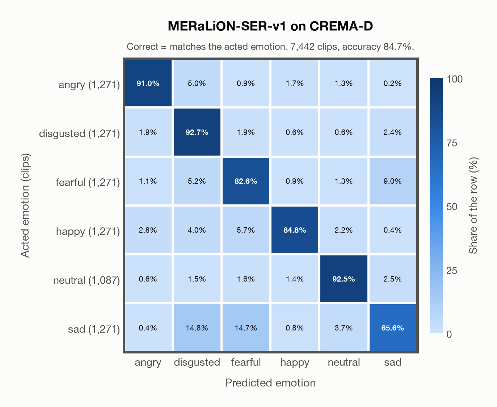
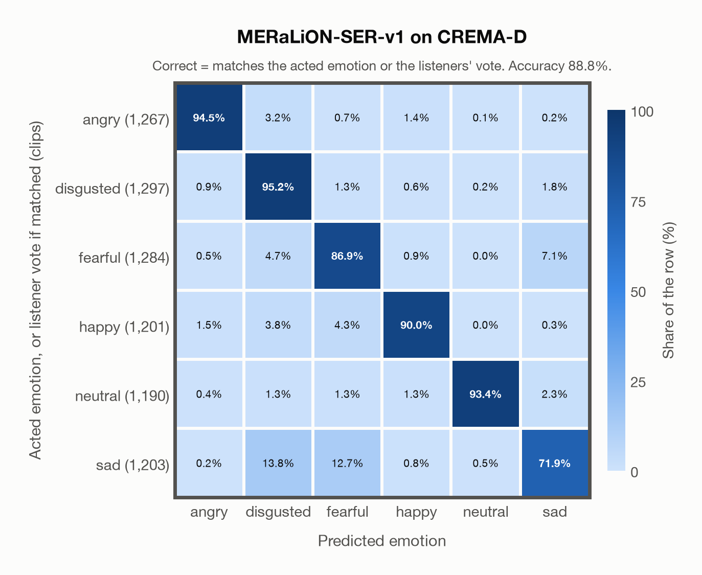

# MERaLiON-SER-v1 on CREMA-D

Generated by `scripts/evaluation/evaluate.py` on 2026-10-28.

## Summary

| Metric | Value |
|---|---|
| Clips evaluated | 7,442 (English) |
| **Accuracy: prediction matches the acted emotion** | **84.7%** |
| **Accuracy: prediction matches the acted emotion or the listeners' vote** | **88.8%** |
| Unweighted accuracy (mean recall of the 6 acted emotions) | 84.9% |
| Macro F1 (acted emotion) | 84.7% |
| Accuracy, all 7 model classes (acted emotion) | 84.7% |
| Chance level (6 emotions) | 16.7% |
| Listeners' majority vote vs acted emotion | 45.6% |

## Setup

- **Model**: MERaLiON-SER-v1 (`MERaLiON/MERaLiON-SER-v1`) as released (no fine-tuning), transformers 5.18.0, loaded by `scripts/models/meralion_ser.py`. Each clip becomes Whisper log-mel features padded with silence to 30 s (as in the model card); the model ignores attention masks and pools over the whole 30 s window, padding included, which is its official behaviour. float32 on every device, as released.
- **Data**: 7,442 clips of CREMA-D (English) from `data/crema_d/`.
- **Ground truth (acted emotion)**: the emotion each actor was asked to portray, from the file name (`ANG`, `DIS`, `FEA`, `HAP`, `NEU`, `SAD`).
- **Listeners' vote**: the majority vote of crowd-sourced listeners who heard the voice only (`summaryTable.csv`, `VoiceVote`); a tie counts every tied emotion.
- **6 emotions**: the prediction is the most probable of the 6 emotions in this dataset (angry, disgusted, fearful, happy, neutral, sad); the model's other classes (`surprised`) are ignored. **All 7 model classes**: the prediction is the most probable of all 7 model classes, so choosing a class that the dataset does not have counts as wrong.
- **Two ways to count a prediction as correct.** *Acted emotion*: it must match the acted emotion. *Acted emotion or listeners' vote*: it also counts when it matches the listeners' majority vote (for a tied vote, any of the tied emotions). Both are reported.
- **Hardware**: Apple M4 Max, device `mps`, PyTorch 2.5.1. Inference took 33.0 min (266 ms per clip).
- **Per-clip predictions**: `outputs/meralion_ser_v1/crema_d_predictions.csv` (not in git; re-run the script to recreate it). The JSON file next to it describes the columns.

## Results per emotion

Rows: acted emotion. Precision, recall and F1 compare the prediction with the acted emotion; the last column also accepts the listeners' vote.

| Emotion | Clips | Precision | Recall | F1 | Correct, acted or listeners' vote |
|---|---|---|---|---|---|
| angry | 1,271 | 93.2% | 91.0% | 92.0% | 94.5% |
| disgusted | 1,271 | 75.4% | 92.7% | 83.1% | 95.1% |
| fearful | 1,271 | 77.1% | 82.6% | 79.8% | 86.8% |
| happy | 1,271 | 94.3% | 84.8% | 89.3% | 90.6% |
| neutral | 1,087 | 89.7% | 92.5% | 91.1% | 92.8% |
| sad | 1,271 | 82.4% | 65.6% | 73.1% | 73.4% |

## Confusion matrix: acted emotion

The same numbers as a table. Rows: acted emotion. Columns: predicted emotion. Each row adds up to 100%.

| Acted \ Predicted | angry | disgusted | fearful | happy | neutral | sad |
|---|---|---|---|---|---|---|
| angry (1,271) | **91.0%** | 5.0% | 0.9% | 1.7% | 1.3% | 0.2% |
| disgusted (1,271) | 1.9% | **92.7%** | 1.9% | 0.6% | 0.6% | 2.4% |
| fearful (1,271) | 1.1% | 5.2% | **82.6%** | 0.9% | 1.3% | 9.0% |
| happy (1,271) | 2.8% | 4.0% | 5.7% | **84.8%** | 2.2% | 0.4% |
| neutral (1,087) | 0.6% | 1.5% | 1.6% | 1.4% | **92.5%** | 2.5% |
| sad (1,271) | 0.4% | 14.8% | 14.7% | 0.8% | 3.7% | **65.6%** |

Most frequent confusions: sad predicted as disgusted (14.8%), sad predicted as fearful (14.7%), fearful predicted as sad (9.0%).

## Confusion matrix: acted emotion or listeners' vote

Here a prediction is correct when it matches the acted emotion or the listeners' vote. A clip goes into the row of the label its prediction matched, otherwise into the row of its acted emotion. The diagonal therefore holds every correct prediction, and the rows differ in size from the matrix above. 304 clips (4.1%) count as correct only because of the listeners' vote; the most common are acted sad predicted as neutral (41), acted sad predicted as fearful (34), acted happy predicted as neutral (28).

| Ground truth \ Predicted | angry | disgusted | fearful | happy | neutral | sad |
|---|---|---|---|---|---|---|
| angry (1,267) | **94.5%** | 3.2% | 0.7% | 1.4% | 0.1% | 0.2% |
| disgusted (1,297) | 0.9% | **95.2%** | 1.3% | 0.6% | 0.2% | 1.8% |
| fearful (1,284) | 0.5% | 4.7% | **86.9%** | 0.9% | 0.0% | 7.1% |
| happy (1,201) | 1.5% | 3.8% | 4.3% | **90.0%** | 0.0% | 0.3% |
| neutral (1,190) | 0.4% | 1.3% | 1.3% | 1.3% | **93.4%** | 2.3% |
| sad (1,203) | 0.2% | 13.8% | 12.7% | 0.8% | 0.5% | **71.9%** |

Most frequent confusions: sad predicted as disgusted (13.8%), sad predicted as fearful (12.7%), fearful predicted as sad (7.1%).

## Predictions outside the 6 emotions

With all 7 model classes, the model chose a class that this dataset does not have for 0 clips (0.0%): `surprised` 0.

## Comparison with human listeners

The listeners' majority vote matches the acted emotion for 45.6% of the 6,798 clips with a single (untied) vote. The model agrees with that vote for 46.5% of the same clips.

## Caveats

- **In MERaLiON-SER-v1's training data** (CREMA-D, ESD, MELD, M3ED and Singaporean speech), so the model has probably seen these clips; treat the result as optimistic.
- One clip, `1076_MTI_SAD_XX.wav`, contains no audio (a known CREMA-D issue); it is kept.
- **Acted labels are not perceived emotions.** The ground truth is what the actor intended; listeners sometimes heard something else, as the listeners' numbers above show.
