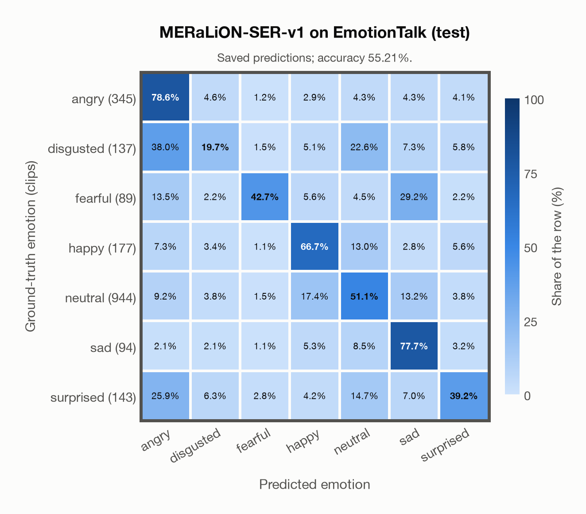

# MERaLiON-SER-v1 on EmotionTalk (test)

Regenerated offline from saved CSV/JSON by `scripts/evaluation/refresh_reports.py`. This refresh performs no model inference or API requests.

## Summary

| Metric | Recomputed value |
|---|---:|
| Clips | 1,929 |
| Accuracy: acted emotion | 55.21% |
| UAR: mean ground-truth-row recall | 53.64% |
| Macro F1 | 47.36% |
| Weighted F1: true-support weighted | 56.06% |
| Accuracy: all model classes | 55.21% |

## Imported run and verification

- Source: [prediction CSV](../../outputs/meralion_ser_v1/emotiontalk_predictions.csv) and [metadata JSON](../../outputs/meralion_ser_v1/emotiontalk_predictions.json); both remain byte-for-byte unchanged.
- Original execution date recorded in JSON: `2026-11-10`.
- Dataset scope recorded in JSON: **EmotionTalk (test)**, Mandarin; 1,929 / 1,929 clips.
- Ground-truth column: `acted_emotion`. Candidate classes: angry, disgusted, fearful, happy, neutral, sad, surprised.
- Row counts, unique audio paths, correctness flags and saved metrics were checked against the CSV. Metric agreement tolerance is 0.000001 (six-decimal metadata).
- Weighted F1 weights each class's F1 by its true support, using the same resolved truth as macro F1; invalid answers remain errors. New metrics absent from the source JSON are recorded in the offline audit and summaries; the source JSON is preserved.
- Original execution/client runtime metadata (reported by the imported run, not measured by this refresh): `{"device": "mps", "hardware": "Apple M3 Pro", "seconds": 886.3, "ms_per_clip": 459.5, "on_cpu": 0}`.

## Results per emotion

| Ground-truth emotion | Clips | Recall | Acted-or-listener recall |
|---|---:|---:|---:|
| angry | 345 | 78.55% | — |
| disgusted | 137 | 19.71% | — |
| fearful | 89 | 42.70% | — |
| happy | 177 | 66.67% | — |
| neutral | 944 | 51.06% | — |
| sad | 94 | 77.66% | — |
| surprised | 143 | 39.16% | — |

Precision/F1 use the same resolved-truth convention as the evaluation script. Weighted F1 uses the resolved-truth clip counts below as weights.

| Predicted emotion | Resolved-truth clips | Precision | Recall | F1 |
|---|---:|---:|---:|---:|
| angry | 345 | 57.17% | 78.55% | 66.18% |
| disgusted | 137 | 27.55% | 19.71% | 22.98% |
| fearful | 89 | 58.46% | 42.70% | 49.35% |
| happy | 177 | 37.46% | 66.67% | 47.97% |
| neutral | 944 | 82.53% | 51.06% | 63.09% |
| sad | 94 | 27.65% | 77.66% | 40.78% |
| surprised | 143 | 43.41% | 39.16% | 41.18% |

## Confusion matrix: acted emotion

| Ground truth \ Predicted | angry | disgusted | fearful | happy | neutral | sad | surprised |
|---|---|---|---|---|---|---|---|
| angry (345) | **78.6%** | 4.6% | 1.2% | 2.9% | 4.3% | 4.3% | 4.1% |
| disgusted (137) | 38.0% | **19.7%** | 1.5% | 5.1% | 22.6% | 7.3% | 5.8% |
| fearful (89) | 13.5% | 2.2% | **42.7%** | 5.6% | 4.5% | 29.2% | 2.2% |
| happy (177) | 7.3% | 3.4% | 1.1% | **66.7%** | 13.0% | 2.8% | 5.6% |
| neutral (944) | 9.2% | 3.8% | 1.5% | 17.4% | **51.1%** | 13.2% | 3.8% |
| sad (94) | 2.1% | 2.1% | 1.1% | 5.3% | 8.5% | **77.7%** | 3.2% |
| surprised (143) | 25.9% | 6.3% | 2.8% | 4.2% | 14.7% | 7.0% | **39.2%** |

## Caveats

- **Training involvement for MERaLiON-SER-v1: No corpus-specific evidence**. Source: SER training on CREMA-D, ESD, MELD, M3ED and Singaporean speech; retained Whisper-medium pretraining sources are incompletely disclosed; upstream seed/base teacher use is counted as seen. Direct use and upstream teacher use both count as training involvement. No pattern: no corpus-specific evidence, not verified unseen. Corpus use is not test-clip leakage.
- Internal CSV/JSON consistency does not authenticate the original model or remote request logs.

[Offline validation audit](emotiontalk_offline_audit.json)
