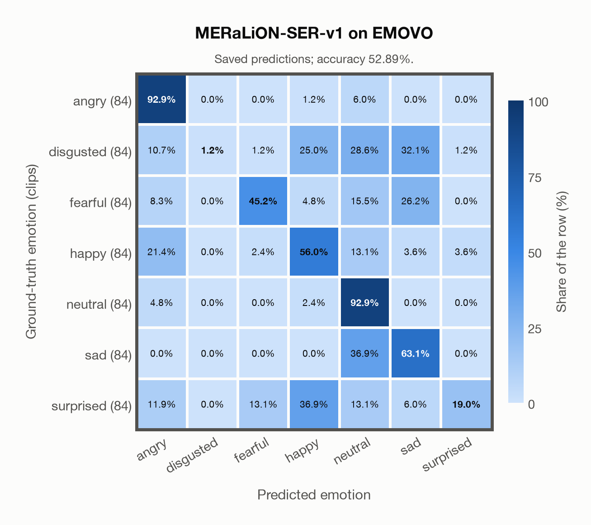

# MERaLiON-SER-v1 on EMOVO

Generated by `scripts/evaluation/evaluate.py` on 2026-11-06.

## Summary

| Metric | Value |
|---|---|
| Clips evaluated | 588 (Italian) |
| **Accuracy: prediction matches the acted emotion** | **52.9%** |
| Unweighted accuracy (mean recall of the 7 acted emotions) | 52.9% |
| Macro F1 (acted emotion) | 46.9% |
| Accuracy, all 7 model classes (acted emotion) | 52.9% |
| Chance level (7 emotions) | 14.3% |

## Setup

- **Model**: MERaLiON-SER-v1 (`MERaLiON/MERaLiON-SER-v1`) as released (no fine-tuning), transformers 5.18.0, loaded by `scripts/models/meralion_ser.py`. Each clip becomes Whisper log-mel features padded with silence to 30 s (as in the model card); the model ignores attention masks and pools over the whole 30 s window, padding included, which is its official behaviour. float32 on every device, as released.
- **Data**: 588 clips of EMOVO (Italian) from `data/emovo/`.
- **Ground truth (acted emotion)**: the emotion each actor was asked to portray, from the first part of the file name (`dis`gusto, `gio`ia, `neu`trale, `pau`ra, `rab`bia, `sor`presa, `tri`stezza).
- Label mapping: rabbia = angry, disgusto = disgusted, paura = fearful, gioia = happy, neutrale = neutral, tristezza = sad, sorpresa = surprised.
- 6 professional actors (3 female, 3 male) say the same 14 sentences (some of them nonsense sentences) in each of the 7 emotions: 588 clips.
- **7 emotions**: the prediction is the most probable of the 7 emotions in this dataset (angry, disgusted, fearful, happy, neutral, sad, surprised); the model has no other classes. **All 7 model classes**: the prediction is the most probable of all 7 model classes, so choosing a class that the dataset does not have counts as wrong.
- **Hardware**: Apple M4 Max, device `mps`, PyTorch 2.7.1. Inference took 2.8 min (286 ms per clip).
- **Per-clip predictions**: `outputs/meralion_ser_v1/emovo_predictions.csv` (in git, so the results can be checked clip by clip). The JSON file next to it describes the columns.

## Results per emotion

Rows: acted emotion. Precision, recall and F1 compare the prediction with the acted emotion.

| Emotion | Clips | Precision | Recall | F1 |
|---|---|---|---|---|
| angry | 84 | 61.9% | 92.9% | 74.3% |
| disgusted | 84 | 100.0% | 1.2% | 2.4% |
| fearful | 84 | 73.1% | 45.2% | 55.9% |
| happy | 84 | 44.3% | 56.0% | 49.5% |
| neutral | 84 | 45.1% | 92.9% | 60.7% |
| sad | 84 | 48.2% | 63.1% | 54.6% |
| surprised | 84 | 80.0% | 19.0% | 30.8% |

## Confusion matrix: acted emotion

The same numbers as a table. Rows: acted emotion. Columns: predicted emotion. Each row adds up to 100%.

| Acted \ Predicted | angry | disgusted | fearful | happy | neutral | sad | surprised |
|---|---|---|---|---|---|---|---|
| angry (84) | **92.9%** | 0.0% | 0.0% | 1.2% | 6.0% | 0.0% | 0.0% |
| disgusted (84) | 10.7% | **1.2%** | 1.2% | 25.0% | 28.6% | 32.1% | 1.2% |
| fearful (84) | 8.3% | 0.0% | **45.2%** | 4.8% | 15.5% | 26.2% | 0.0% |
| happy (84) | 21.4% | 0.0% | 2.4% | **56.0%** | 13.1% | 3.6% | 3.6% |
| neutral (84) | 4.8% | 0.0% | 0.0% | 2.4% | **92.9%** | 0.0% | 0.0% |
| sad (84) | 0.0% | 0.0% | 0.0% | 0.0% | 36.9% | **63.1%** | 0.0% |
| surprised (84) | 11.9% | 0.0% | 13.1% | 36.9% | 13.1% | 6.0% | **19.0%** |

Most frequent confusions: surprised predicted as happy (36.9%), sad predicted as neutral (36.9%), disgusted predicted as sad (32.1%).

## Caveats

- **Training involvement for MERaLiON-SER-v1: Used via upstream training**. Evidence scope: upstream teacher lineage. SER report documents emotion2vec seed/base teachers for SG-ECMT labels; their EmoBox corpus subset is unresolved. This counts as upstream training use; it does not assert direct reuse of those raw clips by MERaLiON. Source: SER training on CREMA-D, ESD, MELD, M3ED and Singaporean speech; retained Whisper-medium pretraining sources are incompletely disclosed; upstream seed/base teacher use is counted as seen. Direct use and upstream teacher use both count as training involvement. No pattern: no corpus-specific evidence, not verified unseen. Corpus use is not test-clip leakage.
- **Unofficial copy.** The official site (voice.fub.it) is gone and there is no official mirror; the files come from a copy on DagsHub (kingabzpro/EMOVO), checked only against the file names and count of the corpus.
- No listeners' labels per clip are published (the authors' listening test covered 2 sentences per actor). Only six speakers. Audio: 48 kHz WAV, stereo except one file (the channels are averaged), resampled to 16 kHz.
