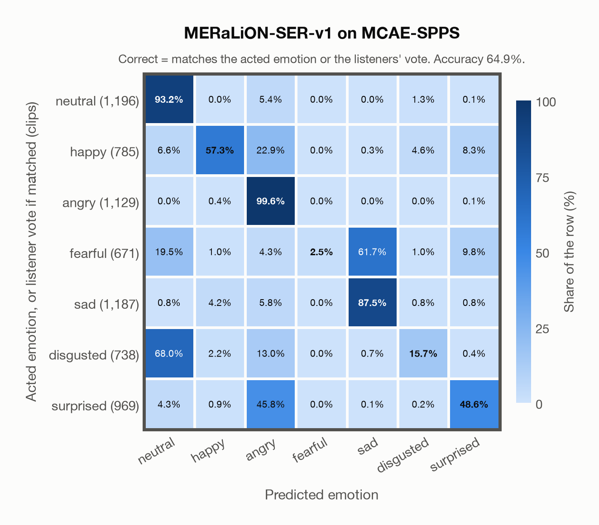

# MERaLiON-SER-v1 on MCAE-SPPS

Generated by `scripts/evaluation/evaluate.py` on 2026-10-28.

## Summary

| Metric | Value |
|---|---|
| Clips evaluated | 6,675 (Mandarin) |
| **Accuracy: prediction matches the acted emotion** | **64.9%** |
| **Accuracy: prediction matches the acted emotion or the listeners' vote** | **64.9%** |
| Unweighted accuracy (mean recall of the 7 acted emotions) | 57.8% |
| Macro F1 (acted emotion) | 54.4% |
| Accuracy, all 7 model classes (acted emotion) | 64.9% |
| Chance level (7 emotions) | 14.3% |
| Listeners' majority vote vs acted emotion | 100.0% |

## Setup

- **Model**: MERaLiON-SER-v1 (`MERaLiON/MERaLiON-SER-v1`) as released (no fine-tuning), transformers 5.18.0, loaded by `scripts/models/meralion_ser.py`. Each clip becomes Whisper log-mel features padded with silence to 30 s (as in the model card); the model ignores attention masks and pools over the whole 30 s window, padding included, which is its official behaviour. float32 on every device, as released.
- **Data**: 6,675 clips of MCAE-SPPS (Mandarin) from `data/mcae_spps/`.
- **Ground truth (acted emotion)**: the emotion each actor was asked to portray, from the second digit of the file name.
- **Listeners' vote**: the majority vote of the 40 listeners who rated each clip (`Corpus information.xlsx`); a tie counts every tied emotion.
- Label mapping: Neutral = neutral, Happiness = happy, Anger = angry, Fear = fearful, Sadness = sad, Disgust = disgusted, Surprise = surprised.
- **7 emotions**: the prediction is the most probable of the 7 emotions in this dataset (neutral, happy, angry, fearful, sad, disgusted, surprised); the model has no other classes. **All 7 model classes**: the prediction is the most probable of all 7 model classes, so choosing a class that the dataset does not have counts as wrong.
- **Two ways to count a prediction as correct.** *Acted emotion*: it must match the acted emotion. *Acted emotion or listeners' vote*: it also counts when it matches the listeners' majority vote (for a tied vote, any of the tied emotions). Both are reported.
- **Hardware**: Apple M4 Max, device `mps`, PyTorch 2.5.1. Inference took 29.2 min (263 ms per clip).
- **Per-clip predictions**: `outputs/meralion_ser_v1/mcae_spps_predictions.csv` (in git, so the results can be checked clip by clip). The JSON file next to it describes the columns.

## Results per emotion

Rows: acted emotion. Precision, recall and F1 compare the prediction with the acted emotion; the last column also accepts the listeners' vote.

| Emotion | Clips | Precision | Recall | F1 | Correct, acted or listeners' vote |
|---|---|---|---|---|---|
| neutral | 1,196 | 60.2% | 93.2% | 73.2% | 93.2% |
| happy | 785 | 84.0% | 57.3% | 68.1% | 57.3% |
| angry | 1,129 | 56.0% | 99.6% | 71.7% | 99.6% |
| fearful | 671 | 100.0% | 2.5% | 4.9% | 2.5% |
| sad | 1,187 | 71.1% | 87.5% | 78.5% | 87.5% |
| disgusted | 738 | 62.4% | 15.7% | 25.1% | 15.7% |
| surprised | 969 | 76.3% | 48.6% | 59.4% | 48.6% |

## Confusion matrix: acted emotion

The same numbers as a table. Rows: acted emotion. Columns: predicted emotion. Each row adds up to 100%.

| Acted \ Predicted | neutral | happy | angry | fearful | sad | disgusted | surprised |
|---|---|---|---|---|---|---|---|
| neutral (1,196) | **93.2%** | 0.0% | 5.4% | 0.0% | 0.0% | 1.3% | 0.1% |
| happy (785) | 6.6% | **57.3%** | 22.9% | 0.0% | 0.3% | 4.6% | 8.3% |
| angry (1,129) | 0.0% | 0.4% | **99.6%** | 0.0% | 0.0% | 0.0% | 0.1% |
| fearful (671) | 19.5% | 1.0% | 4.3% | **2.5%** | 61.7% | 1.0% | 9.8% |
| sad (1,187) | 0.8% | 4.2% | 5.8% | 0.0% | **87.5%** | 0.8% | 0.8% |
| disgusted (738) | 68.0% | 2.2% | 13.0% | 0.0% | 0.7% | **15.7%** | 0.4% |
| surprised (969) | 4.3% | 0.9% | 45.8% | 0.0% | 0.1% | 0.2% | **48.6%** |

Most frequent confusions: disgusted predicted as neutral (68.0%), fearful predicted as sad (61.7%), surprised predicted as angry (45.8%).

## Confusion matrix: acted emotion or listeners' vote

Here a prediction is correct when it matches the acted emotion or the listeners' vote. A clip goes into the row of the label its prediction matched, otherwise into the row of its acted emotion. The diagonal therefore holds every correct prediction, and the rows differ in size from the matrix above. 0 clips (0.0%) count as correct only because of the listeners' vote.

| Ground truth \ Predicted | neutral | happy | angry | fearful | sad | disgusted | surprised |
|---|---|---|---|---|---|---|---|
| neutral (1,196) | **93.2%** | 0.0% | 5.4% | 0.0% | 0.0% | 1.3% | 0.1% |
| happy (785) | 6.6% | **57.3%** | 22.9% | 0.0% | 0.3% | 4.6% | 8.3% |
| angry (1,129) | 0.0% | 0.4% | **99.6%** | 0.0% | 0.0% | 0.0% | 0.1% |
| fearful (671) | 19.5% | 1.0% | 4.3% | **2.5%** | 61.7% | 1.0% | 9.8% |
| sad (1,187) | 0.8% | 4.2% | 5.8% | 0.0% | **87.5%** | 0.8% | 0.8% |
| disgusted (738) | 68.0% | 2.2% | 13.0% | 0.0% | 0.7% | **15.7%** | 0.4% |
| surprised (969) | 4.3% | 0.9% | 45.8% | 0.0% | 0.1% | 0.2% | **48.6%** |

Most frequent confusions: disgusted predicted as neutral (68.0%), fearful predicted as sad (61.7%), surprised predicted as angry (45.8%).

## Comparison with human listeners

The listeners' majority vote matches the acted emotion for 100.0% of the 6,675 clips with a single (untied) vote. The model agrees with that vote for 64.9% of the same clips.

## Caveats

- **Not in MERaLiON-SER-v1's training data** (CREMA-D, ESD, MELD, M3ED and Singaporean speech).
- **Validated clips only.** The dataset keeps a clip only if at least 43% of its 40 listeners chose the intended emotion, so the acted label and the listeners' vote usually agree.
- Mandarin speech, 48 kHz, resampled to 16 kHz by the model's loader.
- **Acted labels are not perceived emotions.** The ground truth is what the actor intended; listeners sometimes heard something else, as the listeners' numbers above show.
