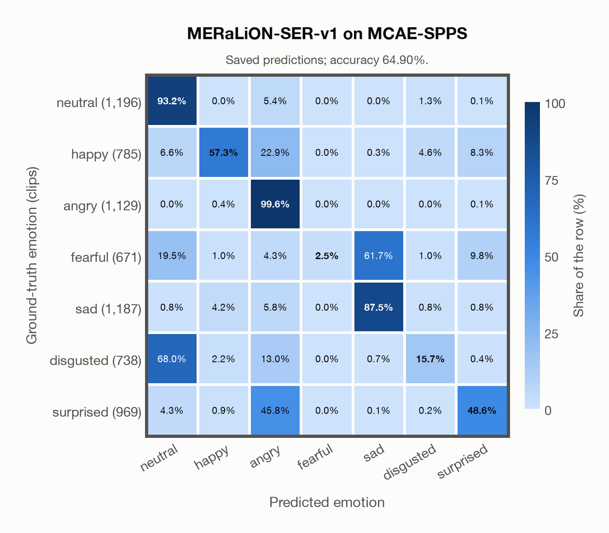

# MERaLiON-SER-v1 on MCAE-SPPS

Regenerated offline from saved CSV/JSON by `scripts/evaluation/refresh_reports.py`. This refresh performs no model inference or API requests.

## Summary

| Metric | Recomputed value |
|---|---:|
| Clips | 6,675 |
| Accuracy: acted emotion | 64.90% |
| UAR: mean ground-truth-row recall | 57.79% |
| Macro F1 | 54.42% |
| Weighted F1: true-support weighted | 59.10% |
| Accuracy: all model classes | 64.90% |
| Accuracy: acted emotion or listener vote | 64.90% |
| Single listener vote vs acted emotion | 100.00% |
| Model vs single listener vote | 64.90% |

## Imported run and verification

- Source: [prediction CSV](../../outputs/meralion_ser_v1/mcae_spps_predictions.csv) and [metadata JSON](../../outputs/meralion_ser_v1/mcae_spps_predictions.json); both remain byte-for-byte unchanged.
- Original execution date recorded in JSON: `2026-10-28`.
- Dataset scope recorded in JSON: **MCAE-SPPS**, Mandarin; 6,675 / 6,675 clips.
- Ground-truth column: `acted_emotion`. Candidate classes: neutral, happy, angry, fearful, sad, disgusted, surprised.
- Row counts, unique audio paths, correctness flags and saved metrics were checked against the CSV. Metric agreement tolerance is 0.000001 (six-decimal metadata).
- Weighted F1 weights each class's F1 by its true support, using the same resolved truth as macro F1; invalid answers remain errors. New metrics absent from the source JSON are recorded in the offline audit and summaries; the source JSON is preserved.
- Original execution/client runtime metadata (reported by the imported run, not measured by this refresh): `{"device": "mps", "hardware": "Apple M4 Max", "seconds": 1752.8, "ms_per_clip": 262.6, "on_cpu": 0}`.

## Results per emotion

| Ground-truth emotion | Clips | Recall | Acted-or-listener recall |
|---|---:|---:|---:|
| neutral | 1,196 | 93.23% | 93.23% |
| happy | 785 | 57.32% | 57.32% |
| angry | 1,129 | 99.56% | 99.56% |
| fearful | 671 | 2.53% | 2.53% |
| sad | 1,187 | 87.53% | 87.53% |
| disgusted | 738 | 15.72% | 15.72% |
| surprised | 969 | 48.61% | 48.61% |

Precision/F1 use the same resolved-truth convention as the evaluation script. Weighted F1 uses the resolved-truth clip counts below as weights.

| Predicted emotion | Resolved-truth clips | Precision | Recall | F1 |
|---|---:|---:|---:|---:|
| neutral | 1,196 | 60.24% | 93.23% | 73.19% |
| happy | 785 | 83.96% | 57.32% | 68.13% |
| angry | 1,129 | 56.00% | 99.56% | 71.68% |
| fearful | 671 | 100.00% | 2.53% | 4.94% |
| sad | 1,187 | 71.12% | 87.53% | 78.47% |
| disgusted | 738 | 62.37% | 15.72% | 25.11% |
| surprised | 969 | 76.34% | 48.61% | 59.39% |

## Confusion matrix: acted emotion

| Ground truth \ Predicted | neutral | happy | angry | fearful | sad | disgusted | surprised |
|---|---|---|---|---|---|---|---|
| neutral (1,196) | **93.2%** | 0.0% | 5.4% | 0.0% | 0.0% | 1.3% | 0.1% |
| happy (785) | 6.6% | **57.3%** | 22.9% | 0.0% | 0.3% | 4.6% | 8.3% |
| angry (1,129) | 0.0% | 0.4% | **99.6%** | 0.0% | 0.0% | 0.0% | 0.1% |
| fearful (671) | 19.5% | 1.0% | 4.3% | **2.5%** | 61.7% | 1.0% | 9.8% |
| sad (1,187) | 0.8% | 4.2% | 5.8% | 0.0% | **87.5%** | 0.8% | 0.8% |
| disgusted (738) | 68.0% | 2.2% | 13.0% | 0.0% | 0.7% | **15.7%** | 0.4% |
| surprised (969) | 4.3% | 0.9% | 45.8% | 0.0% | 0.1% | 0.2% | **48.6%** |

## Confusion matrix: acted emotion or listener vote

A prediction accepted only through the listener vote is placed in that predicted emotion's row; other clips keep their original ground-truth row. Row supports can therefore change.

| Ground truth \ Predicted | neutral | happy | angry | fearful | sad | disgusted | surprised |
|---|---|---|---|---|---|---|---|
| neutral (1,196) | **93.2%** | 0.0% | 5.4% | 0.0% | 0.0% | 1.3% | 0.1% |
| happy (785) | 6.6% | **57.3%** | 22.9% | 0.0% | 0.3% | 4.6% | 8.3% |
| angry (1,129) | 0.0% | 0.4% | **99.6%** | 0.0% | 0.0% | 0.0% | 0.1% |
| fearful (671) | 19.5% | 1.0% | 4.3% | **2.5%** | 61.7% | 1.0% | 9.8% |
| sad (1,187) | 0.8% | 4.2% | 5.8% | 0.0% | **87.5%** | 0.8% | 0.8% |
| disgusted (738) | 68.0% | 2.2% | 13.0% | 0.0% | 0.7% | **15.7%** | 0.4% |
| surprised (969) | 4.3% | 0.9% | 45.8% | 0.0% | 0.1% | 0.2% | **48.6%** |

## Caveats

- **Training involvement for MERaLiON-SER-v1: No corpus-specific evidence**. Source: SER training on CREMA-D, ESD, MELD, M3ED and Singaporean speech; retained Whisper-medium pretraining sources are incompletely disclosed; upstream seed/base teacher use is counted as seen. Direct use and upstream teacher use both count as training involvement. No pattern: no corpus-specific evidence, not verified unseen. Corpus use is not test-clip leakage.
- Internal CSV/JSON consistency does not authenticate the original model or remote request logs.

[Offline validation audit](mcae_spps_offline_audit.json)
