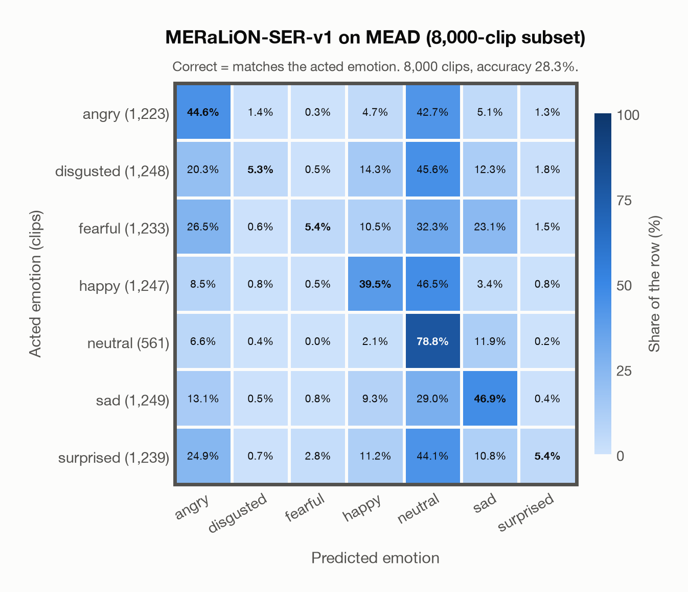

# MERaLiON-SER-v1 on MEAD (8,000-clip subset)

Generated by `scripts/evaluation/evaluate.py` on 2026-11-06.

## Summary

| Metric | Value |
|---|---|
| Clips evaluated | 8,000 (English) |
| **Accuracy: prediction matches the acted emotion** | **28.3%** |
| Unweighted accuracy (mean recall of the 7 acted emotions) | 32.3% |
| Macro F1 (acted emotion) | 25.0% |
| Accuracy, all 7 model classes (acted emotion) | 28.3% |
| Chance level (7 emotions) | 14.3% |

## Setup

- **Model**: MERaLiON-SER-v1 (`MERaLiON/MERaLiON-SER-v1`) as released (no fine-tuning), transformers 5.18.0, loaded by `scripts/models/meralion_ser.py`. Each clip becomes Whisper log-mel features padded with silence to 30 s (as in the model card); the model ignores attention masks and pools over the whole 30 s window, padding included, which is its official behaviour. float32 on every device, as released.
- **Data**: 8,000 clips of MEAD (8,000-clip subset) (English) from `data/mead/`.
- **Ground truth (acted emotion)**: the emotion each actor was asked to portray, from the folder name (`angry`, `disgusted`, `fear`, `happy`, `neutral`, `sad`, `surprised`).
- **Stratified subset** (`subsets` in config/evaluation.yaml): 8,000 of the 27,514 clips, taken at even intervals over the clips sorted by actor, emotion, intensity level and sentence number, so each of the 912 actor/emotion/level cells keeps its share of the clips (rounded down or up, at even intervals within the cell): angry 1,223, disgusted 1,248, fearful 1,233, happy 1,247, neutral 561, sad 1,249, surprised 1,239. Every model is evaluated on the same subset.
- Label mapping: angry, disgusted, happy, neutral, sad and surprised keep their names; fear = fearful. Clips of *contempt* (4,215 of 31,729) are left out because none of the project's emotions matches it.
- 48 of MEAD's 60 actors (those in the official Google Drive folder *Part0*; names starting with M are male, W female) read about 30 sentences in each emotion at three intensities (level 1 weak, 2 medium, 3 strong) and 40 sentences in neutral (one level). All intensities are kept.
- Audio: AAC (.m4a, 48 kHz stereo) from MEAD's audio.tar, converted to 16 kHz mono WAV by scripts/common/download_data.py. Five original files hold no audio and are left out (`M041` sad level 2, 011–014; `W014` angry level 1, 017).
- **7 emotions**: the prediction is the most probable of the 7 emotions in this dataset (angry, disgusted, fearful, happy, neutral, sad, surprised); the model has no other classes. **All 7 model classes**: the prediction is the most probable of all 7 model classes, so choosing a class that the dataset does not have counts as wrong.
- **Hardware**: Apple M4 Max, device `mps`, PyTorch 2.7.1. Inference took 38.1 min (286 ms per clip).
- **Per-clip predictions**: `outputs/meralion_ser_v1/mead_predictions.csv` (in git, so the results can be checked clip by clip). The JSON file next to it describes the columns.

## Results per emotion

Rows: acted emotion. Precision, recall and F1 compare the prediction with the acted emotion.

| Emotion | Clips | Precision | Recall | F1 |
|---|---|---|---|---|
| angry | 1,223 | 31.3% | 44.6% | 36.8% |
| disgusted | 1,248 | 56.4% | 5.3% | 9.7% |
| fearful | 1,233 | 52.3% | 5.4% | 9.8% |
| happy | 1,247 | 43.8% | 39.5% | 41.6% |
| neutral | 561 | 12.9% | 78.8% | 22.2% |
| sad | 1,249 | 44.1% | 46.9% | 45.5% |
| surprised | 1,239 | 47.5% | 5.4% | 9.7% |

## Confusion matrix: acted emotion

The same numbers as a table. Rows: acted emotion. Columns: predicted emotion. Each row adds up to 100%.

| Acted \ Predicted | angry | disgusted | fearful | happy | neutral | sad | surprised |
|---|---|---|---|---|---|---|---|
| angry (1,223) | **44.6%** | 1.4% | 0.3% | 4.7% | 42.7% | 5.1% | 1.3% |
| disgusted (1,248) | 20.3% | **5.3%** | 0.5% | 14.3% | 45.6% | 12.3% | 1.8% |
| fearful (1,233) | 26.5% | 0.6% | **5.4%** | 10.5% | 32.3% | 23.1% | 1.5% |
| happy (1,247) | 8.5% | 0.8% | 0.5% | **39.5%** | 46.5% | 3.4% | 0.8% |
| neutral (561) | 6.6% | 0.4% | 0.0% | 2.1% | **78.8%** | 11.9% | 0.2% |
| sad (1,249) | 13.1% | 0.5% | 0.8% | 9.3% | 29.0% | **46.9%** | 0.4% |
| surprised (1,239) | 24.9% | 0.7% | 2.8% | 11.2% | 44.1% | 10.8% | **5.4%** |

Most frequent confusions: happy predicted as neutral (46.5%), disgusted predicted as neutral (45.6%), surprised predicted as neutral (44.1%).

## Caveats

- **Training involvement for MERaLiON-SER-v1: Used via upstream training**. Evidence scope: upstream teacher lineage. SER report documents emotion2vec seed/base teachers for SG-ECMT labels; their EmoBox corpus subset is unresolved. This counts as upstream training use; it does not assert direct reuse of those raw clips by MERaLiON. Source: SER training on CREMA-D, ESD, MELD, M3ED and Singaporean speech; retained Whisper-medium pretraining sources are incompletely disclosed; upstream seed/base teacher use is counted as seen. Direct use and upstream teacher use both count as training involvement. No pattern: no corpus-specific evidence, not verified unseen. Corpus use is not test-clip leakage.
- **Weak intensity.** A third of the emotional clips are acted at level 1 (weak), which is often hard to tell from neutral; the intensity of each clip is kept in the loader but not in the reports.
- No listeners' labels per clip are published, so there is one way of counting a prediction as correct.
- The sentences differ between emotions: besides common and generic sentences, each emotion has emotion-related ones, whose words hint at the emotion; a model that understands English text can use them.
- Recorded for talking-face generation (audio-visual); no licence for the data is published (the GitHub repository's MIT licence covers its code).
