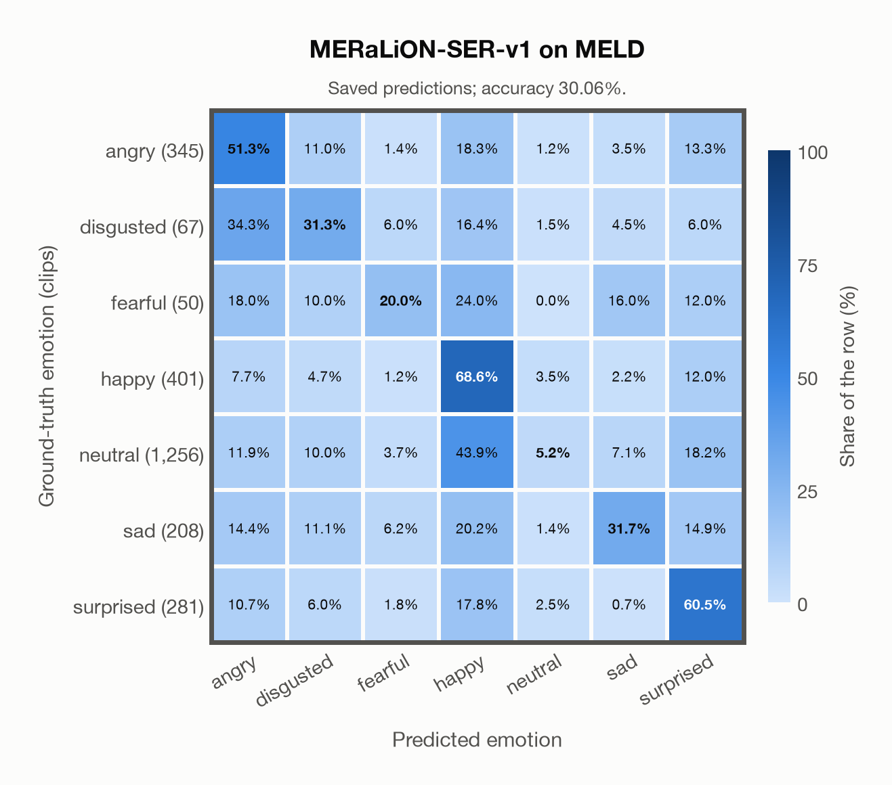

# MERaLiON-SER-v1 on MELD

Regenerated offline from saved CSV/JSON by `scripts/evaluation/refresh_reports.py`. This refresh performs no model inference or API requests.

## Summary

| Metric | Recomputed value |
|---|---:|
| Clips | 2,608 |
| Accuracy: acted emotion | 30.06% |
| UAR: mean ground-truth-row recall | 38.38% |
| Macro F1 | 28.00% |
| Weighted F1: true-support weighted | 24.31% |
| Accuracy: all model classes | 30.06% |

## Imported run and verification

- Source: [prediction CSV](../../outputs/meralion_ser_v1/meld_predictions.csv) and [metadata JSON](../../outputs/meralion_ser_v1/meld_predictions.json); both remain byte-for-byte unchanged.
- Original execution date recorded in JSON: `2026-11-06`.
- Dataset scope recorded in JSON: **MELD**, English; 2,608 / 2,608 clips.
- Ground-truth column: `acted_emotion`. Candidate classes: angry, disgusted, fearful, happy, neutral, sad, surprised.
- Row counts, unique audio paths, correctness flags and saved metrics were checked against the CSV. Metric agreement tolerance is 0.000001 (six-decimal metadata).
- Weighted F1 weights each class's F1 by its true support, using the same resolved truth as macro F1; invalid answers remain errors. New metrics absent from the source JSON are recorded in the offline audit and summaries; the source JSON is preserved.
- Original execution/client runtime metadata (reported by the imported run, not measured by this refresh): `{"device": "mps", "hardware": "Apple M4 Max", "seconds": 697.5, "ms_per_clip": 267.4, "on_cpu": 0}`.

## Results per emotion

| Ground-truth emotion | Clips | Recall | Acted-or-listener recall |
|---|---:|---:|---:|
| angry | 345 | 51.30% | — |
| disgusted | 67 | 31.34% | — |
| fearful | 50 | 20.00% | — |
| happy | 401 | 68.58% | — |
| neutral | 1,256 | 5.18% | — |
| sad | 208 | 31.73% | — |
| surprised | 281 | 60.50% | — |

Precision/F1 use the same resolved-truth convention as the evaluation script. Weighted F1 uses the resolved-truth clip counts below as weights.

| Predicted emotion | Resolved-truth clips | Precision | Recall | F1 |
|---|---:|---:|---:|---:|
| angry | 345 | 39.33% | 51.30% | 44.53% |
| disgusted | 67 | 8.47% | 31.34% | 13.33% |
| fearful | 50 | 11.24% | 20.00% | 14.39% |
| happy | 401 | 27.39% | 68.58% | 39.15% |
| neutral | 1,256 | 69.15% | 5.18% | 9.63% |
| sad | 208 | 34.92% | 31.73% | 33.25% |
| surprised | 281 | 31.84% | 60.50% | 41.72% |

## Confusion matrix: acted emotion

| Ground truth \ Predicted | angry | disgusted | fearful | happy | neutral | sad | surprised |
|---|---|---|---|---|---|---|---|
| angry (345) | **51.3%** | 11.0% | 1.4% | 18.3% | 1.2% | 3.5% | 13.3% |
| disgusted (67) | 34.3% | **31.3%** | 6.0% | 16.4% | 1.5% | 4.5% | 6.0% |
| fearful (50) | 18.0% | 10.0% | **20.0%** | 24.0% | 0.0% | 16.0% | 12.0% |
| happy (401) | 7.7% | 4.7% | 1.2% | **68.6%** | 3.5% | 2.2% | 12.0% |
| neutral (1,256) | 11.9% | 10.0% | 3.7% | 43.9% | **5.2%** | 7.1% | 18.2% |
| sad (208) | 14.4% | 11.1% | 6.2% | 20.2% | 1.4% | **31.7%** | 14.9% |
| surprised (281) | 10.7% | 6.0% | 1.8% | 17.8% | 2.5% | 0.7% | **60.5%** |

## Caveats

- **Training involvement for MERaLiON-SER-v1: Used directly**. Source: SER training on CREMA-D, ESD, MELD, M3ED and Singaporean speech; retained Whisper-medium pretraining sources are incompletely disclosed; upstream seed/base teacher use is counted as seen. Direct use and upstream teacher use both count as training involvement. No pattern: no corpus-specific evidence, not verified unseen. Corpus use is not test-clip leakage.
- Internal CSV/JSON consistency does not authenticate the original model or remote request logs.

[Offline validation audit](meld_offline_audit.json)
