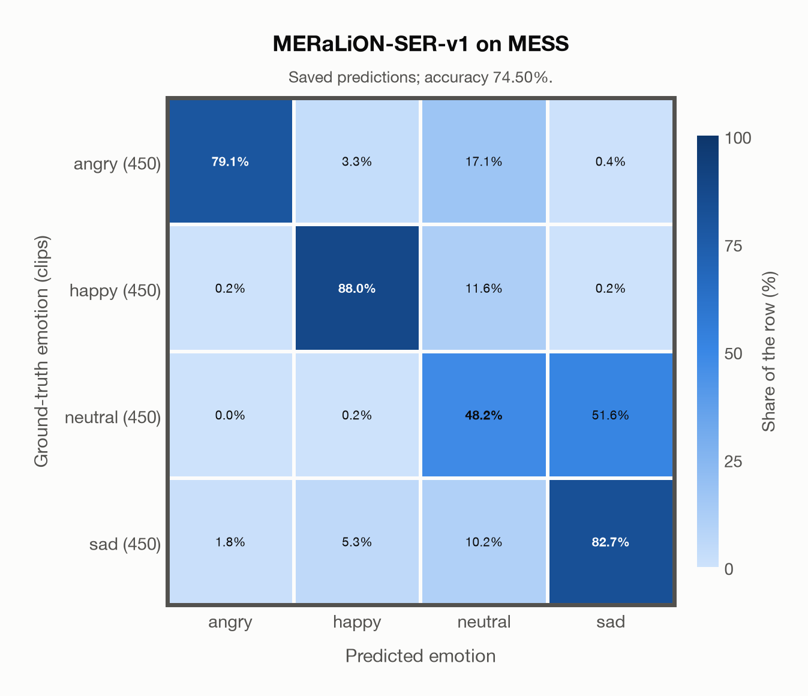

# MERaLiON-SER-v1 on MESS

Regenerated offline from saved CSV/JSON by `scripts/evaluation/refresh_reports.py`. This refresh performs no model inference or API requests.

## Summary

| Metric | Recomputed value |
|---|---:|
| Clips | 1,800 |
| Accuracy: acted emotion | 74.50% |
| UAR: mean ground-truth-row recall | 74.50% |
| Macro F1 | 74.67% |
| Weighted F1: true-support weighted | 74.67% |
| Accuracy: all model classes | 74.50% |

## Imported run and verification

- Source: [prediction CSV](../../outputs/meralion_ser_v1/mess_predictions.csv) and [metadata JSON](../../outputs/meralion_ser_v1/mess_predictions.json); both remain byte-for-byte unchanged.
- Original execution date recorded in JSON: `2026-10-28`.
- Dataset scope recorded in JSON: **MESS**, English; 1,800 / 1,800 clips.
- Ground-truth column: `acted_emotion`. Candidate classes: angry, happy, neutral, sad.
- Row counts, unique audio paths, correctness flags and saved metrics were checked against the CSV. Metric agreement tolerance is 0.000001 (six-decimal metadata).
- Weighted F1 weights each class's F1 by its true support, using the same resolved truth as macro F1; invalid answers remain errors. New metrics absent from the source JSON are recorded in the offline audit and summaries; the source JSON is preserved.
- Original execution/client runtime metadata (reported by the imported run, not measured by this refresh): `{"device": "mps", "hardware": "Apple M4 Max", "seconds": 458.4, "ms_per_clip": 254.7, "on_cpu": 0}`.

## Results per emotion

| Ground-truth emotion | Clips | Recall | Acted-or-listener recall |
|---|---:|---:|---:|
| angry | 450 | 79.11% | — |
| happy | 450 | 88.00% | — |
| neutral | 450 | 48.22% | — |
| sad | 450 | 82.67% | — |

Precision/F1 use the same resolved-truth convention as the evaluation script. Weighted F1 uses the resolved-truth clip counts below as weights.

| Predicted emotion | Resolved-truth clips | Precision | Recall | F1 |
|---|---:|---:|---:|---:|
| angry | 450 | 97.53% | 79.11% | 87.36% |
| happy | 450 | 90.83% | 88.00% | 89.39% |
| neutral | 450 | 55.36% | 48.22% | 51.54% |
| sad | 450 | 61.29% | 82.67% | 70.39% |

## Confusion matrix: acted emotion

| Ground truth \ Predicted | angry | happy | neutral | sad |
|---|---|---|---|---|
| angry (450) | **79.1%** | 3.3% | 17.1% | 0.4% |
| happy (450) | 0.2% | **88.0%** | 11.6% | 0.2% |
| neutral (450) | 0.0% | 0.2% | **48.2%** | 51.6% |
| sad (450) | 1.8% | 5.3% | 10.2% | **82.7%** |

## Caveats

- **Training involvement for MERaLiON-SER-v1: No corpus-specific evidence**. Source: SER training on CREMA-D, ESD, MELD, M3ED and Singaporean speech; retained Whisper-medium pretraining sources are incompletely disclosed; upstream seed/base teacher use is counted as seen. Direct use and upstream teacher use both count as training involvement. No pattern: no corpus-specific evidence, not verified unseen. Corpus use is not test-clip leakage.
- Internal CSV/JSON consistency does not authenticate the original model or remote request logs.

[Offline validation audit](mess_offline_audit.json)
