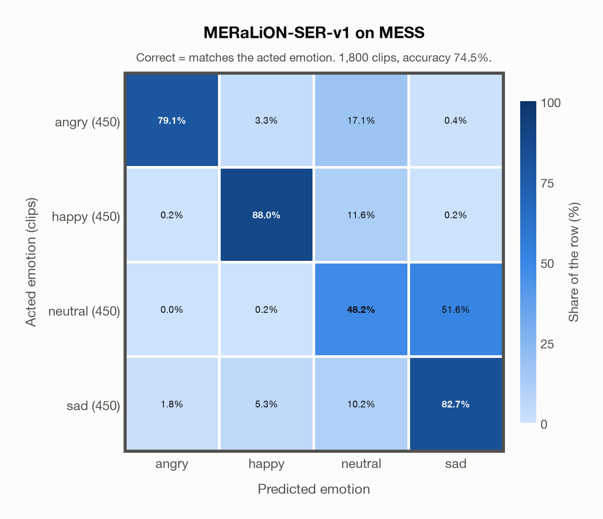

# MERaLiON-SER-v1 on MESS

Generated by `scripts/evaluation/evaluate.py` on 2026-10-28.

## Summary

| Metric | Value |
|---|---|
| Clips evaluated | 1,800 (English) |
| **Accuracy: prediction matches the acted emotion** | **74.5%** |
| Unweighted accuracy (mean recall of the 4 acted emotions) | 74.5% |
| Macro F1 (acted emotion) | 74.7% |
| Accuracy, all 7 model classes (acted emotion) | 74.5% |
| Chance level (4 emotions) | 25.0% |

## Setup

- **Model**: MERaLiON-SER-v1 (`MERaLiON/MERaLiON-SER-v1`) as released (no fine-tuning), transformers 5.18.0, loaded by `scripts/models/meralion_ser.py`. Each clip becomes Whisper log-mel features padded with silence to 30 s (as in the model card); the model ignores attention masks and pools over the whole 30 s window, padding included, which is its official behaviour. float32 on every device, as released.
- **Data**: 1,800 clips of MESS (English) from `data/mess/`.
- **Ground truth (acted emotion)**: the emotion each speaker was asked to portray, from the first letter of the file name (`A`ngry, `C`alm, `H`appy, `S`ad).
- Label mapping: angry = angry, happy = happy, sad = sad, and **calm = neutral** (the project's emotions have no *calm*).
- **4 emotions**: the prediction is the most probable of the 4 emotions in this dataset (angry, happy, neutral, sad); the model's other classes (`fearful`, `disgusted`, `surprised`) are ignored. **All 7 model classes**: the prediction is the most probable of all 7 model classes, so choosing a class that the dataset does not have counts as wrong.
- **Hardware**: Apple M4 Max, device `mps`, PyTorch 2.5.1. Inference took 7.6 min (255 ms per clip).
- **Per-clip predictions**: `outputs/meralion_ser_v1/mess_predictions.csv` (in git, so the results can be checked clip by clip). The JSON file next to it describes the columns.

## Results per emotion

Rows: acted emotion. Precision, recall and F1 compare the prediction with the acted emotion.

| Emotion | Clips | Precision | Recall | F1 |
|---|---|---|---|---|
| angry | 450 | 97.5% | 79.1% | 87.4% |
| happy | 450 | 90.8% | 88.0% | 89.4% |
| neutral | 450 | 55.4% | 48.2% | 51.5% |
| sad | 450 | 61.3% | 82.7% | 70.4% |

## Confusion matrix: acted emotion

The same numbers as a table. Rows: acted emotion. Columns: predicted emotion. Each row adds up to 100%.

| Acted \ Predicted | angry | happy | neutral | sad |
|---|---|---|---|---|
| angry (450) | **79.1%** | 3.3% | 17.1% | 0.4% |
| happy (450) | 0.2% | **88.0%** | 11.6% | 0.2% |
| neutral (450) | 0.0% | 0.2% | **48.2%** | 51.6% |
| sad (450) | 1.8% | 5.3% | 10.2% | **82.7%** |

Most frequent confusions: neutral predicted as sad (51.6%), angry predicted as neutral (17.1%), happy predicted as neutral (11.6%).

## Predictions outside the 4 emotions

With all 7 model classes, the model chose a class that this dataset does not have for 4 clips (0.2%): `fearful` 0, `disgusted` 4, `surprised` 0.

## Caveats

- **Not in MERaLiON-SER-v1's training data** (CREMA-D, ESD, MELD, M3ED and Singaporean speech).
- *Calm* is not quite *neutral*: calm clips predicted as neutral count as correct.
- The public version has 1,800 clips and acted labels only; the listeners' ratings are available from the author on request. Audio is sampled at 24,414 Hz, resampled to 16 kHz.
